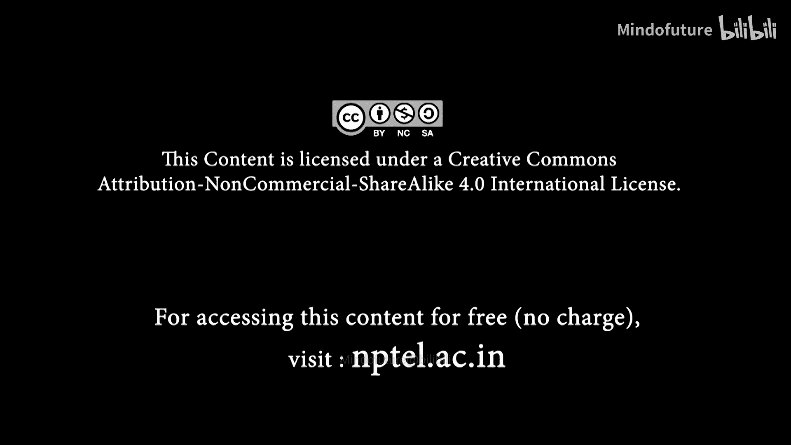
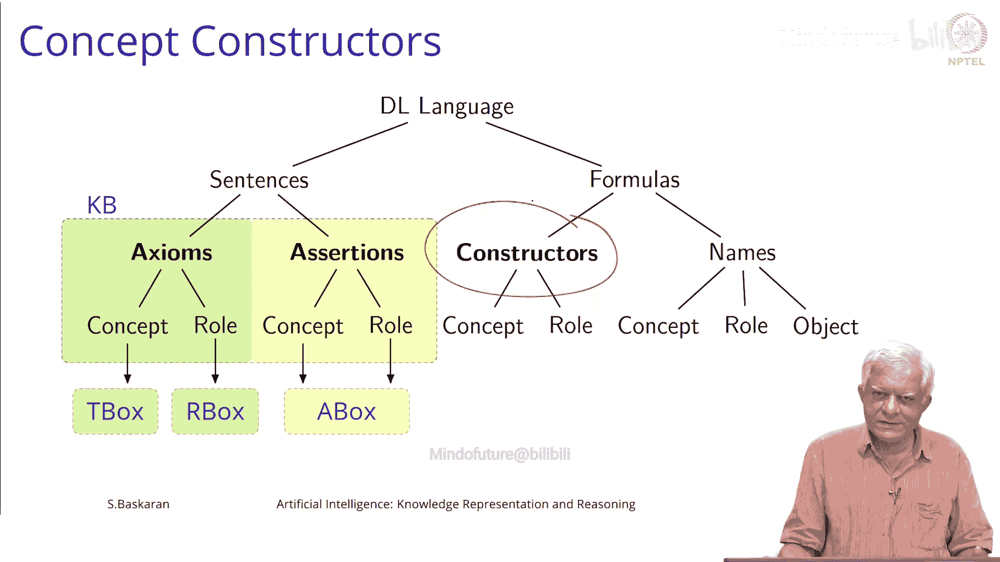

知识表示与推理：P115：描述逻辑 📚

在本节课中，我们将学习描述逻辑。描述逻辑是用于表示和推理本体知识的一种形式化语言，它是语义网和本体工程的核心。我们将了解描述逻辑的基本构成、其与一阶逻辑的关系，以及如何用它来构建知识库。

---

上一节我们介绍了RDF和RDFS，它们是网络上表示数据的基础。本节中，我们来看看描述逻辑，这是一种专门用于讨论本体的逻辑子集。

描述逻辑也被称为名词短语的逻辑。名词短语指的是“山羊”、“狮子”等类别。描述逻辑允许我们定义这些类别，定义类别之间的关系，以及属于特定类别的个体之间的关系。

与一阶逻辑的半可判定性不同，描述逻辑是一个可判定的子集。这意味着对于描述逻辑中的公式，我们可以在有限时间内得到“是”或“否”的查询答案。

描述逻辑是一个语言家族，其表达能力和计算复杂度之间存在权衡。表达能力越强的语言，其推理的计算复杂度通常也越高。

以下是描述逻辑的一些网络资源，其中“本体”一词频繁出现：
*   **实现**：例如网络本体语言。
*   **自动推理机**：可用于执行我们将要讨论的推理。
*   **本体库**：包含许多针对特定领域开发的专门本体，例如存储医学领域出版物的系统及其关联本体。

在描述逻辑中，我们将学习两种语句：
1.  **量化公式**：涉及概念的陈述。
2.  **断言**：关于个体的陈述。

我们还将学习如何构造新概念，并讨论概念名称、规则和对象。下面列出了一些将使用的符号。

就像为一阶逻辑定义词汇表一样，描述逻辑也有自己的词汇表。随着学习的深入，我们会看到这一点。

描述逻辑语言家族中的语言通常用缩写命名，例如 ALC、SROIQ 等。让我们看看这些缩写代表什么。

最基本的语言是 **AL**（属性语言），它只讨论二元属性。当我们加入**补集**概念时，就得到了 **ALC**（属性语言加补集）。概念被解释为论域的子集，例如“医生”、“食肉动物”等。给定一个概念 C，如果能谈论其补集，则该语言名称中包含字母 **C**。

其他扩展包括：
*   **S**：表示角色传递性。
*   **R**：表示复杂的角色包含公理。
*   **H**：表示角色层次结构（例如，“父亲”是“父母”的一种类型）。
*   **O**：表示可以包含个体名称（枚举）。
*   **I**：表示逆角色。
*   **N**：表示数量限制。
*   **Q**：表示合格的数量限制。

因此，像 **SROIQ** 这样的语言名称，可以告诉我们它允许表达哪些内容。

---

让我们具体看看这些元素代表什么。

描述逻辑仅使用一元和二元谓词来建模一个领域。
*   **一元谓词**（概念）用矩形表示，例如：`Person`、`Happy`、`Apple`、`Teen`。
*   **二元谓词**（角色）用箭头表示，例如：`owns`、`hasBrother`。角色将一个个体与另一个资源（也是个体）关联起来。
*   **个体**用圆圈表示。

我们已经知道逻辑中的解释概念，同样的概念适用于描述逻辑，因为描述逻辑毕竟是一阶逻辑的子集。
*   概念 **C** 的解释 **C^I** 是一个对象集合，即论域 **Δ** 的一个子集。
*   角色 **R** 是论域 **Δ × Δ** 的一个子集。
*   个体被映射到特定的个体，例如，名称 `Lucy` 指代个体 **Lucy^I**。

以下是描述逻辑中的一些语句示例及其对应的一阶逻辑表示。描述逻辑的表示更受限，因此所有描述逻辑语句都能用一阶逻辑表示，但反之则不然。

第一个语句使用了概念构造算子 **⊓**（交集）。它表示“青少年”与“至少拥有一件苹果设备的事物”这两个概念的交集，是“快乐”概念的子集。符号 **⊑** 表示“被包含于”，对应一阶逻辑中的蕴含 **⇒**。

在一阶逻辑中，你会说：如果 x 是青少年，并且存在一个 y，使得 x 拥有 y 且 y 是苹果设备，那么 x 是快乐的。

类似地，其他语句表示：“兄弟”角色是“兄弟姐妹”角色的子角色；个体“Lucy”是快乐的；“Lucy”有兄弟“Jack”。

---

现在，让我们谈谈这种语言中的知识库。

知识库由三个部分组成：
1.  **TBox**：概念公理的集合。
2.  **RBox**：角色公理的集合。
3.  **ABox**：关于个体的断言的集合。

我们刚才看到的三个句子分属于知识库的不同部分：关于兄弟和兄弟姐妹角色的句子属于 **RBox**；关于青少年、苹果所有者和快乐的句子属于 **TBox**；关于 Lucy 和 Jack 的句子属于 **ABox**。

*   **概念断言**表达类的成员关系。
*   **角色断言**表达对象到对象的关系。
*   **概念公理**表达子类、等价性和不相交性。
*   **角色公理**表达子属性、等价性，以及自反性、对称性等属性（记住，角色是二元关系）。

知识库的陈述使用以下三组有限的符号来书写：
*   **N_C**：概念名称的集合。
*   **N_R**：角色名称的集合。
*   **N_I**：对象（个体）名称的集合。

---

本节课中我们一起学习了描述逻辑的基础知识。我们了解到描述逻辑是一种可判定的逻辑，用于定义类别（概念）、关系（角色）和个体。知识库由 TBox（概念公理）、RBox（角色公理）和 ABox（个体断言）组成。描述逻辑有多种语言，在表达能力和计算复杂度之间进行权衡。接下来，我们将深入探讨描述逻辑中的概念构造算子。