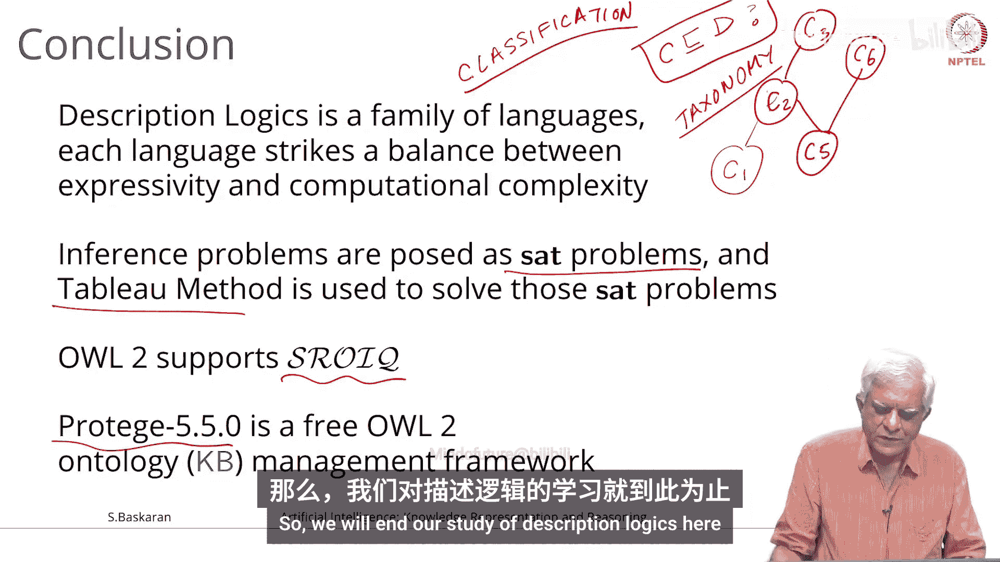

# 116：ALC表示例 🧩

在本节课中，我们将通过一系列具体示例，学习如何使用Tableau方法来判定ALC（属性逻辑与概念）中概念的**可满足性**以及知识库的**蕴涵关系**。我们将看到如何将自然语言描述的问题形式化为逻辑表达式，并应用推理规则来得出结论。

---

## 从Tableau方法到实践应用

上一节我们介绍了Tableau方法的基本规则。本节中，我们来看看这些规则如何在实际例子中应用。

### 示例1：存在角色填充者的概念

首先，我们检查一个简单的概念是否可满足。这个概念是：**存在一个角色R的填充者，该填充者属于概念C**。

用ALC公式表示为：`∃R.C`

**推理过程：**
1.  引入一个新的个体常量 `a` 到ABox中。
2.  将公式 `a: ∃R.C` 添加到 `a` 的标签集合中。
3.  TBox为空，因此我们只能应用存在量词规则（∃-规则）。
4.  应用∃-规则：创建一个新个体 `x`，并添加关系 `(a, x): R` 和公式 `x: C`。
5.  没有更多规则可应用，且未发现矛盾。因此，该概念是**可满足的**。

**结论**：我们可以构造一个模型，其中个体 `a` 通过关系 `R` 关联到另一个属于概念 `C` 的个体 `x`。

---

### 示例2：全称角色限制的概念

接下来，检查另一个概念：**所有角色R的填充者都属于概念D**。

用ALC公式表示为：`∀R.D`

**推理过程：**
1.  引入新个体 `a`，并添加公式 `a: ∀R.D`。
2.  TBox为空。
3.  全称量词规则（∀-规则）要求：对于 `a` 的每一个R-后继，检查其是否属于 `D`。但当前 `a` 没有任何R-后继。
4.  因此，没有规则被触发，我们直接得到了一个模型（一个满足 `∀R.D` 但没有任何R-关系的个体 `a`）。该概念是**可满足的**。

**结论**：全称陈述在“没有相关个体”的情况下可以**空真**地成立。

---

### 示例3：存在与全称的合取

现在考虑一个更复杂的概念：**存在一个属于C的R-填充者，并且所有R-填充者都属于D**。

用ALC公式表示为：`(∃R.C) ⊓ (∀R.D)`

**推理过程：**
1.  引入新个体 `a`，并添加公式 `a: (∃R.C) ⊓ (∀R.D)`。
2.  应用合取规则（⊓-规则），将其拆分为两个公式加入 `a` 的标签集：`a: ∃R.C` 和 `a: ∀R.D`。
3.  首先应用∃-规则：创建新个体 `x`，添加 `(a, x): R` 和 `x: C`。
4.  然后，由于 `a: ∀R.D` 且存在关系 `(a, x): R`，应用∀-规则：将 `x: D` 添加到 `x` 的标签集。
5.  现在 `x` 的标签集中同时包含 `C` 和 `D`，没有矛盾。因此，该合取概念是**可满足的**。

**结论**：一个个体可以同时满足“存在某个特性的填充者”和“所有填充者满足另一特性”，只要那个特定的填充者同时满足这两个特性。

---

### 示例4：推理实例——Lucy喜欢水果吗？

我们将一个自然语言推理问题形式化：
*   **已知**：Lucy喜欢苹果(`a`)。苹果是水果(`C`)。
*   **查询**：能否推出“存在一个水果是Lucy喜欢的”？即 `Lucy: ∃likes.Fruit`。

**形式化与推理过程：**
1.  **知识库 (KB)**:
    *   `(lucy, apple): likes`
    *   `apple: Fruit`
2.  **查询 (Q)**: `lucy: ∃likes.Fruit`
3.  为了检验KB是否蕴涵Q，我们采用反证法：将查询的否定加入KB，检查是否导致矛盾。
    *   查询的否定：`lucy: ¬(∃likes.Fruit)`，等价于 `lucy: ∀likes.(¬Fruit)`。
4.  **构建Tableau**:
    *   ABox包含：`(lucy, apple): likes`, `apple: Fruit`, `lucy: ∀likes.(¬Fruit)`。
    *   对 `lucy` 应用∀-规则：因为存在 `(lucy, apple): likes`，所以必须将 `apple: ¬Fruit` 添加到 `apple` 的标签集。
5.  **发现矛盾**：`apple` 的标签集现在同时包含 `Fruit` 和 `¬Fruit`。这是一个**闭包（矛盾）**。
6.  由于否定查询导致矛盾，原查询成立。

**结论**：从“Lucy喜欢苹果”和“苹果是水果”，我们可以有效推出“存在一个水果是Lucy喜欢的”。

---

### 示例5：推理实例——Lucy只喜欢水果吗？

基于同样的已知事实，我们问另一个问题：
*   **查询**：能否推出“Lucy只喜欢水果”？即 `lucy: ∀likes.Fruit`。

**推理过程：**
1.  **查询 (Q)**: `lucy: ∀likes.Fruit`
2.  **否定查询**：`lucy: ¬(∀likes.Fruit)`，等价于 `lucy: ∃likes.(¬Fruit)`。
3.  **构建Tableau**:
    *   ABox包含：`(lucy, apple): likes`, `apple: Fruit`, `lucy: ∃likes.(¬Fruit)`。
    *   应用∃-规则于 `lucy: ∃likes.(¬Fruit)`：创建一个新个体 `x`，添加 `(lucy, x): likes` 和 `x: ¬Fruit`。
4.  **分析结果**：此时，我们没有发现任何矛盾。我们有一个模型：Lucy喜欢苹果（属于水果），也喜欢另一个不是水果的个体 `x`。这**不违反**已知事实。
5.  因此，否定查询是**可满足的**，意味着原查询**不被蕴涵**。

**结论**：我们知道Lucy喜欢一个水果（苹果），但不足以证明她“只”喜欢水果。她可能还喜欢别的东西。

---

### 示例6：包含子类关系的推理

考虑包含TBox公理的推理：
*   **TBox**: `C ⊑ D` （所有C都是D）
*   **ABox**: `a: ⊤` （存在某个个体a）
*   **查询**：能否推出 `a: ∃R.C ⊓ ∃R.D`？即a有一个属于C的R-填充者，同时a也有一个属于D的R-填充者。

**推理过程（反证法）**:
1.  否定查询：`a: ¬(∃R.C ⊓ ∃R.D)`，推导后得 `a: ∀R.(¬C) ⊔ ∀R.(¬D)`... 更精确的否定和展开会得到 `a: ∃R.C ⊓ ∀R.¬D` 形式的冲突假设（具体取决于推演步骤）。核心是利用 `C ⊑ D`。
2.  将否定查询和 `C ⊑ D`（即 `¬C ⊔ D`）加入。
3.  通过系统应用⊔-规则（析取分支）、∃-规则和∀-规则，最终会在所有分支上导致 `C` 与 `¬C`，或 `D` 与 `¬D` 的冲突。
4.  所有分支均闭合，产生矛盾。

**结论**：在给定 `C ⊑ D` 的前提下，该蕴涵关系成立。这展示了如何利用子类关系进行推理。

---

### 示例7：一个完整的场景——房东与纳税人

让我们分析一个更贴近现实的例子：
*   **知识库**:
    1.  `Landlord ⊑ ∃owns.House` （房东拥有房子）
    2.  `∃owns.Taxable ⊑ Taxpayer` （拥有应税物品的人需纳税）
    3.  `House ⊑ Taxable` （房子是应税物品）
    4.  `jack: Landlord` （Jack是房东）
*   **查询**：`jack: Taxpayer` （Jack是纳税人吗？）

**推理过程（反证法）**:
1.  假设Jack不是纳税人：将 `jack: ¬Taxpayer` 加入ABox。
2.  根据公理1和 `jack: Landlord`，应用⊑-规则，推出 `jack: ∃owns.House`。应用∃-规则，创建一座Jack拥有的房子 `h1`，且 `h1: House`。
3.  根据公理3 `House ⊑ Taxable`，推出 `h1: Taxable`。
4.  现在，Jack拥有一个应税物品(`h1`)。根据公理2 `∃owns.Taxable ⊑ Taxpayer`，这应推出 `jack: Taxpayer`。
5.  但ABox中已有 `jack: ¬Taxpayer`，产生矛盾。
6.  因此，原假设错误，查询 `jack: Taxpayer` 成立。

**结论**：通过Tableau方法，我们可以系统地验证，从给定的规则和事实中，能够必然推出“Jack是纳税人”。

---

## 总结与展望

本节课中，我们一起学习了如何运用Tableau方法解决ALC中的关键推理问题。我们通过多个示例，演练了如何：
1.  判定概念的**可满足性**。
2.  检验知识库是否**蕴涵**某个查询，方法是采用反证法，将查询的否定加入知识库并检查是否导致矛盾。
3.  处理包含**全称量词**、**存在量词**、**合取**以及**子类包含公理**的复杂场景。

描述逻辑在表达能力和计算复杂度之间进行权衡。Tableau算法为ALC等描述逻辑提供了可靠的决策过程。基于此，我们可以构建概念之间的**分类体系**——这是一个称为**分类**的过程，即根据子类关系将概念组织成层次化的分类法。这构成了许多本体应用的基础。

---

