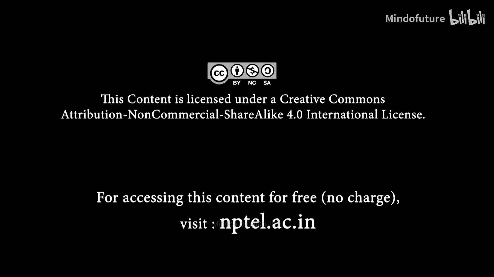
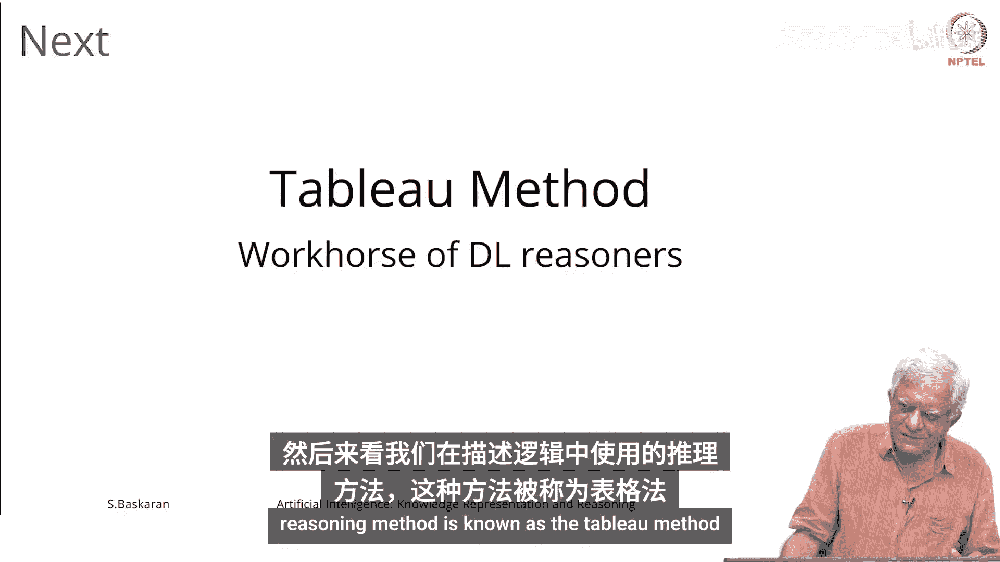

# 117：描述逻辑示例

在本节课中，我们将通过具体的例子来学习描述逻辑（Description Logic）如何表示知识。我们将看到如何使用描述逻辑来定义概念、描述属性以及表达概念之间的关系。

描述逻辑是一种用于表示概念（名词短语）及其关系的逻辑。它允许我们从一些基本（原始）概念出发，通过逻辑运算符组合出新的、更复杂的概念定义。

## 概念的定义与组合

上一节我们介绍了描述逻辑的基本思想，本节中我们来看看如何使用逻辑运算符来定义新概念。

描述逻辑的核心是定义概念。我们可以使用逻辑运算符，如交集（`⊓`）、并集（`⊔`）和补集（`¬`），从原始概念组合出新概念。

以下是几个基本概念组合的例子：

*   **勤奋的学生**：这个概念可以定义为“勤奋的”个体与“学生”个体的**交集**。
    *   **公式**：`EagerStudent ≡ Eager ⊓ Student`
*   **公交车或小汽车**：这个概念可以定义为“公交车”个体与“小汽车”个体的**并集**。
    *   **公式**：`BusOrCar ≡ Bus ⊔ Car`
*   **非电动的**：这个概念可以定义为对“电动的”这个概念的**补集**。
    *   **公式**：`NonElectric ≡ ¬Electric`

这种定义方式具有明确的语义。我们假设原始概念（如 `Student`, `Car`）在一个共享的命名空间中有公认的含义。这与一阶逻辑不同，在一阶逻辑中，谓词（如 `student(X)`）的名称本身没有固定含义，完全依赖于用户的解释。描述逻辑通过共享词汇表，确保了知识表示的一致性。

## 使用量词描述关系

仅仅定义静态概念还不够，我们经常需要描述概念之间的关系。描述逻辑通过使用存在量词（`∃`）和全称量词（`∀`）来做到这一点。

以下是使用量词描述复杂概念的示例：

*   **拥有电动汽车的人**：首先，这个人必须是“人”。其次，他必须**存在**至少一辆他“拥有”的“电动汽车”。
    *   **公式**：`Person ⊓ ∃owns.ElectricCar`
*   **只拥有电动汽车的人**：这个人必须是“人”，并且他**所有**“拥有”的东西都必须是“电动汽车”。
    *   **公式**：`Person ⊓ ∀owns.ElectricCar`
*   **拥有带电池物品的人**：这个人必须**存在**一个他“拥有”的东西，并且那个东西“有部件”是“电池”。
    *   **公式**：`Person ⊓ ∃owns.(∃hasPart.Battery)`

## 概念等价与分类

我们之前用子集关系（`⊑`）定义概念，但这是一种单向约束。使用等价关系（`≡`）可以给出更严格、双向的定义。

考虑“汽车”的定义：
*   使用子集关系：`Car ⊑ (≥4 hasWheel) ⊓ (≤4 hasWheel)`。这表示“所有汽车都有恰好4个轮子”，但反过来不成立（有4个轮子的不一定是汽车）。
*   使用等价关系：`Car ≡ (≥4 hasWheel) ⊓ (≤4 hasWheel)`。这表示“汽车”与“恰好有4个轮子的东西”是**完全等价**的。这严格定义了什么是汽车，并允许系统进行自动分类：给定一个对象的描述，系统可以判断它是否属于“汽车”这个概念。

## 角色（关系）的约束

描述逻辑中的关系称为“角色”（Role）。我们可以对角色施加约束，例如定义其定义域和值域。

以“参加”（`attends`）这个角色为例，它连接“学生”和“讲座”。
*   **定义域约束**：只有学生才能参加活动。可以表述为：任何作为 `attends` 角色主体的个体，必须是学生。
    *   **公式**：`∃attends.⊤ ⊑ Student` （`⊤` 代表全集）
*   **值域约束**：被参加的东西一定是讲座。可以表述为：任何作为 `attends` 角色客体的个体，必须是讲座。
    *   **公式**：`⊤ ⊑ ∀attends.Lecture`
*   **逆角色**：`attends` 的逆角色是 `attendedBy`，表示“被...参加”。我们可以定义：`attendedBy ≡ attends⁻`

## 角色的属性

角色本身也可以具有属性，如对称性、传递性等，用于描述家庭关系、社交关系等。

以下是描述角色属性的例子：
*   **逆关系**：“有孩子”（`hasChild`）的逆角色是“有父母”（`hasParent`）。
    *   **公式**：`hasParent ≡ hasChild⁻`
*   **角色复合**：“孙子/女”（`hasGrandchild`）可以定义为“有孩子”和“有孩子”这两个角色的复合。
    *   **公式**：`hasGrandchild ≡ hasChild ◦ hasChild`
*   **全称约束嵌套**：“所有孙子都是医生的那些人”。这可以有两种等价表述：
    1.  所有有孩子的人，他们的所有孩子也都有孩子，并且那些（孙子）孩子都是医生。
        *   **公式**：`∀hasChild.(∀hasChild.Doctor)`
    2.  所有有孙子的人，他们的所有孙子都是医生。
        *   **公式**：`∀hasGrandchild.Doctor`
*   **角色特性**：我们可以声明“兄弟”关系（`hasSibling`）是对称的（如果A是B的兄弟，则B也是A的兄弟）、传递的，并且是非自反的（一个人不能是自己的兄弟）。

## 开放世界与封闭世界假设

最后，我们需要理解描述逻辑（以及大多数逻辑系统）遵循的**开放世界假设**（Open World Assumption, OWA）。

考虑一个例子：知识库中说“Lucy喜欢苹果和橘子”，没有其他关于她喜好的信息。
*   **问题**：我们能得出结论“Lucy只喜欢水果”吗？
*   **封闭世界假设**（如数据库、Prolog）：我们假设已知的信息是**完整的**。既然知识库只说她喜欢苹果和橘子，我们就推断她只喜欢这些。查询“喜欢**只**喜欢水果的人”会返回Lucy。
*   **开放世界假设**（描述逻辑、一阶逻辑）：我们假设知识库的信息是**不完整的**。没有提及的信息可能是未知的，也可能是真的。因此，我们不能断定Lucy不喜欢手机或其他东西。所以，“Lucy只喜欢水果”这个陈述在逻辑上是**假**的。

开放世界假设更符合现实世界的认知，但有时我们也需要类似封闭世界的“默认推理”，即基于现有信息做出最合理的假设，但新信息出现时允许修正结论。

本节课中我们一起学习了描述逻辑的具体应用。我们看到了如何定义和组合概念，如何使用量词描述关系，如何通过等价关系精确定义概念以支持分类，以及如何对角色施加约束和声明其属性。最后，我们理解了描述逻辑所基于的开放世界假设及其与数据库封闭世界假设的根本区别。在下一节中，我们将探讨描述逻辑中用于自动推理的**Tableau算法**。