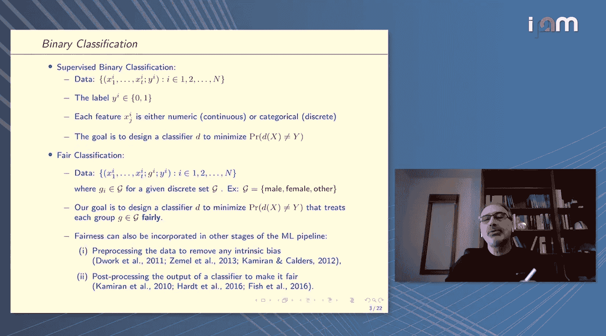

# IPAM【中英⚡深度学习与组合优化｜2021 Deep Learning and Combinatorial Optimization】 p01 P1 公平且可解释的二元分类决策规则 [BV1nYcuz1EQC_p1]

I will talk about fair and intable decision making in this talk。

 I know this is a workshop on you know deep learning。

This is not related to as much related to deep learning。

 but we are learning things and we are doing classification。

So what is fair and interpretable classification？😊，So as we all know。

 mission learning has made its way into many， many applications。

 including ones that have societal impacts such as landing， hiring。

 college admissions or parole decisions。Now in these applications。

 unlike recommendations or advertising。The result of the ML algorithm affects human beings and such they are also not totally automated and there's a human in the loop because these are critical decisions and once they' a human in the loop。

 obviously domain experts， these humans would like to understand criticize the model machine learning model so that they can trust it。

And clearly， you know these decisions。😊，Need to be controlled both moral reasons and legal reasons because they are affecting human beings。

So by that， you know there's an increasing need for designing algorithms that are interpretable so that they can be understood by humans。

 moreover， since the decisions are affecting people at the end。

 these need to be fair to those who are affected by the decisions so this is you know the general to justify interpretability and also fairness。

😊，Now， to be clear， neither interpretivity nor fairness come for free because at the end of the day we want to design an accurate classifier and once you start putting more constraints on the decision making。

 obviously you might lose some accuracy and you want to control that and measure that as well。😊。

With that， let's move on to our context， we will be looking at binary classification。

 supervised binary classification。😊，where we have labeled data with a bunch of features and the goal of the classifier is to decide on the label of unseen data with high accuracycues。

 you want to minimize the probability of making errors on unseen data so this is the basic supervised binary classification sitting when you're moving to fair classification。

 we assume that data has one more feature。😊。

