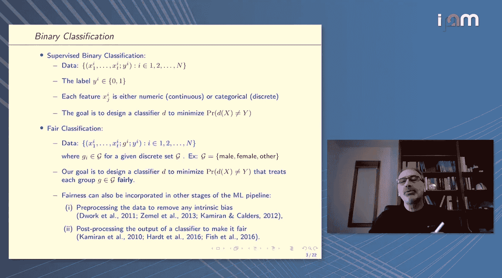

# IPAM：1：公平且可解释的二元分类决策规则

在本节课中，我们将探讨公平且可解释的决策制定。虽然本次研讨会主题是深度学习，而本话题与深度学习关联不深，但我们同样涉及学习过程和分类任务。我们将首先理解什么是公平且可解释的分类。

## 背景与动机

机器学习已广泛应用于许多领域，包括那些具有社会影响力的应用，例如贷款审批、招聘、大学录取或假释决策。在这些应用中，与推荐或广告不同，机器学习算法的结果直接影响人类。同时，这些决策并非完全自动化，通常有“人在回路”中参与，因为它们是关键决策。当有“人在回路”时，领域专家（即决策者）自然希望理解并评判机器学习模型，以便能够信任它。

显然，这些决策需要受到控制，这既是出于道德原因，也是出于法律原因，因为它们影响着人类。因此，设计能被人类理解的、可解释的算法的需求日益增长。此外，由于决策最终影响的是人，这些决策也需要对受影响者保持公平。这就是我们追求可解释性和公平性的普遍理由。

需要明确的是，可解释性和公平性并非没有代价。归根结底，我们的目标是设计一个准确的分类器。一旦开始对决策过程施加更多约束，就可能损失一些准确性。我们也需要控制并衡量这种损失。

## 问题设定：二元分类

接下来，让我们进入具体情境。我们将关注**二元分类**问题，具体来说是**有监督的二元分类**。我们拥有带标签的数据集，其中包含一系列特征。分类器的目标是以高准确率决定未见数据的标签，即最小化在未见数据上犯错的概率。这是基本的有监督二元分类设定。

当我们转向公平分类时，我们假设数据还有一个额外的特征。

## 总结

本节课中，我们一起学习了公平且可解释的二元分类决策规则的背景与动机。我们了解到，在影响人类的关键决策应用中，模型的**可解释性**对于建立信任至关重要，而**公平性**则是道德和法律的基本要求。同时，追求这些属性可能会以牺牲一定的模型准确性为代价。最后，我们明确了本课程讨论的具体技术场景是**有监督的二元分类**，并指出在公平分类问题中，数据通常包含一个表示敏感属性的额外特征。