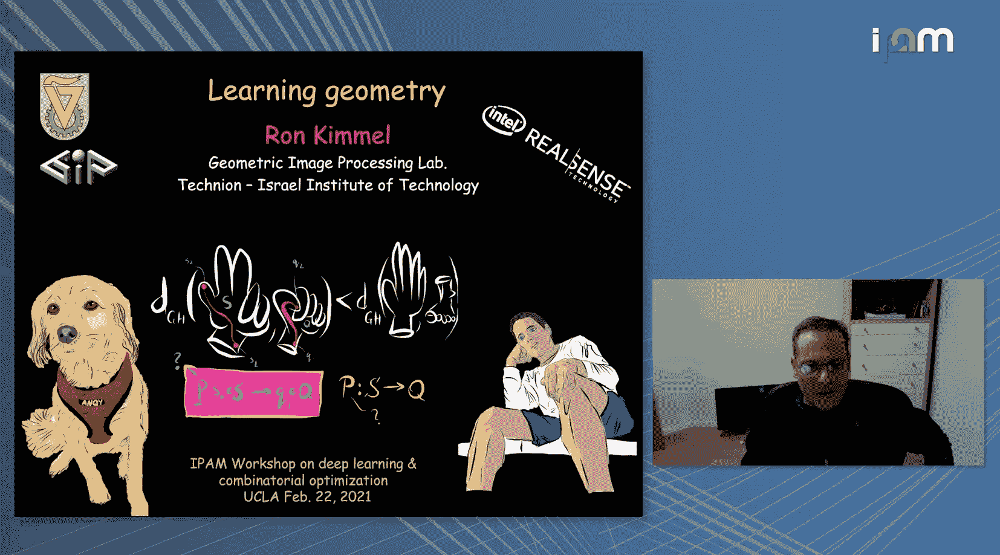

# IPAM【中英⚡深度学习与组合优化｜2021 Deep Learning and Combinatorial Optimization】 p02 P2 学习几何 [BV1nYcuz1EQC_p2]

So I assume that the name of the conference， deep learning and and combinatorial optimization。

 it's either I mean it's ending the looseance so I will talk about deep learning less so about combinatorial optimization so a little bit about deep learning it's a disruptive line of research that change the way that we do computation that we address computational problems today it involves optimizing for many parameters tuning them training them and at the end of the day you have some architecture that knows how to classify to segment and to reason about what you're looking at the methodology works great as long as they are explicit assumptions about the dimension of the data I mean assuming that you have low dimension of parameters of the data itself or that declines on some low dimensionality space。

Or at the other end， if it has some spatial or temporal shift environment properties that you can utilize in order to optimize your machine。

 what I will talk about today is a set of problems that we have been engaged with for many years and these are geometric problems and the question that we address is how to take these inherently non shift invari like properties and use neural networks in order to address them to solve them somehow。

So again， going into the Cururing Awards two years ago， the Noble of Computing。

 we have the Laoon now NU professor and Facebook A director that introduced the Connet and Hinton that introduced the AlexNe all convolutional and Benji that is known with Goodfe for his guns。

 now the modern convolution and neural network needs this special Envari property in order to solve problems。

And these three giants got the hearing Award for being persistent for almost 30 years since the 90s and pushing this methodology and I still remember giving the talk it was 2003 in I when Y Lehn was giving his presenting his content and showing how he can read。

 I mean interpret numbers or letters and my take home message from this workshop was to work on the Gro household the distance of comparing between surfaces because this is what captured my eye。

 but still I remember that I was really impressed by the fact that you can actually throw many annotated examples to sort of a computational machine and at the end of the day get really nice results。

What we will do is try to follow the philosophy。