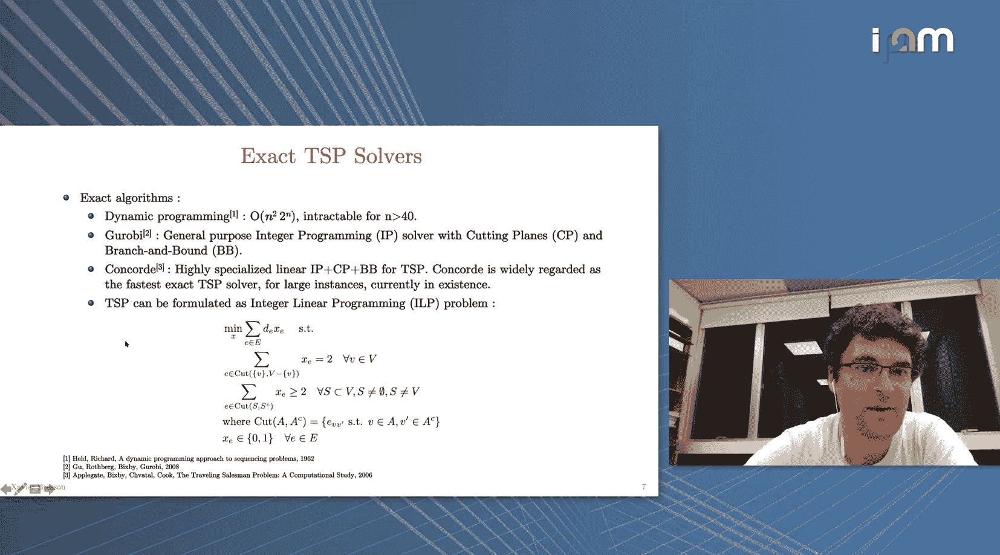

# IPAM【中英⚡深度学习与组合优化｜2021 Deep Learning and Combinatorial Optimization】 p03 P3 用于旅行商问题的Transformer网络 [BV1nYcuz1EQC_p3]

So I'm going to talk about the To formula network for the traveling assessmentman problem。

And this is a joint talk with Thomas Ran from AU。Okay。So this is the outline of my talk。😊。

So because I have 25 minutes so I'm going to be brief on some part of my talk。

 so like I will saw with a story of TSP， but I will be brief for traditional solves and then I will introduce the recent neural network solves for TSP。

Then our architecture。I will go briefly for the deco technique and I will present the numerical results and I will discuss and make conclusion。

😊，So TSP。You probably know very well the TSP but just in case so you have a set of cities and the goal is to find the shortest possible path starting from one city going through all the city exactly once and then come back to the original city so this point was first formulated by William Hamilton。

Some time ago。And TSP belongs actually to the class to the larger class of putting problems which are used every day in industry。

 you know for warehouse management， transportation， supply chain。

 hardware design manufacturing and so on， so TSP is a hard problem exhaustive search as a complexity of n factor oil。

But this is the most popular and the most studied communatorator problem starting with Won Neman in 51。

So you have two。Two traditional classes of algorithms to tackle commator problems。

So you have exact algorithms like exhaust search， dynamic programming or in programming。

 these algorithms are guaranteed to find the optimal solution。

 but they become inable quickly when end grows。And then you have approximate algorithms where you trade basically optimality with respect to two computational time and for this kind of algorithms you are going to design some heuristic so it's a simple rule that you usually apply theoretically until you get to the solution。

Complexity for the these algorithms are usually polynomial。

And the equity is estimated with respect to the best solution。So again。

 I'm going to be quick because of the time。So we have。

