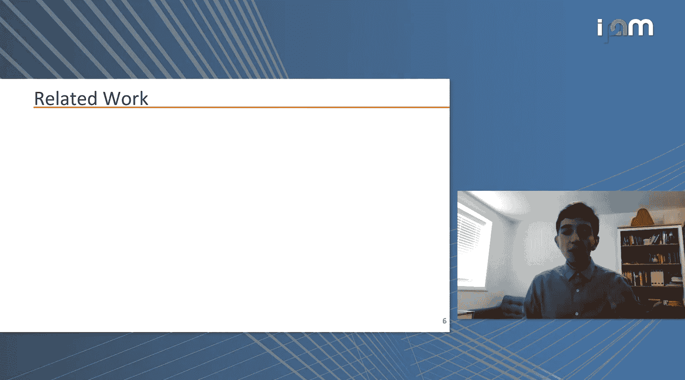

# IPAM【中英⚡深度学习与组合优化｜2021 Deep Learning and Combinatorial Optimization】 p06 P6 利用ReLU稳定性扩展精确神经网络压缩 [BV1nYcuz1EQC_p6]

All right well thank you very much for the invitation so in the three spirit of this workshop I'm going to give a talk now about deep learning and component optimization and basically how we can use component optimization to make neural networks smaller because sometimes we need to train neural networks that are sufficiently large to get some level of accuracy and then to make them fit in a computer we might need a different computer like in a smaller device we might need to we might have a peing problem which is basically the same thing that would happen if we were coming to this conference in person and hedge back a bag。

Especially on the way back for example， the last time I was atipM did find a very good sale in the bookstore which was not good for my bag now this is joint work with Abinav Kumar from Michigan State University and Sri Kumarmarmaligan from Google Research。

So in this talk we're going to consider fit forward neural networks as basically mapping a function from an input space X to an output space y。

 and I'm going to further assume that all the neurons are going to be rectified within units where the output is given by the maximum between zero and an a transmission of the inputs given by the weights and the bias when we train the neural network and thinking in terms of the。

Ay with biological neurons， we can see that a relo is inactive when the maximum is obtained with the first term and that the relu is active。

 when the maximum is obtained with the second term and therefore we have a positive output from the neuron。

Now the question that we're interested here is whether we can find a neural network with fewer neurons and perhaps fewer layers that can establish the same mapping from X to Y。

And to make this question is likely easier to solve， especially。

Given the fact that whenever used optimization havingbounded inputs helps。

 what if we consider equivalence only if with respect show inputs that are relevant for a given application。

 so we're not talking about any x mapping to Y， we're talking about x belonging childet capital X of inputs that might happen in practice。

And to context contextualize that with one example， a classic one。

 Let's think about the MUS data set。 The MUS dataset set is a collection of。

Images of handwritten digits there are 28 by 28 images and along every dimension we're going to get a value between0 and1 so basically we don't care what happens if one of the inputs is negative or greater than one because that's never going to happen in practice so that's one case where restricting the inputs is not a problem among many other cases。

Now， there is a lot of work on compressing neural network。

