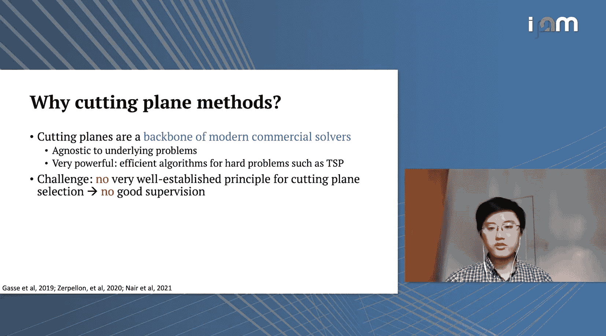

# IPAM【中英⚡深度学习与组合优化｜2021 Deep Learning and Combinatorial Optimization】 p07 P7 整数规划的强化学习：学习切割 [BV1nYcuz1EQC_p7]

Yeah thank you very much with it for the introduction and thank you very much to the organizer forVi as well。

 I'm very excited to talk to you today about reinforcement learning for integer programming learning to cut。

😊，So first， I'dd like to thank my collaborators， Shira and Yuri， both at Columbia University。

So in this workshop we've been talking about machine learning for combinatorial optimization。

 so there are many ways of using machine learning techniques to try to help accelerate or solving combin optimization problems one method is to directly predict the solutions condition on the representation of of of the problems so in this case we have to think about the parameterization of the solutions as well as the architecture that can be tailored to specific problems that we try to predict or we can take a more more neutral approach that gets a closer to an algorithmic approach that is we can design a neural architecture to mimic algorithmic computations so in this case we're able to combine the flexibility of the representation learned by machine learning methods as well as the inductive biases that come from an algorithm like algorithmic thinking。

But there's also a third approach which is to directly combine machine learning with hard coded algorithms in this case what we try to do is to use machine learning techniques to automate certain decision making of algorithms and in this case we can replace some of the human design heuristics as' part of these popular algorithms prior work has already studied a lot on algorithms such as a branch and bound and also a lot of work on primal heuristics and in this work we're going to focus on cutting plane methods。

And as you can see all of these three approaches are part of a bigger spectrum of this entire array of approach that apply machine learning to comminatorial optimization problems on the top we have more like a pure machine learning based predictions that allows us to benefit from the flexibility of machine learning representations but on the bottom we can combine machine learning with pure classic algorithms so that can benefit from decades of research from hardcoded algorithms to solve comm optimization problems as well。

So why are we interested in cutting plane methods cutting plan methods are a backbone of many of these very powerful modern commercial solvers first thing that's very good about them is that they're agnostic to the underlying problems that we have and it's also very powerful approach。

 for example we can have very efficient algorithms for solving heart problems such as TSP using cutting planes。

One major challenge of considering cutting plan methods is that there's no very well。

