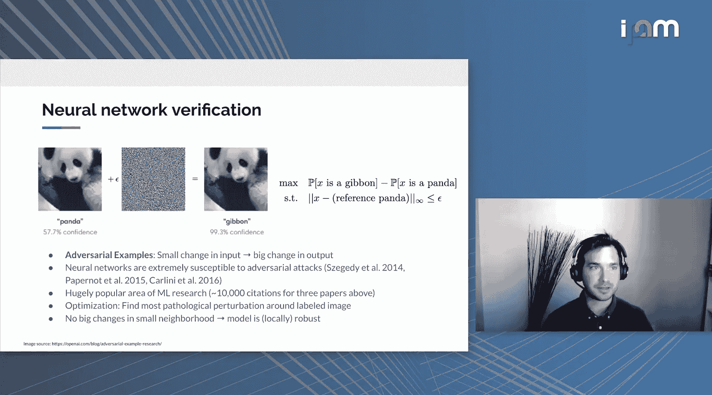

# IPAM【中英⚡深度学习与组合优化｜2021 Deep Learning and Combinatorial Optimization】 p08 P8 神经网络验证作为分段线性优化 [BV1nYcuz1EQC_p8]

Yeah， so my talk today is going to be essentially looking at a problem in deep learning and trying to take a perspective that maybe comes from operations research to develop new methods to solve it。

 so this is the kind of a series of papers that we've been working on over the past couple of years with my co-authors Ross Bochn。

 Will Kunll， Christian and Wan Pablo。Okay so just to make sure everybody's on the same footing to start out with I'm just going to describe what a piecewise linear function is right it's actually it's a quite simple object。

 the idea is that you have some function， you have a partition of the domain of that function into pieces and then your functions is going to be linear on each of those pieces but the linear part can vary as you move across these different domain pieces so these are in some sense a very simple family of functions they're kind of locally linear but they're nonetheless capable of articulating really complex nonlinear or noncon convex kind of behaviors。

And piecewise linear functions arise in a lot of context in OR， and in fact， I spend a lot of my。

Time during my PhD thinking hard about kind of how best to model and solve optimization problems containing piecewise linear functions so so in orR you might encounter a piecewise linear function to model something economic right so maybe you have some diminishing returns or economies of scale that arise。

If you're working in process engineering or chemical engineering。

 you're working with a physical system， maybe you're mixing some chemicals together and they interact in a nonlinear way right so it's natural to try to capture these nonlinear behaviors through a piecewise linear approximation。

And so often in OR we get kind of lucky or we take some modeling assumptions such that we work with lowdial or separable piecewise linear functions。

 which is quite nice from kind of an analytic perspective。

 so there's kind of a long sequence of work spanning decades developing really good algorithms for solving these types of optimization problems。

 particularly looking at this kind of low dimensional setting。

 so I picked out two pictures here from my PhD thesis I spent a lot of time thinking about Uniivari piecewise linear functions like we have here on the left。

😊，And then byvari piece wise learning functions like we have over here on the right。

 right so these are low dimensional and you can really throw tools like a polyhedral theory at them to understand how best to model them in an optimization context。

Okay， so that's some background on Pe linear functions we'll return in a second and now I'm going to tell you about the application in deep learning that were kind of targeting and this is neural network verification so the idea is that it's been observed over the past couple of years that you might train in neural network that has really good accuracy in sample and of out of sample but is none。

