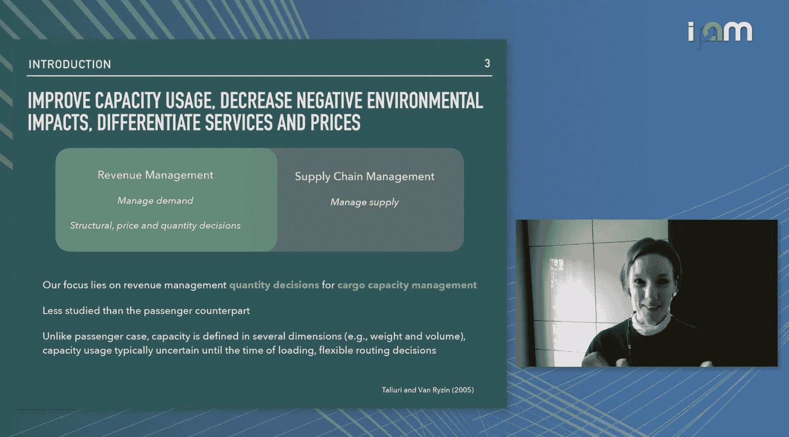

# IPAM【中英⚡深度学习与组合优化｜2021 Deep Learning and Combinatorial Optimization】 p09 P9 机器学习能否帮助解决货运容量管理预订控制问题？ [BV1nYcuz1EQC_p9]

Thank you very much， thank you for the opportunity to talk today。

 so I'm going to talk about some exploratory and ongoing work on cargo capacity management which I hopefully will convince you that it's an important class of problems this is joint work with Andrea Lodi and our student Justin Du Marchelle。

😊，嗯。So let's see so why is this important so I think everyone is probably where a parcel delivery is booming in particular these days due to online retail the market is is in 2019 was were like $430 billion dollars estimated to and over 100 billion packages small packages were。

Shipped in 2020 and actually it's forecasted to that that volume will double by 2026。

 so there is a boom in parcel delivery， but at the same time there is a negative effect around this in particular greenhouse gas emissions so the transportation sector accounts for about 30% in the US and I think that number holds for many countries also the transportation is actually has inefficiencies。

 so a significant share of the vehicle mice traveled by trucks for instance are done empty and I don't think I need to convince you about the cost associated there's a huge cost associated with congestion。

So this kind of motivates there is a need to improve the capacity usage。

 decrease negative and environmental impact of transportation and partly this can be done through differentiation of services and prices so we kind of have two fields are interested on the one hand supply chain management interested in we're focused on managing the supply and the optimization of the supply and on the other hand。

 we have revenue management that is focused on managing demand so through structural price and quantity decisions and this talk is going into focused on revenue management side and particular quantity decisions but related to cargo capacity management so I think we're all kind of used to seeing revenue management on the passenger side when we're booking airline tickets or in the days when we were actually booking airline tickets and so we're kind of used to seeing this differentiation of prices and services on the passenger side but it's actually not very well developed on the。

On the cargo side。It's less studied in the literature and less used in practice and one of the issues is that it's kind of complicated to do cargo capacity management in particular because the capacity is not as clear as in the passenger side and passenger side one passenger occupies one seats。

