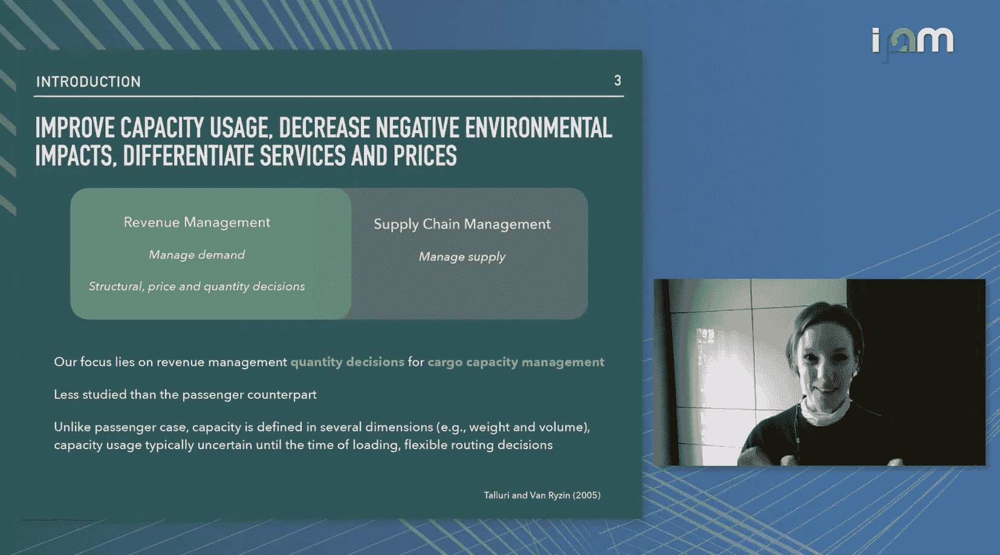

# 深度学习与组合优化：P9：机器学习能否帮助解决货运容量管理预订控制问题？

在本节课中，我们将探讨机器学习在货运容量管理，特别是预订控制问题中的应用潜力。我们将了解该问题的重要性、复杂性，以及为何传统方法面临挑战。

---

## 为什么货运容量管理很重要？🚚

上一节我们介绍了课程主题，本节中我们来看看货运容量管理为何是一个重要问题。

近年来，由于在线零售的兴起，包裹递送行业蓬勃发展。2019年，该市场规模约为4300亿美元。2020年，运送的小型包裹数量超过1000亿件。预计到2026年，这个数量将翻倍。

然而，包裹递送的繁荣也带来了负面影响，特别是温室气体排放。在美国，交通运输部门约占排放量的30%，这个比例在许多国家也类似。交通运输本身存在效率低下的问题。例如，卡车完成的车辆行驶里程中有相当一部分是空载行驶。此外，交通拥堵也带来了巨大的成本。

这促使我们需要提高运力使用率，减少运输对环境的负面影响。部分解决方案可以通过服务的差异化和定价来实现。我们主要关注两个领域：一方面是专注于管理供应和优化供应链的供应链管理；另一方面是专注于通过结构性价格和数量决策来管理需求的收益管理。本次讨论将聚焦于收益管理方面，特别是与货运容量管理相关的数量决策。

我们可能都习惯了在客运方面看到收益管理，例如预订机票时。我们习惯了在客运方面看到这种价格和服务的差异化。但在货运方面，它发展得并不充分。相关文献研究较少，实际应用也不多。其中一个问题是货运容量管理本身比较复杂，特别是因为其“容量”不像客运那样清晰。在客运中，一名乘客占用一个座位。

---

## 货运容量管理的核心挑战 📦

上一节我们了解了问题的重要性，本节中我们来看看其核心挑战。

货运的“容量”定义更为模糊。它可能涉及重量、体积、形状，以及货物在运输工具中的具体摆放方式。这种多维度和物理约束使得精确预测和管理可用容量变得非常困难。

传统的优化模型和启发式方法在处理这种高维、不确定且受复杂物理约束的问题时，往往显得力不从心。这为机器学习方法提供了潜在的应用空间。

---

## 机器学习能提供什么帮助？🤖

在了解了传统方法的局限后，本节我们探讨机器学习可能带来的帮助。

机器学习，特别是深度学习，擅长从高维、非结构化的数据中学习复杂模式。在货运容量管理中，它可以应用于以下几个方面：

以下是机器学习可能发挥作用的几个方向：

1.  **需求预测**：利用历史订单数据、市场趋势、季节性因素等，更准确地预测不同航线、不同货物类型的未来需求。模型可以表示为：
    `需求 = f(历史数据, 市场特征, 时间特征)`

2.  **容量消耗预测**：学习特定货物属性（如尺寸、重量、形状）如何实际消耗运输工具的空间（体积利用率、重量分布）。这比简单的“占一个座位”规则复杂得多。

3.  **动态定价与预订控制**：基于实时的需求预测和剩余容量预测，构建智能系统来决定是否接受一个预订请求，以及以何种价格接受。这可以看作一个序列决策问题。

4.  **货物装载优化**：虽然更偏向运营层面，但机器学习可以辅助或加速三维装箱等复杂组合优化问题的求解，提供高质量的初始解或启发式规则。

---

## 总结与展望 🔮

本节课中，我们一起学习了货运容量管理预订控制问题。

我们首先认识到，由于电子商务增长和环境影响，提高货运效率至关重要。接着，我们分析了该问题的核心挑战在于货运“容量”的多维性和模糊性，这使得传统的收益管理方法直接应用起来很困难。最后，我们探讨了机器学习如何通过改进需求预测、容量消耗建模和智能决策，为这一复杂的组合优化问题提供新的解决思路。

尽管这项研究是探索性和持续性的，但它展示了将数据驱动方法与运筹学优化相结合，以应对现实世界物流挑战的巨大潜力。未来的工作将集中于开发具体的模型框架，并在真实数据上进行验证。

---