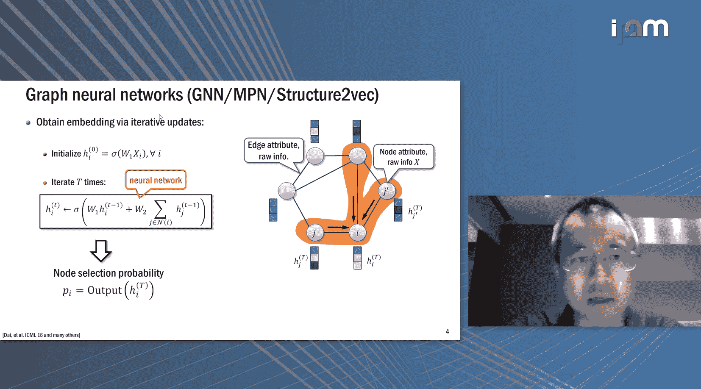

# IPAM【中英⚡深度学习与组合优化｜2021 Deep Learning and Combinatorial Optimization】 p10 P10 图算法可微分发现的框架 [BV1nYcuz1EQC_p10]

So today I'm going to talk about how to make this graph neuralna based method for solving comminatory optimization but more powerful。

 more expressive， and this is work done in Georgia Tech and with the collaborator from Google Brain and also Chinese University of Hong Kong。

So when we talk about this comminatory optimization problem over graphs and we can find many different applications。

 it doesn't matter what kind of area you're working on a social network or you know internet or commut biology problem or smart city problem you can find graph data and very often you want to solve some graph based the comminator optimization problem such as minimum what cover problem minimum do set。

 maximum dominantance set and then things like this okay so I will in this talk take a minimum what cover as the running example。

 but we have tried the same method in other kind of commin optimization as well okay like max car and other comminatory optimization。

So let me just use these comm optimization problem over graph as the running example。

 So in this particular problem， we want to select a subset of nodes from the graph。

 and if the node is selected， we're going to have a label one and what we try to do is to try to cover all the edges So that means that at least one end of the edge is being selected okay so when you write it as a comm optimization problem is' going to be something like this So every pair of every edge and then for the two end of the edge。

 the the selection kind of indicator has to some to be larger than one okay and then you try to minimize the total number of selected nodes right and the problem is very simple but it has been used in you know information diffusion and many different kind of areas and it's very simple problem。

 but it's NP problem。And there are many heuristic or approximation algorithms being designed for this particular type of problem and recently there has been interest using something called graphra neural net to parametertize and graph algorithm and learn this algorithm trying to solve this commin optimization problem so the kind of reasoning behind it is such combin optimization problem are not just being solved ones but being solved repeatedly there's opportunity to learn some algorithms which can adapt to that particular distribution problem potentially solve better that combin optimization problem so what is graph neural nets graph neural nets。

