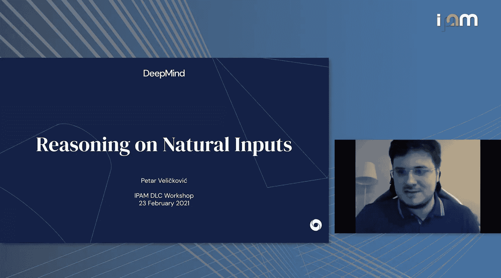
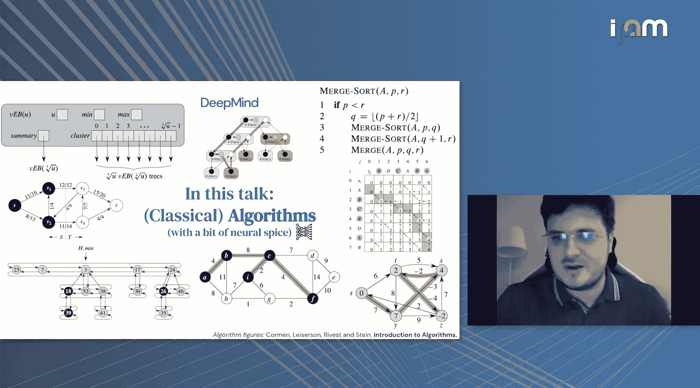
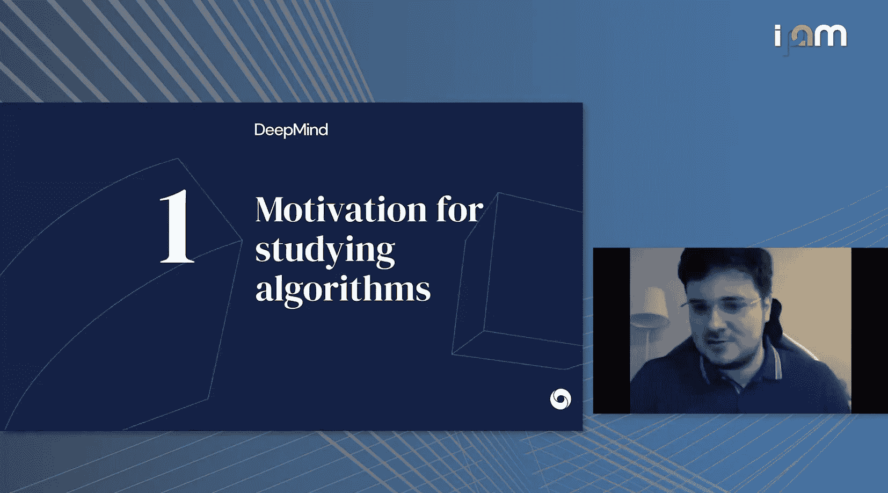
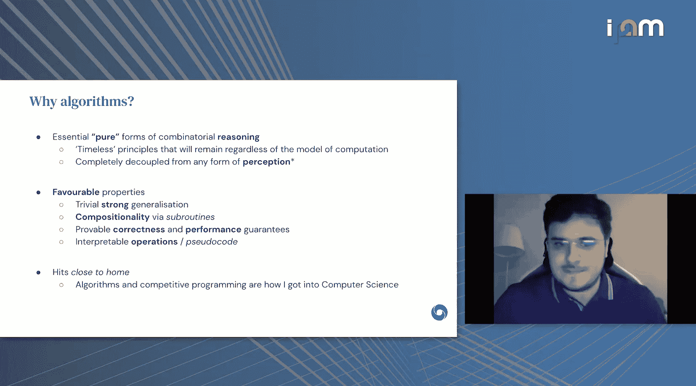
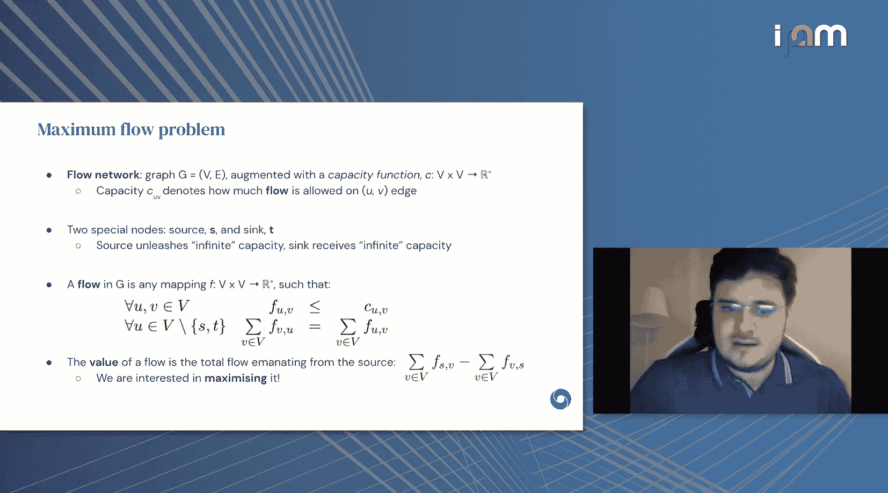

# IPAM【中英⚡深度学习与组合优化｜2021 Deep Learning and Combinatorial Optimization】 p11 P11 自然输入的推理 [BV1nYcuz1EQC_p11]

All right， so thanks again Walter for the very fine introduction I do very fondly remember our first introduction and today I'll be talking to you about broadly speaking how we can use neural techniques or combunatorial optimization and apply them to reasoning on natural inputs so what I'll be talking about today in this talk is largely the classical algorithms that you might encounter in a typical computer science curriculum so things like sorting pathfinding dynamic programming and so on and then I will see how just with a little bit of neural space in the right place you will be able to vastly expand the kinds of possibilities that you can have these classical algorithms so without further ado I'm sure a lot of you already have this motivation in mind but I felt like it's good to be exactly on the same page on what is it that makes algorithms such a great great thing to study。

So the reason why I like to study algorithms is because I think of them as essential pure forms of combinatorial reasoning。

 you can think of them as basically these timeless principles and they will probably remain relevant regardless of what computation model you're using is it a CPU is it a GPU is it a quantum computer you can probably expect algorithmic reasoning to be a very key component in any of these platforms and reasoning about algorithms allows you to for the most part。

 completely decouple for any form of perception and just focus on what is the thing that you want to combinatorly optimize and beyond that they just have many very favorable properties like they trivially strongly generalize they can be split up into various suborines which makes them compositional and you can usually prove that theyre correct and that they will have a certain time or memory complexity and usually they're written in this pseudo code form which allows you to interpret their operations very nicely and at least for me and I believe for several people in the audience here it hits very close。

St home because algorithms and competitive programming are generally how I got into computer science in the first place way before I discovered machine learning。

So hopefully this gives a bit of a good starting point for why algorithms are a good idea。

 and I would like to really dig in and give you a concrete example of what I mean by all these nice properties。

Specifically I've been looking at the maximum flow problem， which should be familiar to many of you。

 just a quick we can specify an input to a flow problem using these flow networks which are graphs that are augmented with a capacity function and a capacity for every pair of nodes will tell you how much flow am I allowed to unleash along that edge。

 two vertices in the graph are special， they're the source S and the sync T。

 source can unleash infinite flow and sync receives infinite flow。

