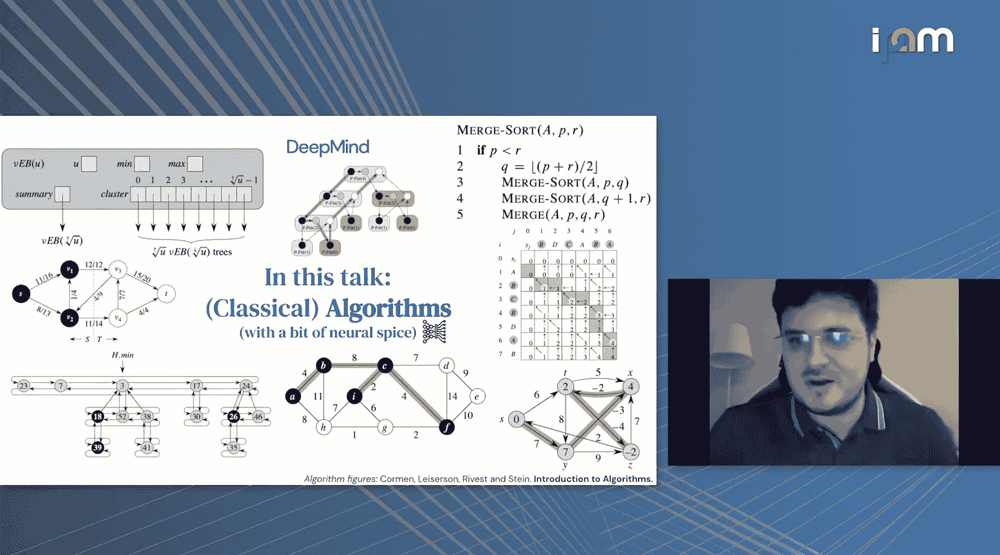
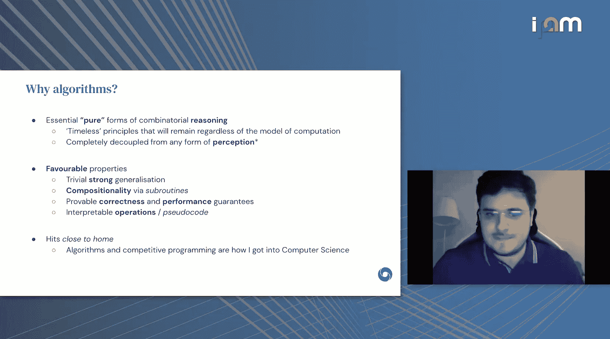
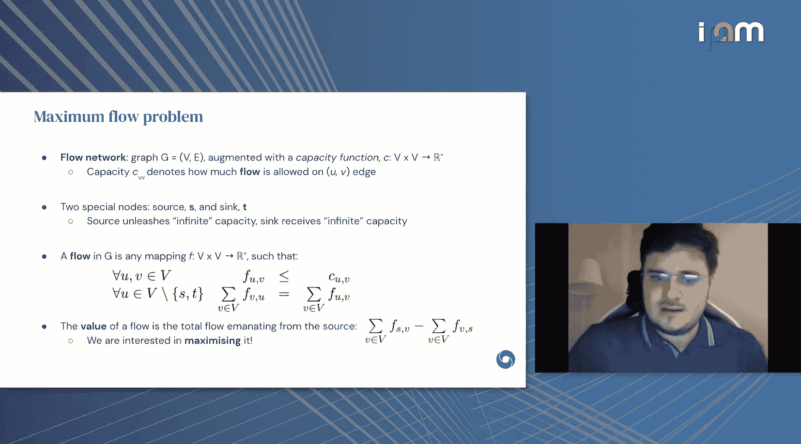

# 深度学习与组合优化：P11：自然输入的推理

在本节课中，我们将探讨如何将神经技术应用于组合优化问题，并使其能够处理自然输入。我们将从经典的计算机科学算法入手，看看如何通过巧妙地引入神经网络，极大地扩展这些传统算法的能力范围。

## 为什么研究算法？🤔

上一节我们介绍了本课程的主题。本节中，我们来看看为什么算法本身是一个极佳的研究对象。

我认为算法是组合推理的基本纯粹形式。你可以将它们视为永恒的原则。无论使用何种计算模型——CPU、GPU还是量子计算机——算法推理都可能是其中的关键组成部分。研究算法允许你在很大程度上，完全与任何形式的感知解耦，只专注于你想要进行组合优化的目标。

此外，算法还具有许多非常有利的特性：
*   **强大的泛化能力**：它们能轻易地实现强泛化。
*   **可组合性**：可以被分解为各种子程序。
*   **可证明性**：通常可以证明其正确性，并确定其时间或空间复杂度。
*   **清晰的表达**：通常以伪代码形式编写，便于理解其操作。

对于我和许多听众而言，算法和竞技编程是我们最初进入计算机科学领域的途径，远早于我们发现机器学习。

## 一个具体案例：最大流问题 🌊

以上我们介绍了算法的优良特性。接下来，我们通过一个具体例子来深入理解这些特性。

我一直在研究**最大流问题**，这对许多人来说应该很熟悉。我们可以用**流网络**来指定一个流问题的输入。流网络是一种图，它通过一个容量函数进行增强。每对节点之间的容量会告诉你允许沿该边释放多少流量。

图中有两个特殊的顶点：**源点 S** 和**汇点 T**。源点可以释放无限的流量，而汇点接收无限的流量。

## 本节课总结 📝

本节课中，我们一起学习了将神经网络与经典组合优化算法（如最大流问题）结合的基本动机和起点。我们认识到，算法作为组合推理的核心，具有泛化性强、可组合、可证明等优点。通过在其适当的位置引入神经组件，我们有望显著扩展这些传统算法的可能性，使其能够处理更复杂的自然输入。