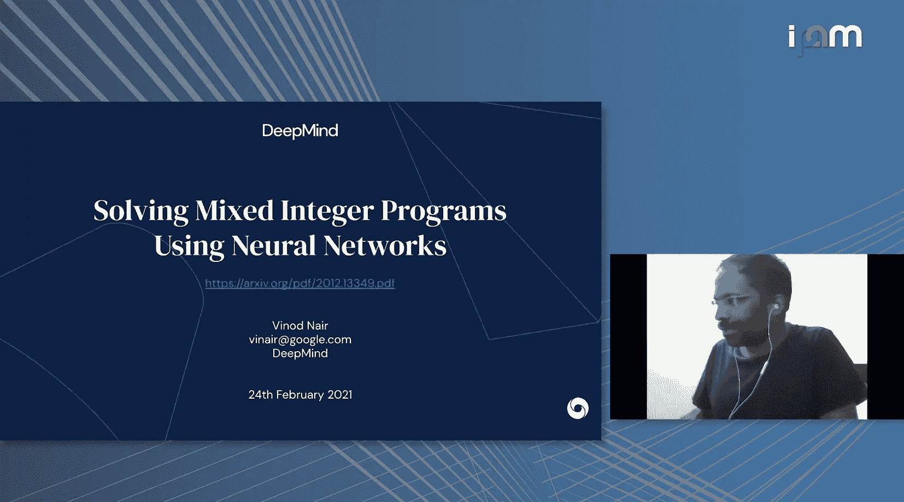
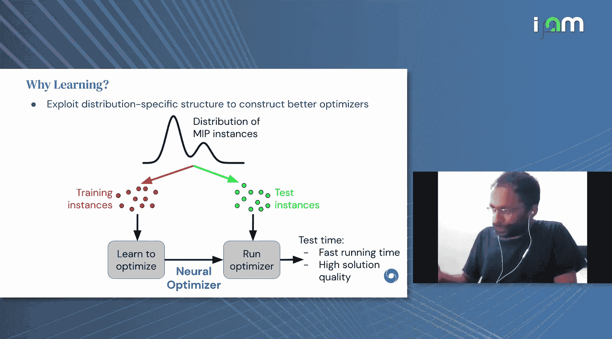

# IPAM【中英⚡深度学习与组合优化｜2021 Deep Learning and Combinatorial Optimization】 p12 P12 使用神经网络求解混合整数规划 [BV1nYcuz1EQC_p12]

Thanks， Kyle， good morning everyone。Yeah， I'm excited to present some recent results that we've been getting at deep on using deep learning for mixed of programming。

Before I start so we have an archive paper which has a lot more details than what I'm presenting today。

 so I'll just be presenting a very high level short summary of the work。

 but please do look at the paper for more details。

And this work was done with several collaborators who are listed here。

 both that Deep Mind as well as Google research。All right。

 so let me jump in and quickly give a short background on mixed individual programming or MIPS。

So integer programming is the problem of optimizing a linear objective function over a set of integer variables。

With a set of linear constraints and so as you can see here。

 the linear objective function is c transpose x and the constraints have to form ax less than or equal to B where A' is and matrix and b is a vector。

And what makes the problem hard is， of course the integrality constraints。

 if we were to ignore them and consider the continuous relaxation。

 we get what's called a linear program， which is solvable in polynomial time。

 but with the integrality constraints， we get an incomplete problem。

And the mixed in mixed integer programming refers to the fact that you can have both integers and continuous variables in X。

And， you know， as。Most of you would know this has a lot of real world applications， in some sense。

 mixed strategic programming is a very powerful language for expressing optimization problems that makes a very good tradeoff between expressiveness and tractability of search。

So the linearity of the objectives and the constraints make the search very tractable。

 and it turns out that many real world problems can be expressed in terms of linear objectives and linear constraints。

So you know just the breadth of applications in acts as a huge motivation to see whether we can improve solvers for this problem using deep learning。

And of course， there are many commercial and non commercial solvers already available for this problem。

And the question is， can learning add anything beyond what these solvers already currently achieve。

 which is already extremely impressive？Okay， so why learning or like how can learning possibly help in this domain？

The idea here is that。

