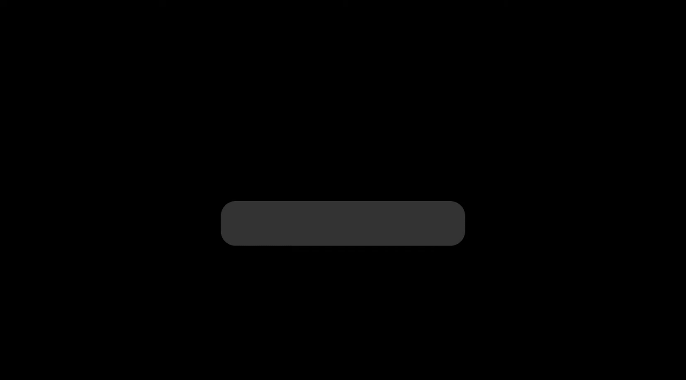
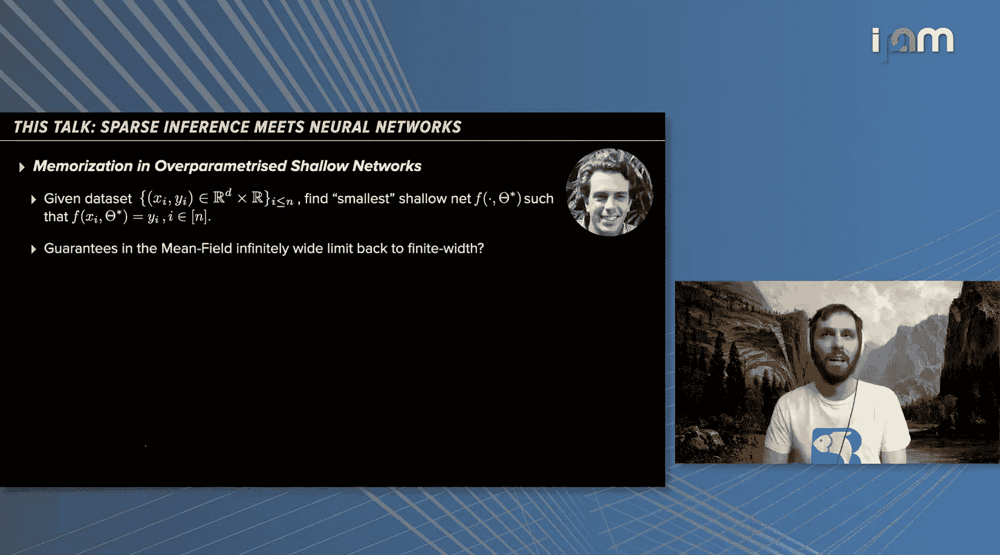

# IPAM【中英⚡深度学习与组合优化｜2021 Deep Learning and Combinatorial Optimization】 p13 P13 论稀疏线性规划与（简单）神经网络 [BV1nYcuz1EQC_p13]

Okay， thank you， Kyle and thank you for the organizes this workshop fantastic lineup so far。 So yes。

 I'm going to be presenting some some of the work of together with two collabators， so Maideos。

 who is a student here at UCLA at the mathth Department and Luc of An， who is a PhD student at Grant。

😊，So from what I could gather so far， I mean， I haven't watched saw the talks but I have seen some fantastic talks so far that really have you know gave us interesting flavors of what deep learning can do for communial optimization like I mean just the recent talk was fantastic giving very nice improvements right and they cover an interesting range of different comminatorial optimization regimes like different applications this talk is not really going to be in that in that flavor it's mostly okay how in what sense some aspects。

 elements of comminial optimization reflect back to inner questions of deep learning so how can commun optimization help us maybe understand better some aspects of deep learning。

And of course， when I say communal optimization here， I'm gonna be very， very restrict。

 So I'm just gonna you know focus on a very， very tiny And if you want a you know boring class of communal optimization that is characterized by the sparse inference So just to set the stage the sparse linear recovery problem that I'm going be focusing throughout the talk is really the question of given some underdetered linear system of equations。

 the system of equations， can you recover the Z by exploiting some extra assumptions of the problem right So and typically these assumptions come to some some form of sparsity。

And so this framework has so we know that this framework contains several representative NP problems and has been incredibly influential across the statistics。

 applied math， different areas， right it's really like a good framework to understanding in particular the power of no linearar approximation and this is like one of the examples that I really like a lot from connecting it back to neuroscience from Brunoult Husen and David field。

😊，And and also the reason why it's also a problem I like a lot is that one can connect back to you very interesting。

 powerful geometric properties in particular entry door to efficient algorithms。

 and this is really the power of relaxation when one replaces this like a sparssity based quantity like counting the number of noger to something that is actually a Comvex object like El1 Norm。

 and I guess that here everyone is familiar with a groundbreaking work of giants like Emmamanuel。

 Candez， Justin Romemberg， Terrencetown and David Donho that really， really developed like a huge。

 very beautiful theory on when this relaxation is actually efficient。

