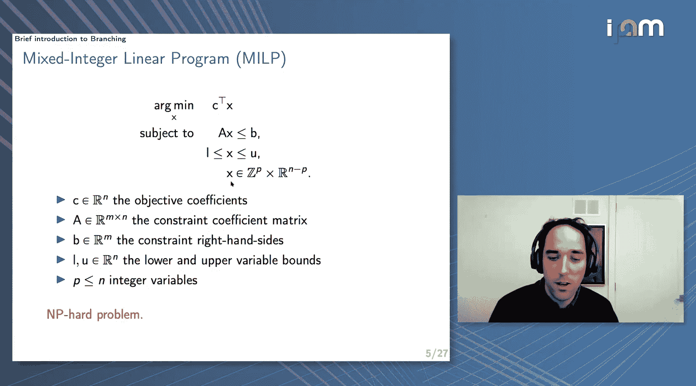

# IPAM【中英⚡深度学习与组合优化｜2021 Deep Learning and Combinatorial Optimization】 p14 P14 使用图卷积神经网络进行精确组合优化 [BV1nYcuz1EQC_p14]

Great， thanks all for the introduction and thanks not for inviting me to this great workshop。

 so this is work that I'm presenting， but it was really led by Maxim Gu and Zia Shitla with help from Nivanni and advice from on reality and myself。

 I should also say this is if you were at Viode's talk earlier the first talk of the day this is really sort of prequel to that talk in terms of when the work appeared and so I think lots of the concept I'll reuse lots of the concept that Leno talked about and hopefully it can get into some more details in some of these。

😊，Okay， so the goal here is to solve comingfer optimization problems。And we know that solvers exist。

 so of commercial grade solvers exist that can provide exact solution to such problems。😊。

The use case we consider here sorry the use case to consider here is that we're in a setting where we want to regularly solve problems from the same family okay so imagine that every day you have to solve a slightly different instance of a TSP problem Of course this is the sort of use case is interesting for machine learning because you can imagine that you may be able to collect historical data train with that data and then use your machine learning heuristic to help to solve or solve new problems fast okay and so really what we're trying to do here is we're trying to use machine learning as a heuristic inside the combat optimization solver so this is the image you can have in your in your head is that you have the solver which takes in as a problem and once in a while it will give its state to the machine learning model and the machine learning model makes a decision and gives it back to the solver at the end of the day you get a solution。

So there's many different。Decisions we can make inside the solver， as I'll talk about later。

 the one we focus on in this work is the problem of branch。So a quick overview of my talk。

 I'll first introduce branch and Bo and branching then i'll talk about machine learning modeling how we can model this as a sequential decision making process our contribution here was to introduce GCNN's graphic conional neural networks for this task and then i'll end with an numerical study。

So introduction to branching so the sort of comm optimization problem we're talking about can be cast as a mixed integer linear program where you're trying to minimize。

A objective function where you have variables x according to a set of constraints。

 you have lower and upper bound constraintstrain on x's。

 and in particular it's an integer program because a subset of the variables。

