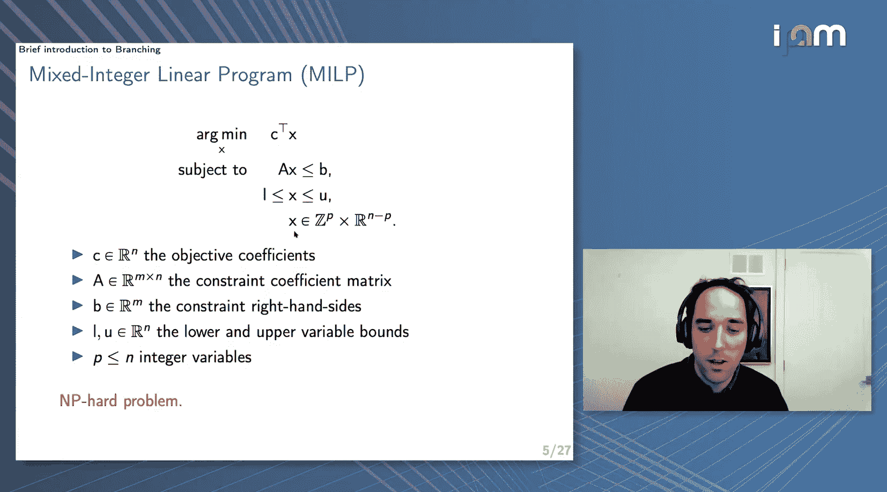

# 深度学习与组合优化：1：使用图卷积神经网络进行精确组合优化

在本节课中，我们将学习如何将图卷积神经网络（GCNN）应用于精确组合优化问题，特别是分支定界算法中的分支决策过程。

## 概述

组合优化问题广泛存在于工业与科研领域。虽然已有成熟的商业求解器能提供精确解，但在需要频繁求解同一类问题变体的场景下，机器学习有望通过学习历史数据，构建启发式方法，从而加速求解新问题的过程。本教程将探讨如何将机器学习模型，特别是图卷积神经网络，集成到组合优化求解器中，辅助其做出更优的分支决策。

## 分支定界算法简介

上一节我们介绍了应用机器学习加速求解组合优化问题的愿景。本节中，我们来看看其核心应用场景之一：分支定界算法。

我们讨论的组合优化问题通常可以表述为混合整数线性规划问题。其目标是最小化一个目标函数 `c^T x`，同时满足约束 `A x ≤ b`，并且变量 `x` 有上下界 `l ≤ x ≤ u`。其中一部分变量被限制为整数值，这构成了整数规划问题。

分支定界是求解此类整数规划问题的核心精确算法。它通过不断分割可行解空间（分支）并估算每个子空间的目标值下界（定界）来寻找最优解。

以下是分支定界算法中一个关键决策点的示例图示：

## 作为序列决策问题的分支

理解了分支定界的基本原理后，我们来看看如何用机器学习的视角看待它。在分支定界过程中，算法需要不断选择哪个变量进行分支。这个选择极大地影响搜索树的规模和求解速度。因此，我们可以将变量选择建模为一个序列决策问题。

在每个决策点，机器学习模型接收当前求解器状态（如线性松弛解、约束矩阵等），并预测下一个最佳的分支变量。模型的目标是学习一个策略，使得整个求解过程的效率最高。

## 图卷积神经网络建模

上一节我们将分支决策建模为序列决策问题。本节中，我们来看看如何用图卷积神经网络（GCNN）来对这个问题进行建模。

我们的核心贡献是将分支决策问题构建为一个图学习任务。我们将整数规划问题自然地表示为一个二分图：变量节点和约束节点。变量与约束之间的连接关系构成了图的边。这种表示方法可以捕捉问题的组合结构。

图卷积神经网络非常适合处理这种结构。它通过消息传递机制聚合邻域信息，能够学习变量和约束的嵌入表示。基于这些学习到的嵌入，我们可以预测每个变量的分支分数。

以下是该二分图表示的可视化示意图：

## 方法实现与实验研究

在介绍了GCNN的建模方式后，我们来看看具体的实现细节和实验效果。

我们设计了一个端到端的训练流程。模型学习的目标是模仿一个被称为“强分支”的昂贵但高效的专家规则。通过大量历史问题实例的训练，GCNN学习预测与专家决策相似的变量分数。

以下是方法的核心步骤概述：
1.  **数据准备**：收集大量同一问题家族的MILP实例及其在求解过程中的状态。
2.  **图构建**：将每个MILP状态转化为变量-约束二分图。
3.  **模型训练**：训练GCNN，使其输出的变量分数与强分支规则的选择相匹配。
4.  **集成推理**：将训练好的GCNN模型集成到求解器中，在分支时提供决策建议。

实验表明，与传统的启发式分支规则（如伪代价分支）相比，我们学习的GCNN策略能显著减少分支定界树的节点数，从而在多个基准测试集上加速了求解过程。

## 总结

本节课中，我们一起学习了如何利用图卷积神经网络来增强组合优化求解器的分支决策能力。我们首先回顾了分支定界算法，然后将其中的变量选择问题构建为序列决策任务。通过将整数规划表示为二分图，并应用GCNN学习变量嵌入，我们成功训练出了一个能够有效预测分支变量的机器学习模型。该方法展示了将问题结构感知的深度学习模型与经典优化算法相结合的巨大潜力，为快速求解重复出现的组合优化问题提供了一条新路径。