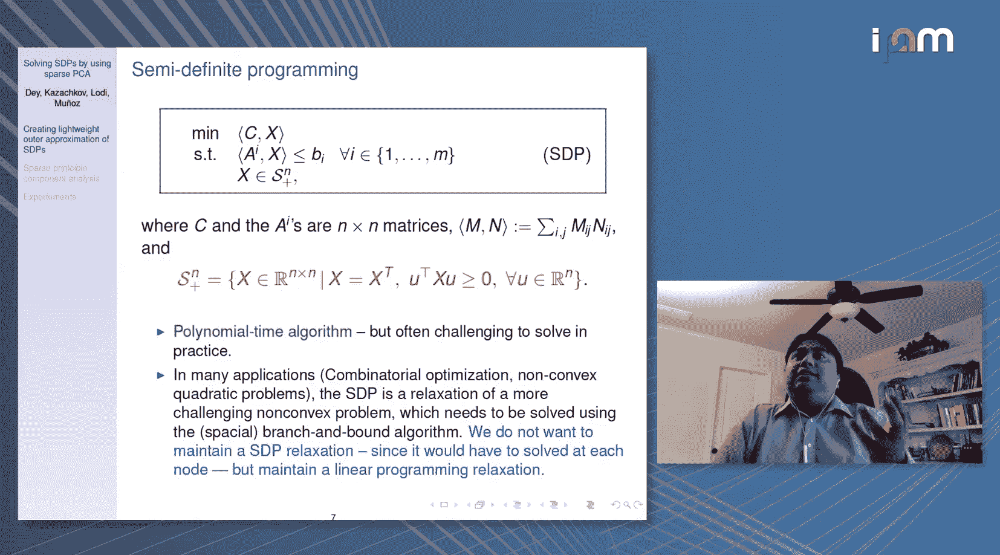

# IPAM【中英⚡深度学习与组合优化｜2021 Deep Learning and Combinatorial Optimization】 p15 P15 利用稀疏主成分分析求解半定规划 [BV1nYcuz1EQC_p15]

All right thanks thanks Kyle for the introduction， thanks for the organizers for inviting me。

 I do have to start with one apology if you looked at the schedule a couple of days back I had a different talk planned unfortunately my mistake I did not request my partners partner institutions for being able to release the data and a talk but anyways this gives me opportunity to present some really exciting work but we just posted the paper I believe like last week together with Alex Kaskov and Re Loiv who we all know very well andzallo Mus and the way the connection is of this talk is that I'm going to be talking about solving STPs which is related to solving communal optimization problems and a sense par PC is something that the Staistic committee really has worked a lot on but also the machine learning community is interested in my apologies in advance in the sense。

😊，There is not going to be much learning involved in this talk but what we will see is that you know techniques can be taken from one area and applied in another area not only necessarily at the mathematical level but also at a more computational level and that's what we'll see in this talk so we are very excited about this work all right so let me start with the motivation we all know what SDPs are but just in terms of rotation you know what we are trying to do is we have these matrix variables x capital X is always going to be variable in this talk all matrices are going to be symmetric when you see them and you have a linear objective linear constraints and this matrix x is supposed to be PSD matrix right so these inner products are because these are all symmetric matrices。

 based in our products that just sort of the usual thing and as we all know PhD matrices are basically symmetric matrices where when you。

😊，putte the quadratic form on them， it's not negative right for all all vectors equal the many characterizations of this cone of matrices。

 for example， all the eigenvalues are not negative。😊，All right。

 so so the story is that you know there is beautiful theory in convicx optimization that say seven different programs can be solved in polynomal time。

 but unfortunately sort of computationally you know there has been a challenge and really if you use any of the general purpose solvers know this end here which is representing the number of rows or number of columns hits around 100 that's when you the sort of even commercial solvers start struggling you know maybe with say special structures。

 you can of course scale problemss that solve much larger problems but that's been a challenge。😊。

In a sense， what I'm interested in is。😊。

