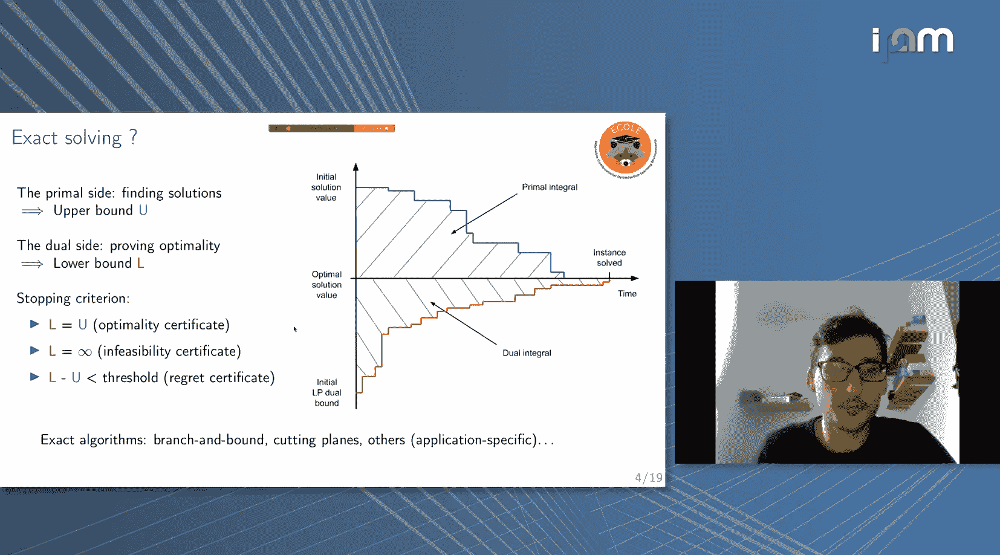

# IPAM【中英⚡深度学习与组合优化｜2021 Deep Learning and Combinatorial Optimization】 p16 P16 Ecole：组合优化求解器中类似Gym的机器学习库 [BV1nYcuz1EQC_p16]

Thank you。So yeah I would like to present this library E。

 which is developed within the datata for realtime decision making Research Cha here in Montreal。

 so it's underellalo's a research Cha。And yeah I'm going to talk about why is this library and how it works。

So I would like to start first with introducing my view of comm optimization servers。嗯。😊。

So when I say that EL is meant for machine learning for communal optimization。

 I specifically mean mixed individual in our programs。So currently。

 a college is accepted to this kind of problems。So I think you all know very well whats a meal。

 there has been plenty of talks today which introduced it already。So basically。

 it's a linear program with the addition of some integrality constraints on some of the variables。

While it appears simple， it's actually a very versatile modeling tool， a lot。

 a lot of real world applications can be formalized as MIPS。And also。

 it's NP hard to solve in general。What do names。So what's exact solving for mis？

So exact sirline consists of two parts first you have to be able to produce upper bounds。

 so I'm considering minimization problems here。So a upper bound is a feasible solution。

If you can provide a solution which satisfies all of the constraints in your problem that it's feasible。

 it has an objective value， you know that you can at least do that well， it's an a problem。

On the other side， some algorithms allow you to get lower bounds on your optimization programs。

 for example， if you start the linear programming relaxation you get a lower bound。

 you know that there is no feasible solution better than that bound。And basically。

 an exact solve provides you those two things， a ne bound on the primal side and a lower bound on the dual side。

And it's going to improve， it's going to refine those bounds over time。

So it can be using bunch and bound， using cutting planes or whatever other algorithm which can provide such bounds。

And basically， you say that you solved an instance when your reach is first criterion。

 when L equals you。

