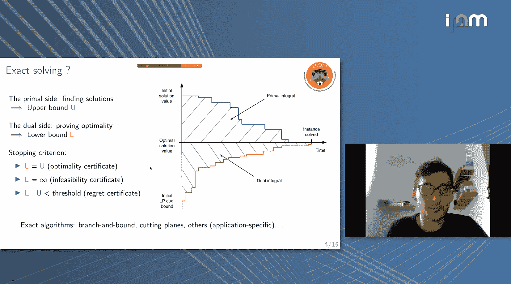

**IPAM课程：P16：Ecole：组合优化求解器中类似Gym的机器学习库**


感谢。我将介绍这个名为Ecole的库。它由蒙特利尔的实时决策研究团队开发。该团队隶属于Mila研究所。我将阐述这个库的用途及其工作原理。

首先，我想介绍我对组合优化求解器的理解。

当我说Ecole用于组合优化的机器学习时，我特指混合整数线性规划问题。目前，求解器主要处理这类问题。我认为大家都很熟悉MIP。今天已有许多讲座介绍过它。本质上，它是一个线性规划，但对部分变量增加了整数约束。

虽然形式简单，但它是一个非常通用的建模工具。许多现实世界的应用都可以形式化为MIP。同时，求解MIP通常是NP难问题。那么，什么是MIP的精确求解？

精确求解包含两个部分。首先，你需要能够产生上界。这里我考虑最小化问题。上界是一个可行解。如果你能提供一个满足问题中所有约束的解，即它是可行的，并且有一个目标值，那么你就知道至少能达到这个水平。这是一个上界。

另一方面，一些算法允许你获得优化问题的下界。例如，如果你求解线性规划松弛问题，你会得到一个下界。你知道没有可行解能比这个界更好。基本上，一个精确求解器会提供这两样东西：原始侧的上界和对偶侧的下界。

它会随时间不断改进和优化这些界。它可以使用分支定界、割平面或其他任何能提供此类界的算法。基本上，当满足第一个停止准则，即上界等于下界时，你就说解出了一个实例。

---

### **概述**

在本节中，我们将学习Ecole库。这是一个专为混合整数线性规划设计的、类似于OpenAI Gym的机器学习库。我们将了解MIP求解器的基本工作原理，以及Ecole如何为机器学习方法集成到求解过程中提供环境。

---

### **组合优化求解器：我的视角**

上一段我们提到了Ecole库的目标领域。本节中，我们来看看组合优化求解器，特别是混合整数线性规划求解器的核心机制。

MIP求解器的目标是找到问题的最优解。这通过维护和收紧两个边界来实现：

*   **上界**：对应一个**可行解**。对于最小化问题，这是目前找到的最好（即目标值最小）的可行解。其目标值记为 **UB**。
*   **下界**：通过求解问题的松弛版本（如线性规划松弛）获得。它代表了理论上可能达到的最佳目标值。对于最小化问题，任何可行解的目标值都不会低于此值。其目标值记为 **LB**。

求解过程就是不断改进这两个边界，直到它们相等或足够接近。此时，我们就找到了最优解。

---

### **Ecole库的设计目标**

理解了求解器的基本框架后，本节我们探讨Ecole库要解决的核心问题：如何将机器学习有效地集成到上述求解过程中。

传统的MIP求解器（如SCIP、CPLEX）是复杂的软件，内部有众多算法和启发式规则。直接修改其代码以嵌入机器学习模型非常困难。Ecole旨在提供一个标准化的接口，将求解器变成一个“环境”，就像在强化学习中训练智能体玩游戏一样，研究人员可以训练模型来做出决策，以加速求解过程。

Ecole库允许机器学习模型在求解过程的特定节点进行干预，例如：
*   在分支定界时选择哪个变量进行分支。
*   决定是否以及添加哪种割平面。
*   选择搜索树中下一个要探索的节点。

以下是Ecole库工作流程的一个概念性伪代码：

```python
import ecole

env = ecole.environment.Branching()  # 创建一个用于分支决策的环境
observation, action_set, reward, done, info = env.reset(instance)  # 载入一个MIP问题实例

while not done:
    # 机器学习模型根据当前观察（observation）做出决策
    action = model(observation, action_set)
    # 在环境中执行该动作（例如，选择分支变量）
    observation, action_set, reward, done, info = env.step(action)
```

---

### **总结**



本节课我们一起学习了Ecole库的基本概念。我们首先回顾了混合整数线性规划求解器通过维护上界和下界来寻找最优解的原理。接着，我们介绍了Ecole库如何将复杂的求解器抽象为一个标准的机器学习环境，使研究人员能够便捷地开发和测试用于加速MIP求解的机器学习算法，特别是在分支、割平面选择等关键决策点上。Ecole为组合优化与机器学习的交叉研究提供了一个重要的工具平台。