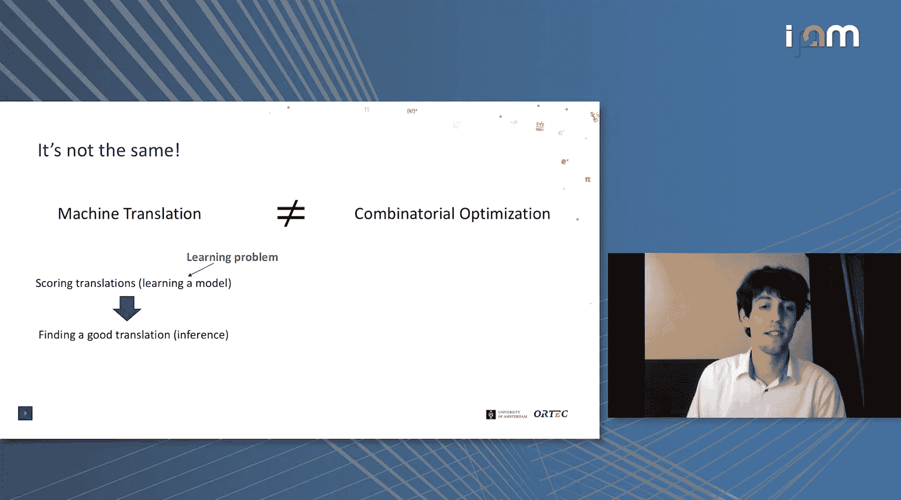

# IPAM【中英⚡深度学习与组合优化｜2021 Deep Learning and Combinatorial Optimization】 p17 P17 组合优化的深度学习：计算浮点运算，让运算有价值！ [BV1nYcuz1EQC_p17]

Okay， so so thanks for being here today， so today indeed we'll talk about deep learning for commentary optimization and some of the work I'll present today is with my call office this here。

Okay so let's start so we're talking about deep learning for combinatory optimization and actually my favorite example of combinatory optimization problem is the traveling scientist problem and we actually wrote a paper about this two years ago and this was also the topic of a very nice talk on Monday so I will quickly recap the way in which this works so we start with a problem instance and then we input this into a neural network and a neural network it's going to predict basically where we should move next and then we can feed back this partial solution back into our neural network and it's going to tell us where we should go next and in the end and this is going to create solution to a right which gets us basically back as fast as possible to the coffee corner and now so this was two years ago if we wrote this paper which was actually follow up on earlier work along the same lines and a lot of things have happened in the meanwhile so for example scientists they don't travel nowadays。

RightAnd so technology chain and we can teleport actually directly to the poster of your choice with the virtual conferences。

 so that's actually very interesting because that was exactly the use case this algorithm was designed for right because we can just retrain the model and then well to basically learn by itself it's completely irrelevant and by now but what should be your order but。

On a bit more mysterious note， I want to have a bit closer look on what's actually the motivation behind using this solution methodology so as we have also seen in the talk I guess on Monday。

 it's easy to make this parallel to for example machine translation right or we're trying to good good solution translations by predicting actually translation for some sentence we want to translate and if we compare this to combinator optimization then we can consider or we can at least approach combinator optimization problem as trying to predict the solution for a problem instance that we have but what I want to say is we should be very careful if we're going to do this because actually those problems although we can use like the same strategy for solving them maybe they are not the same and so let me elaborate on that a bit more。

So if we consider machine translation there's every actually different aspect of the problem right so first and foremost there's a problem of what I call to a translation so knowing whether a certain translation is good right so this is a learning problem this involves data and the model and then secondly there's the problem of actually giving this model finding them a good translation which which。

