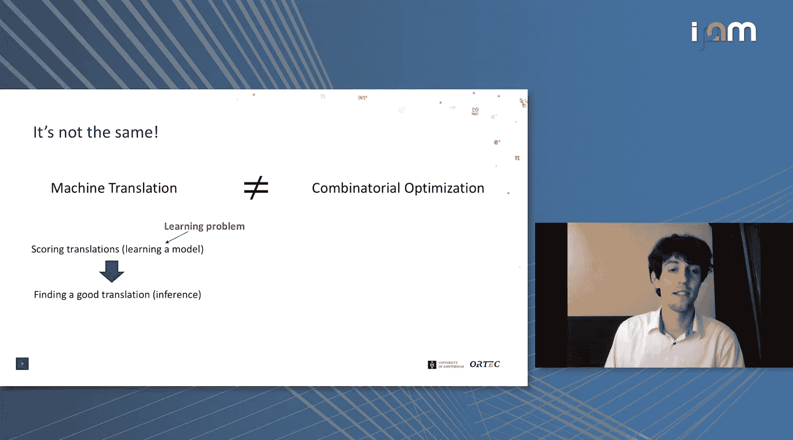

# 深度学习与组合优化：P17：计算浮点运算，让运算有价值！⚡

在本节课中，我们将探讨深度学习在组合优化领域的应用。我们将回顾一个经典案例，并深入分析其背后的动机与挑战，特别是将深度学习用于组合优化与用于机器翻译等任务之间的关键区别。

## 引言：从旅行科学家问题说起

今天我们将讨论深度学习在组合优化中的应用。我将介绍一些与同事共同完成的工作。

我们首先从深度学习用于组合优化的一个经典例子——旅行科学家问题开始。大约两年前，我们发表了一篇与此相关的论文，本周一的一场精彩演讲也讨论了这个话题。我将快速回顾其工作原理。

我们从一个问题实例开始，将其输入神经网络。神经网络会预测下一步应该移动到哪里。然后，我们将这个部分解决方案反馈给神经网络，它会告诉我们下一步该去哪里。最终，这个过程会生成一个解决方案，让我们能尽快返回咖啡角。

## 背景与演变

这篇论文是沿袭早期同类工作的后续研究。自那以后，情况发生了很多变化。例如，科学家们现在不再需要实地旅行了。

技术已经改变，在虚拟会议中，我们可以直接传送到你选择的海报前。这非常有趣，因为这正是该算法设计时所针对的应用场景。我们可以重新训练模型，让它自行学习在当前环境下无关紧要的因素，以及你的访问顺序应该是什么。

## 深入动机：与机器翻译的类比

我想更深入地探讨一下，采用这种解决方案背后的动机是什么。正如周一的演讲中可能提到的，很容易将其与机器翻译进行类比。

在机器翻译中，我们试图通过预测句子的翻译来生成好的译文。如果将其与组合优化进行比较，我们至少可以将组合优化问题视为尝试为我们拥有的问题实例预测一个解决方案。

但我想强调的是，如果我们这样做，必须非常小心。因为尽管我们可以使用相同的解决策略，但这些问题可能并不相同。让我对此进行更详细的阐述。

## 核心区别：学习问题与搜索问题

如果我们考虑机器翻译，问题实际上有不同的方面。

首先，最主要的是我称之为“翻译评估”的问题，即判断某个翻译是否优秀。这是一个**学习问题**，涉及数据和模型。

其次，是实际使用这个模型来找到一个好翻译的问题，这更多是一个**搜索问题**。

---

本节课中，我们一起学习了深度学习在组合优化中的应用，特别是通过旅行科学家问题的案例。我们回顾了其基本流程，并探讨了将深度学习用于组合优化与用于机器翻译任务的根本区别：前者同时涉及学习（评估解决方案质量）和搜索（生成解决方案）两个层面，而后者更侧重于学习后的生成过程。理解这一区别对于设计有效的组合优化深度学习模型至关重要。