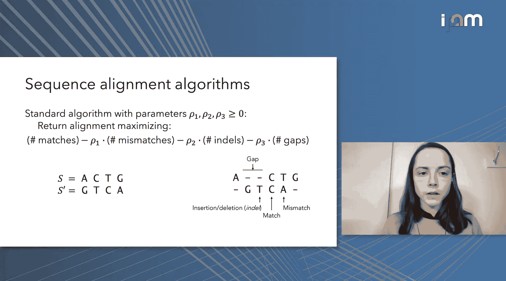

# IPAM【中英⚡深度学习与组合优化｜2021 Deep Learning and Combinatorial Optimization】 p18 P18 多少数据足以学习高性能算法？ [BV1nYcuz1EQC_p18]

Great， thank you so much。😊，So this paper is going to appear this year in stock and its joint work with Nina Blk and Dana Blasio Travis Dickick。

 Carl Kingsford and Tuas Santo， and it was really a collaboration between us in the Computer science Department at CMU together with the Compbio department and the machine learning department。

So as we've seen several times in this workshop， algorithms often come with a ton of tunable parameters。

 and these parameters can have a significant impact on the algorithm's runtime， its solution quality。

 and so on。😊，And tuning these parameters by hand is just a notoriously time consuming。

 tedious and error prome process。So our goal in data driven algorithm design is to automate the process of algorithm configuration or parameter tuning with the help of machine learning。

😊，So we want to be able to algorithmically find good parameter settings using a set of typical problem instances from the particular application domain at hand。

And you can think of this set of typical problem instances as the training set。

Whatever parameter setting we come up with， it should ideally also have good performance not only on our training set。

 but also on future inputs from the same application， but which aren't already on our training set。

So I'm going to use the following combinatorial problem as a running example throughout this talk。

 which is sequence alignment， and sequence alignment of course has many applications throughout biology。

 NLP and other fields。😊，So the input to a sequence alignment algorithm is a pair of sequences like these two SNS prime。

And the output is an alignment of these sequences。And there are a bunch of different features of an alignment that we might care about。

 such as the number of matches。The number of mismatches。

The number of insertions or deletions or indels for short。

 and this is where I've matched a character up with one of these gap characters。

And the number of Aine gaps， which is these sequences of consecutive gap characters。

So here's a standard dynamic programming algorithm for this combinatorial problem。

 which is defined by these three tunable parameters， row 1， row2 and row 3。

So we use dynamic programming to find an alignment which maximizes this parameterized objectiveive function。

 which is the number of matches， minus row1 times the number of mismatches。

 minus row2 times the number of indellls， minus row3 times the number of gaps。

