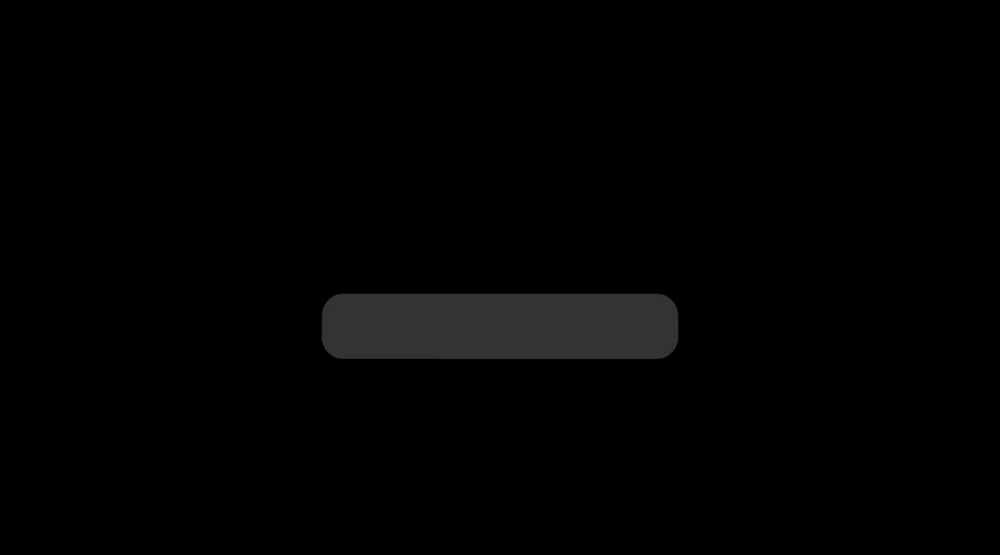
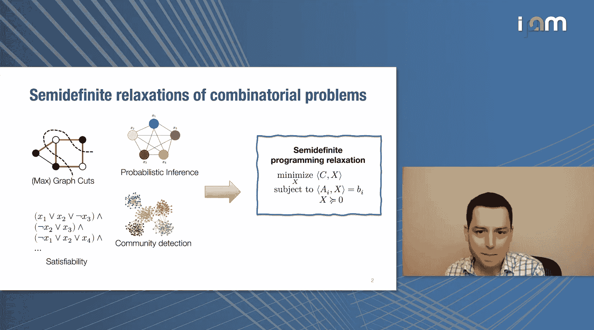

# IPAM【中英⚡深度学习与组合优化｜2021 Deep Learning and Combinatorial Optimization】 p19 P19 用于（可微分）组合优化的快速半定规划 [BV1nYcuz1EQC_p19]

Well， thanks everyone for having me here。It's great to be here and talk today about our work in differentiable combinatorial optimization。

This is going to be really the credit goes to my students that did this work here and in particular Poe on the left here was really the student graduating the semester and also currently still on the job market and not quite snaed up yet。

 so if people are interested by all means contact him I'm sure he'd love to hear from you。

But he really led all this work and he's really been one of the the chief sort of drivers of this main line of work。

 I also want to thank the Priya who's also been an integral part of it。

 so's my student Priya as well as a Master student of mine drug and then finally Brian Wilder at Harvard also worked on some of our stuff particularly on the SAT Network。

😊，Okay， so I'm going to give kind of a brief overview today about our work on semidefinite relaxations and how we how semi deffinite relaxation of commentary optimization while they've been known for a while I'm very excited about kind of hopefully breathing in a new sort of or extending kind of the excitement and life of these things。

 by injecting a perspective of kind of their easy ability to integrate within modern differentiable learning architectures。

So to start off with， let me sort of talk a little bit about the ideas to infinite relaxations and what these are for those that don't know。

Now this is sort of a workshop on commentary optimization。

 so I imagine this is actually likely to be familiar with a lot of people， with a lot of people here。

but if you think about sort of the the set of problems that we want to solve and comes optimization。

 these often involve things like graph cuts or problems like inference， satisfiability。

 communication， etc cea， these are all sort of reasoning problems over discrete structures。

And it's very well known that all of these problems have semi definite programming relaxations to them。

In other words， we can take these combatorial problems and I will actually define this a little bit more for those that aren't familiar with it。

 but as I broad overview， we can take these discrete problems and embed them in a continuous space。

Specifically using the techniques of semi infiniteite programming， semi infiniteite programming。

 the classical problem here is to minimize some linear function of a matrix x。

Subject to a bunch of inequality constraints or equality constraints on x。

 and then a semi definite constraint on x。And we'll talk about why this works in a second for these commentary problems。

But this is actually a very。

