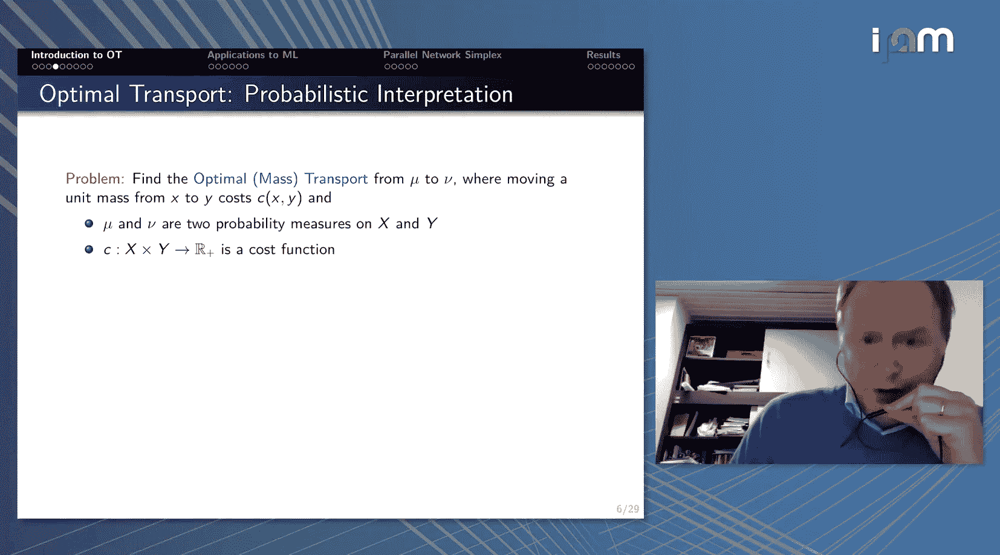

# IPAM【中英⚡深度学习与组合优化｜2021 Deep Learning and Combinatorial Optimization】 p20 P20 通过并行网络单纯形法进行离散最优传输 [BV1nYcuz1EQC_p20]

Okay， thanks a lot， so I'm going to present I will you a number of results that has been achieved together with my colleague at theni Feerico Bati who moved to Polytechnic of Milano and with Peter and nowson。

 who we speak later on the seminar。So the plan of the talk is to give a brief introduction of transport with a combinatorial optimization perspective。

 and I will anticipate the application of of the network simplicity machine learning and then I will。

Move to a brief description technical description on a possible parallel implementation the network simple that try to exploit a GPU and finally we present just one slide of computational result so Oman transport is a like go back is really old fashioned talk is a old problem is like 250 old problems introduced by Mon。

Where in his original paper， he was talking about the distribution of molecules and how to move a distribution of molecules from a given origin shape to a target shape nowadays when we talk about otman transport beam。

Talk about probability distribution by the original problem of Marsh。

It can be like a formulating a comm optimization。Sorry， let me hide the Zoom panel。

 Okay can be formulated like an assignment problem。

 which can be sort strongly polynomial time with flow aggregates that is。

In bipartide graph that are usually solved to to are usually used to formulate opens and transfer problem can be solve in in cube problem。

 So it's polynomial， that is by。High power in the complexity。From Ma。

 there is a really important contribution to what when transferred by Ktorrovch。

 who is not only the inventor of dual theory of linear programming。

But is also the searches who introduced the transport metrics。

 But nowas is now also as a basic matrix or Krovvi versus matrix and the original works of Krovvi was motivated by application。

OnAnother resource optimization problem and was written in Russian。In communization terms。

 the control of each problem is different from the mo because we move from an astanium problem to a transportation problem and the complexity and the strongly polynomial complexity raised to Ncubgan。

On bipartid graph。So this is somehow an important point。嗯。

