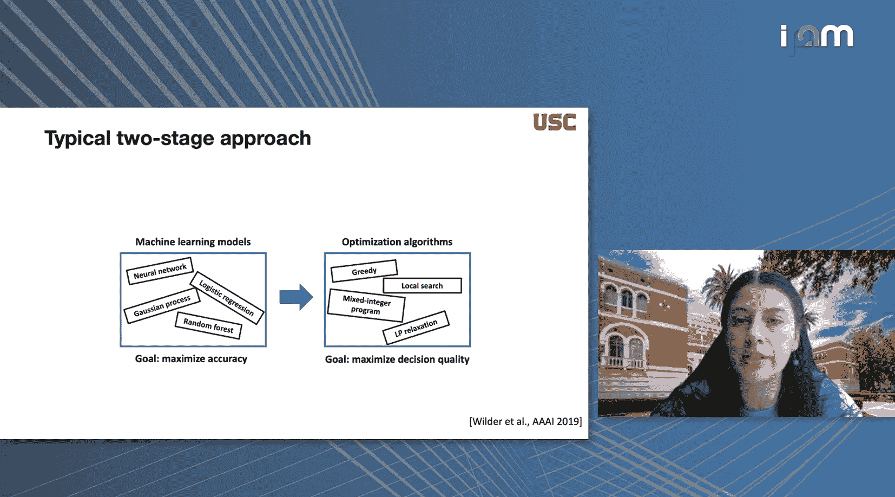

# IPAM【中英⚡深度学习与组合优化｜2021 Deep Learning and Combinatorial Optimization】 p21 P21 决策导向学习：在机器学习中整合下游组合学 [BV1nYcuz1EQC_p21]

Thanks Peter， yeah， so I'm so happy to be here with this amazing lineup of speakers presenting the recent advances that we have seen at the intersection of deep learning and combmininator optimization in the last three to four years this field has really grown it's an exciting research area with a lot of potential。

 where we have seen you know attempts at replacing combinatory optimization algorithms with purely deep learning approaches to integrating machine learning into discrete optimization algorithms。

 an area in which I have done a bit of work mostly in collaboration with my former PhD student Elias Cail who is now an assistant professor at University of Toronto where one can basically take existing combmininatorial algorithms and try to make them smarter by integrating ML guided components and we have done。

In this area， things like train greedy algorithms for graph optimization algorithms with reinforcement learning。

 Li So talked about this work earlier in the workshop or using machine learning to guide branch and bound for mixed integer programming both for branching and prim heuristic selection and we saw some follow-up improvements presented also in the workshop earlier this week。

 but today I want to talk a little bit more of a different direction of integration where we are thinking about how to infuse machine learning with knowledge of the constrained decision making。

 combatorial decision making that comes after it。So we want to incorporate knowledge about the downstream comminatorotics into the training group。

And the work I'll talk about today is mostly in collaboration with Brian Weder while he was at the University of Southern California。

 Brian now is at Harvard and is actually on the job market。So in many real world applications。

 we have a familiar pipeline where we have some observed data and use that data to learn models in order to make predictions and with those predictions。

 then we make resource allocation and other decisions for future steps。

And most of the time the way that in the real world。

 these settings are addressed is really to first start with building a machine learning model that is as accurate as possible。

 so maximize accuracy and once we are done with that， we hand that over to our optimization team。

 which comes up with a good model and good algorithm bit mixed integer programming greedy， etc。

 which is then trying to maximize decision quality。

