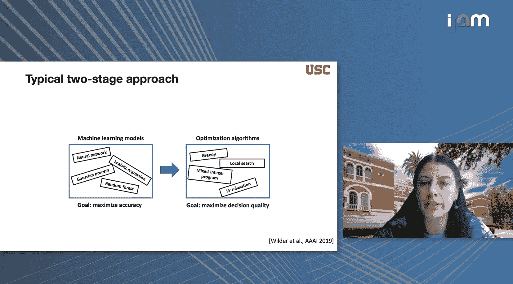

# 深度学习与组合优化：P21：决策导向学习：在机器学习中整合下游组合学

## 概述
在本节课中，我们将学习一种名为“决策导向学习”的方法。这种方法的核心思想是，在训练机器学习模型时，不仅要考虑预测的准确性，还要考虑模型预测结果如何影响后续的决策过程。我们将探讨如何将下游组合优化问题的知识整合到机器学习模型的训练中，以提升最终决策的整体质量。

---

感谢Peter。很高兴能与如此出色的演讲者们一同在此，展示过去三到四年间我们在深度学习与组合优化交叉领域所见证的进展。这个领域确实在快速发展，它是一个充满潜力、令人兴奋的研究领域。

我们见证了多种尝试，从试图用纯粹的深度学习方法取代组合优化算法，到将机器学习整合到离散优化算法中。

我在这个领域也做了一些工作，主要是与我以前在加拿大多伦多大学担任助理教授的博士生Elias Cail合作。我们的基本思路是，尝试通过整合机器学习引导的组件，使现有的组合算法变得更智能。

在这个方向上，我们做过一些工作，例如：使用强化学习训练图优化算法的贪心算法。Li So在本次研讨会早些时候已经讨论过这项工作。或者，使用机器学习来引导混合整数规划中的分支定界法，包括分支和原始启发式选择。本周早些时候的研讨会上，我们也看到了一些后续的改进成果。

但是，今天我想讨论一个略有不同的整合方向。我们思考的是，如何将后续约束性决策（即组合决策）的知识融入到机器学习中。我们希望将关于下游组合优化的知识整合到训练过程中。

我今天要介绍的工作，主要是在Brian Weder还在南加州大学时与他合作的成果。Brian现在在哈佛大学，并且实际上正在求职市场上。

在许多实际应用中，我们有一个熟悉的流程：我们有一些观测数据，利用这些数据学习模型以进行预测，然后根据这些预测为后续步骤做出资源分配等决策。

大多数时候，在现实世界中处理这些场景的方式是：首先构建一个尽可能准确的机器学习模型，即最大化预测准确性。完成这一步后，我们将模型交给优化团队。优化团队会建立一个好的模型和算法（例如混合整数规划、贪心算法等），其目标是最大化决策质量。

---

## 总结
本节课中，我们一起学习了“决策导向学习”的基本概念。我们了解到，传统的流程是先将机器学习模型的预测准确性最大化，再将其用于优化决策。而决策导向学习则提倡在模型训练阶段就考虑下游的组合优化问题，将决策质量作为训练目标的一部分，从而实现从预测到决策的端到端优化。这种方法旨在弥合预测模型与最终决策之间的鸿沟，提升整体系统的性能。