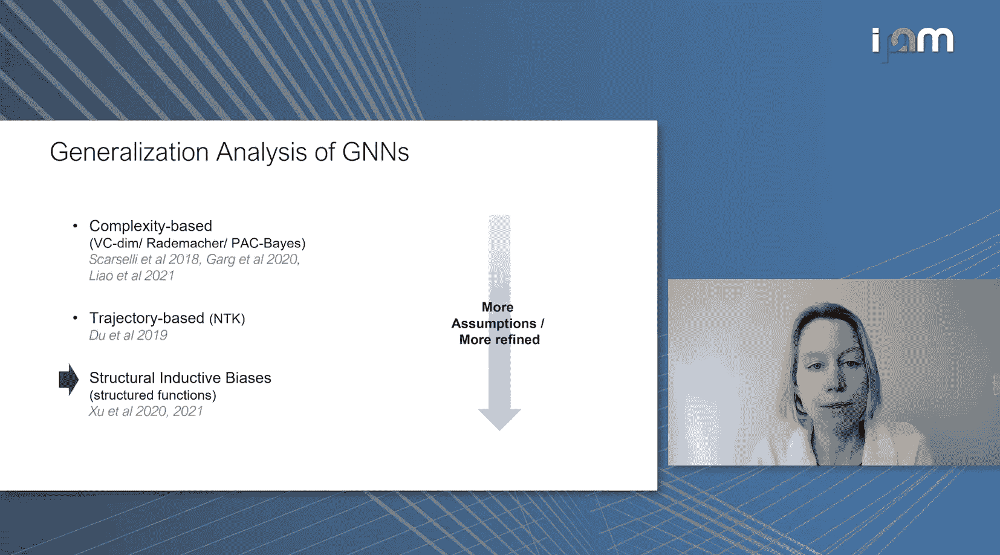

# IPAM【中英⚡深度学习与组合优化｜2021 Deep Learning and Combinatorial Optimization】 p22 P22 图神经网络中的任务结构与泛化 [BV1nYcuz1EQC_p22]

Thank you Pe for the introduction and thanks all for listening and for the invitation to this workshop so I've really been enjoying the talks here it's an honor to be here and today I would like to talk about generalization and extrapolation in graph neural networks more from a perspective of trying to understand these properties this is joint work with a number of people that I've been collaborating with in particular my student Qulu I would like to point out here。

😊，So。This talk is about algorithmic reasoning and what is algorithmic reasoning。

 we already saw this in previous talks it's essentially having in neural network learn a full optimization algorithm so questions that can come up that you're trying to learn to answer such as like you're given a set of items。

 what are the colors of the fatherest pair of objects or in physical reasoning。

 trying to predict the next state of a physical system or trying to compute something like a shortest path。

😊，So in all of these tasks， what you have is you're given essentially a universe of some items and they're interacting in some way。

 and then first you have to actually like perceive these items and encode them in some feature vectors and then you're trying to reason about these items and try to answer the question。

😊，Now this is essentially similar to what Peter talked about on Tuesday。

 but different from his talk today I would like to focus on the second part of this pipeline and trying to understand sort of how you could learn this reasoning so what I will assume is that we already have done the perception and we already have our objects encoded in some form as feature vectors like maybe the colors。

 the positions etc ce and we are just trying to learn to answer question so we are essentially just learning the algorithm。

And what I would like to understand here is how well can actually different neural networks learn this reasoning task and why or why not can they？

And this is essentially a question about generalization and I would like to look at it in two different parts the first one is looking at just the standard way of generalization。

 you're giving training distribution， you're looking at data from the same distribution。😊。

And relating generalization performance to actually structure of the architecture and structure of the task。

And in the second part of my talk， I would like to go further and look at extrapolations。

 so now you're seeing data from a different distribution。Can you work。

 will your method work on that or not， and what does that depend on？

So let's start with generalization and since Graph neuralal networks will play an important role in this。

 let me just quickly recap what is a graph neural network I know many of you have。😊。

