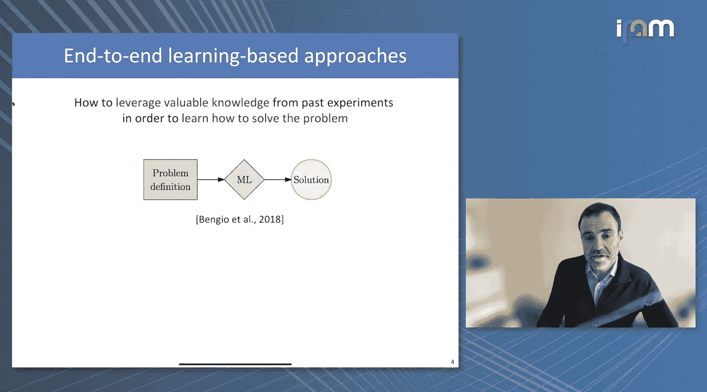

# IPAM【中英⚡深度学习与组合优化｜2021 Deep Learning and Combinatorial Optimization】 p23 P23 结合强化学习与约束规划进行组合优化 [BV1nYcuz1EQC_p23]

Thank you Peter so this talk will be about combining reinforcement learning and constraint programming for Comunal optimization his joint work with my colleague Ktankapath from Polytechnic And C from the University of Toronto as well as T Moza and Isabulou Schwartz which were at element AI that was recently acquired by series now so before I start I want again thanks all the all the organizers and everybody in IPAm for this fabulous conference and incredible lineup and talk that I've seen so far I have not had much fun in a conference for a long time so。

😊，It's incredible all right， so let's start。😊，We know solving commercial optimization problem is difficult。

 we have to pick one optimal solution， a lot of set of discrete solution which are this set might not even even be connected and it's not continuous。

 but we have to do it often because these are important problem in transportation。

 both ground and air transportation in leisure in supply chain and retail and healthcare and most importantly we have to do it very often。

Now if a human would be planning and solving commercial transition in these settings when they would start。

 they would be quite bad at it and then it would improve over time after a few months they become reasonable and after a few years they become experts and this is not the case for our algorithm and this is why we'll try to see if we can exploit the fact that we need to solve these problems over and over again in order to become more efficient。

Now， solvers we use to solve comminat problems that arise in logistics problems either healthcare or supply chain。

 or integer programming or constraint programming or SA solvers。

 and they rely on some form of branching or solution space exploration that is complete mental heuristics as we exist as well。

 but I'll focus on complete metal for this talk。Now this is nice because they provide guarantees of optimality。

 which means that even if they are not able to find the optimal solution。

 they can provide some kind of dual bound that tells us how far we are from let's say a potentially optimal solution and we also have also a good set of general purpose solvers for each of them。

 some of them are commercial and or some of them are open source and free。

Now the downside is of course this ist a complete exploration so it takes time。

 but most importantly even though you solve this problem day after day after day。

 the solver doesn't improve over time as a human would do right we're not leveraging the fact that we are solving these problems。

So I think this is what a lot of people are trying to do in this workshop trying to see if we can learn something from numerous resolution of the same problem and try to be more efficient added so how can we do we've seen a couple of different approach throughout this this very nice workshop。

 one of them as laid out in the paper by Yohua Andrea and Antoa。

