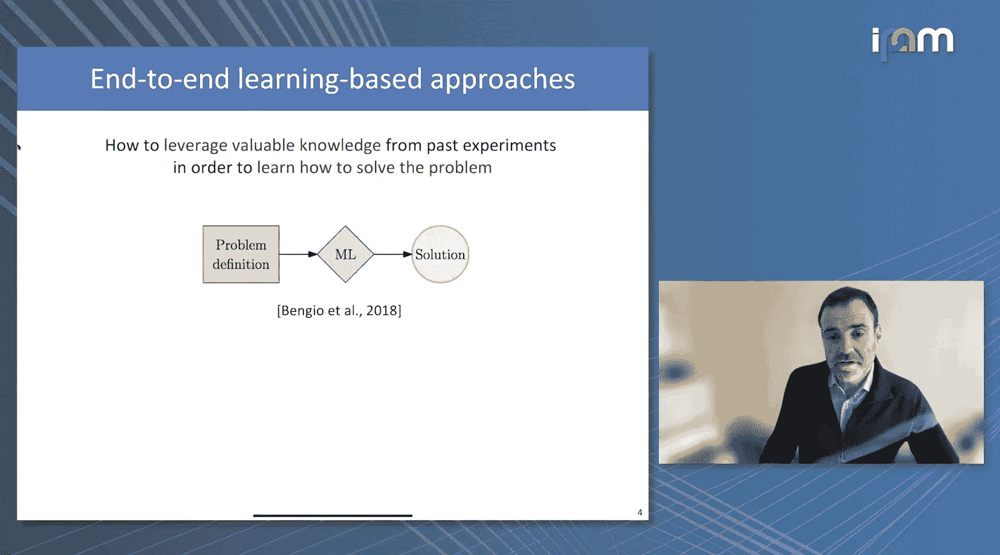

# 深度学习与组合优化：P23：结合强化学习与约束规划进行组合优化

在本节课中，我们将探讨如何将强化学习与约束规划相结合，以解决组合优化问题。我们将了解传统求解器的局限性，并学习一种能够从重复求解中不断改进的新方法。

## 概述

组合优化问题求解困难。我们需要从一组离散的解中选出最优解，这组解甚至可能不连续。然而，这些问题在交通、物流、医疗和零售等领域至关重要，并且需要频繁求解。

## 传统求解器的现状

上一节我们介绍了组合优化问题的普遍性与重要性。本节中，我们来看看目前用于解决这些问题的传统求解器。

我们通常使用整数规划、约束规划或SAT求解器来解决物流、医疗或供应链中出现的组合问题。这些求解器依赖于某种形式的分支定界或解空间探索，属于完备方法。它们能提供最优性保证，即使找不到最优解，也能给出对偶界，以衡量与潜在最优解的差距。同时，存在一些通用求解器，部分为商业软件，部分为开源免费软件。

然而，其缺点在于，这种完备探索需要时间。更重要的是，即使日复一日地解决相同类型的问题，求解器自身并不会像人类专家那样随着时间的推移而改进。我们没有充分利用重复求解这些问题的经验。

## 学习型求解器的动机

既然传统求解器无法自我进化，那么如何让求解过程变得更高效呢？这正是本次研讨会中许多人尝试探索的方向：我们能否从对同一问题的多次求解中学习，从而提高效率？

以下是几种可能的实现途径：

*   **学习启发式策略**：学习如何更有效地进行分支决策或变量赋值。
*   **学习问题简化**：学习识别并移除对最优解影响不大的约束或变量。
*   **学习求解策略**：为不同类型的问题子结构配置最佳的求解参数。

## 结合强化学习与约束规划的方法

接下来，我们将重点介绍一种具体的方法：将强化学习与约束规划相结合。

我们的目标是训练一个策略，使其能够模仿约束规划求解器在搜索树节点上所做的决策。我们使用图神经网络来编码当前求解状态（即部分赋值后的约束满足问题），并输出一个决策，例如选择哪个变量进行赋值。

以下是该方法的简化流程描述：

1.  将当前CSP（约束满足问题）状态编码为图。
2.  使用GNN处理该图，得到节点（变量）和边（约束）的嵌入向量。
3.  基于嵌入向量，通过策略网络预测下一个要赋值的变量。
4.  执行赋值，更新CSP状态，并进入下一个决策步骤。

这个训练过程可以形式化地表示为一个强化学习问题。智能体（策略网络）在环境（约束规划求解器）中行动，其目标是最大化累积奖励，例如最小化最终求解时间或搜索树大小。

## 总结

本节课中，我们一起学习了如何将强化学习与约束规划结合以改进组合优化求解。我们首先指出了传统完备求解器无法从经验中学习的局限性。然后，我们探讨了让求解器“学习”的动机与可能途径。最后，我们详细介绍了一种使用图神经网络和强化学习来学习变量分支策略的方法，该方法能够使求解器在重复求解同类问题时变得越来越高效。