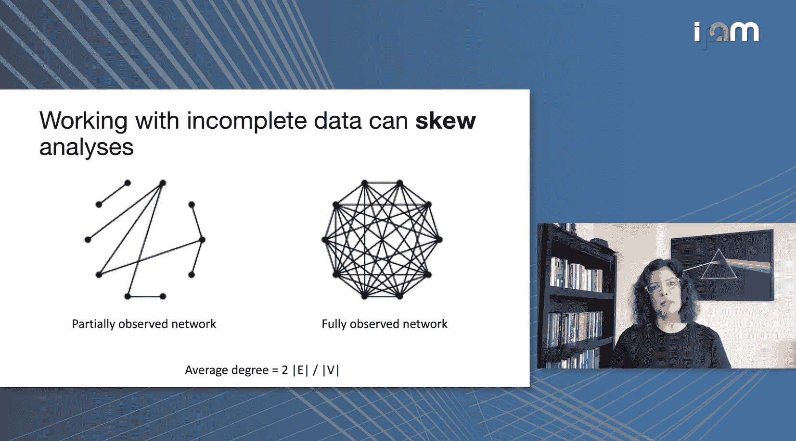

# IPAM【中英⚡深度学习与组合优化｜2021 Deep Learning and Combinatorial Optimization】 p24 P24 通过嵌入空间上的深度强化学习进行任务驱动的网络发现 [BV1nYcuz1EQC_p24]

I want to thank the organizers in IPAM I've been involved with IPAM since like 2004 I've organized long programs short programs when I wasn't in academia。

 I was an industrial mentor for their research in industrial partnership program so IPAM is a gem so thank you very much for hosting this。

 I know how much work goes into these things。So today I'm going to talk to you guys about。

This work that we did on what's called task drivenrive network discovery and the fact that we used a deep reinforcement learning model becomes clear as we go along but the idea was really to focus on this task drivenrive network discovery the work is a joint with Dr。

 Ramunnda Cascers who's on the participants list， thank you Ramunnda for attending the talk if I say anything wrong and she can correct me Ramunnda is at MIT Lincoln Laboratory and our colleague Peter Mores who was at MIT Lincoln Labor when we did this work and then moved to Microsoft earlier this year。

And the work is forthcoming in the Applied Network Science journal。

 part of moving to the Network Science Institute， now I published in network science venues。

 which is fun。Okay， so complex networks are ubiquitous if you haven't drank the kulate call me I'll send you the kulid right you're interested in some phenomena either social or physical or technological and you know that the relational dependencies between the entities and so you want to learn predictive and descriptive models of the complex topology that connects the various elements right from technological networks and social networks information network biological networks now there is a lie there is a falsehood on this slide in that partially observed complex networks are ubiquitous fully observed complex networks are not as ubiquitous as you would like them to be。

So whatever phenomena you're interested in is oftentimes partially observed， for example， right now。

 we would love to have the fully observed contact network right to be able to do tracing and controlling the pandemic。

 there's also oftentimes hard in terms of hard or expensive in terms of collecting more data。

 and the last thing is even if you had all the data in the world。

 you may not have all the computational power in the world and even if you did have all the computational power in the world。

 you may not want to use it for climate change purposes or you just you know youd rather not use all the computational power in the world。

So and of course， we all know that when you work on partially。

