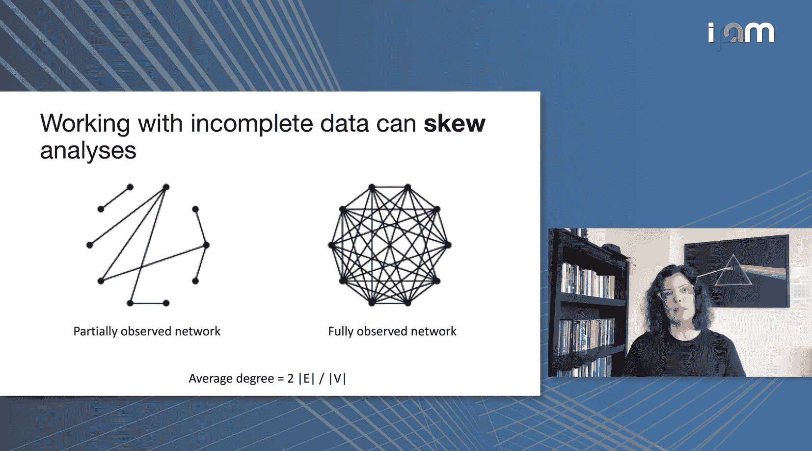

**深度学习与组合优化：P24：通过嵌入空间上的深度强化学习进行任务驱动的网络发现**

在本节课中，我们将学习如何利用深度强化学习模型，在嵌入空间中进行任务驱动的网络发现。我们将探讨在复杂网络通常只能被部分观测的现实下，如何高效地发现对特定下游任务至关重要的网络结构。

---

首先，我要感谢IPAM的组织者。我自2004年起就与IPAM结缘，曾组织过长期和短期项目。即使不在学术界时，我也曾作为工业导师参与他们的工业合作研究项目。IPAM是一块瑰宝，非常感谢你们主办这次活动，我深知其中需要付出多少努力。

今天，我将向大家介绍我们关于“任务驱动网络发现”的研究工作。随着讲解深入，我们使用的深度强化学习模型会变得清晰，但核心理念是聚焦于“任务驱动”的网络发现。这项研究与Ramunnda Cascers博士（她在参会者名单中，感谢Ramunnda来听讲，如果我说错了什么她可以纠正我）以及我们的同事Peter Mores共同完成。Ramunnda在MIT林肯实验室，Peter在我们进行这项研究时也在MIT林肯实验室，并于今年早些时候加入了微软。这项研究即将发表在《应用网络科学》期刊上，该期刊隶属于网络科学研究所。现在能在网络科学领域的平台发表文章，这很有趣。

复杂网络无处不在。如果你还没有接受这个观点，请联系我，我很乐意与你分享相关资料。无论你感兴趣的是社会、物理还是技术现象，你都知道实体之间的依赖关系。因此，你希望学习连接各种元素的复杂拓扑结构的预测性和描述性模型，这包括技术网络、社交网络、信息网络和生物网络。然而，这张幻灯片上存在一个不实之处：**部分观测的复杂网络无处不在，但完全观测的复杂网络并不像我们期望的那样普遍。**

你所感兴趣的现象常常是部分可观测的。例如，当前我们非常希望拥有完全观测的接触网络，以便进行疫情追踪和控制。此外，收集更多数据通常是困难或昂贵的。最后，即使你拥有世界上所有的数据，也可能没有足够的计算能力；即使拥有足够的计算能力，出于气候变化或其他原因，你可能也不希望动用全部的计算资源。

当然，我们都知道，当你在部分观测的网络上工作时，你拥有的数据可能不足以支撑你关心的下游任务。

---

### 问题背景与动机

上一节我们提到了网络数据部分观测的普遍性。本节中，我们来看看这引出的核心问题：**网络发现**。

网络发现是指，在给定一个部分观测的网络（即已知部分节点和边）的情况下，通过有选择地查询（例如，通过实验或数据收集）未知的边，来逐步揭示更完整的网络结构。关键在于，我们通常有特定的下游任务（如节点分类、链路预测、社区检测等），发现网络的目的就是为了更好地完成这些任务。因此，我们需要一种**任务驱动**的方法，智能地决定查询哪些边，以最小的成本最大程度地提升任务性能。

传统方法可能随机查询或基于网络本身的中心性指标进行查询，但这些方法没有考虑下游任务的具体需求。我们的目标是开发一种方法，能够根据任务反馈，自适应地、高效地指导网络发现过程。

---

### 方法概述：嵌入空间与深度强化学习

为了解决上述问题，我们提出了一个结合**网络嵌入**和**深度强化学习**的框架。其核心思想是将网络发现过程建模为一个顺序决策问题。

以下是该框架的关键步骤：

1.  **网络嵌入**：首先，我们将当前已观测到的网络（随着发现过程会动态变化）映射到一个低维的嵌入空间。每个节点由一个稠密向量表示，即 `node_embedding = f(G_observed)`。这个嵌入捕获了节点的结构信息。
2.  **强化学习建模**：
    *   **智能体**：我们的网络发现算法。
    *   **状态**：在每一步，状态是当前已观测网络的嵌入表示。我们可以将其表示为所有节点嵌入的集合或一个全局图嵌入。
    *   **动作**：从候选的未观测边中选择一条进行查询。动作空间是所有可能缺失的边。
    *   **奖励**：查询一条边并将其加入观测网络后，我们在更新后的网络上运行下游任务模型（例如，一个分类器），其性能的提升（如准确率的增加）作为奖励。奖励公式可以简化为：`Reward = Performance(G_new) - Performance(G_old)`。
    *   **策略**：一个深度神经网络，它接收当前状态（图嵌入），并输出选择每条候选边的概率。策略网络的目标是学习一个策略 `π(a|s)`，以最大化长期累积奖励。
3.  **训练与执行**：我们使用深度强化学习算法（如策略梯度或Actor-Critic方法）来训练这个智能体。训练完成后，智能体可以应用于新的部分观测网络，智能地选择边进行查询，以高效地优化下游任务。

---

### 总结

本节课中，我们一起学习了任务驱动网络发现的问题背景和解决方法。

*   我们认识到完全观测的网络很少见，网络发现是一个关键且具有挑战性的问题。
*   我们提出将网络发现过程形式化为一个顺序决策问题，其目标是最优化特定的下游任务性能。
*   我们介绍了一个创新的框架，该框架结合了**网络嵌入**技术来表征状态，并利用**深度强化学习**来学习最优的发现策略。这个框架能够根据任务反馈自适应地指导查询，实现高效、智能的网络发现。

通过这种方法，我们可以在数据收集成本高昂或计算资源有限的情况下，更有效地揭示网络结构，从而为后续的分析和预测任务提供更高质量的数据基础。