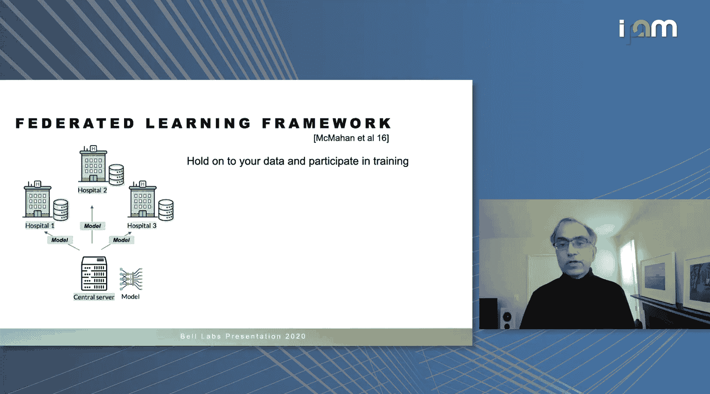

# IPAM【中英⚡深度学习与组合优化｜2021 Deep Learning and Combinatorial Optimization】 p25 P25 如何在保护数据隐私的前提下进行深度学习 [BV1nYcuz1EQC_p25]

Thank you， it's fun to talk at this workshop as you mentioned。

 I used to do commentatorial algorithms or commentatorial optimization in context of NPR problems and lately for the last decade I've been interested in。

Deep learning and other machine learning techniques。So this talk is about Inhe。

 an idea that allows deep learning on your data without revealing your data。

And has joined work with Yang Xibo Wang， a grad student， Zhao Zong postdoc， Kaaili， my colleague。

 and also there's a second paper on textt which has the same team and also Don Qhenhen。

 another colleague。So today's interconnected world rest upon a fian bargain。

We provide our data to the corporations and in return。

 get the world of devices trained and tailored for us。But we can wonder。

 is this state of affairs inherentance？Realize that the smart world increasingly relies upon large deep nets。

 trained and customized on our data using some version of the back propagation algorithm。

So from now on， this hardworking little blue fellow will denote standard deep net training。

Which brings us to our seemingly oxmrononic question。

Can deep learning be done on our data without making us reveal the data？If yes。

 then here are some applications， hospitals would like to train a deep net using patient data。

 but privacy laws prevent them from handing over the data to others。

User groups may want to customize Gbo using their chats without revealing those chats。More generally。

 a solution to the above question begins to fundamentally change the implicit assumptions about privacy utility tradeoffs that underlie today's big tech。

So there are two distinct settings to be aware of in this space。

 one is where computationally powerful clients， say hospitals are using private data to collaboratively train a deep net on a central server。

A second setting is that there's a large number of lightweight devices， for instance。

 internet of things， which are sending user data to central servers for doing deep learning towards the desired goal。

Which all the users will benefit from。So we're going to address the first setting。

 but the solution is also applicable to the second setting and it's not quite as secure probably for the second setting。

Federated learning is a framework for thinking about such questions。

 especially the first setting our running illustration will be hospitals trying to train a deep net without。

