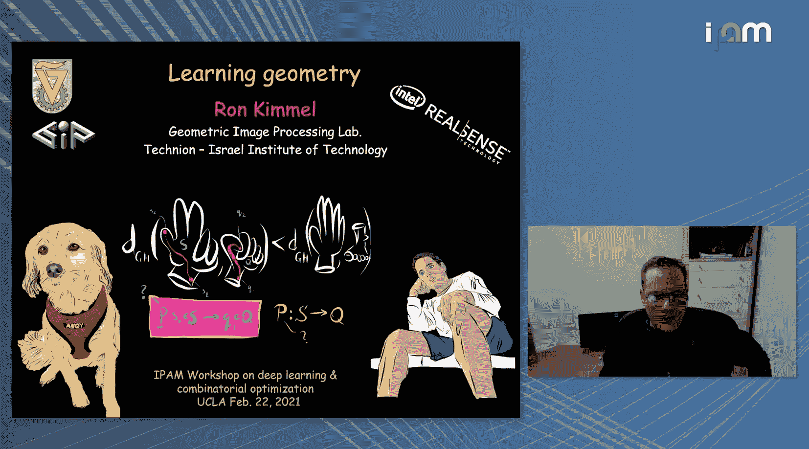

#  002：学习几何

在本节课中，我们将探讨如何将深度学习方法应用于几何问题。几何问题通常不具备传统深度学习所依赖的平移不变性等特性，这带来了独特的挑战。我们将介绍如何利用神经网络来解决这类问题。

---

上一节我们介绍了深度学习在组合优化中的一般背景，本节中我们来看看一个具体的应用领域：几何问题。

我假设本次会议的名称“深度学习与组合优化”意味着我将更多地讨论深度学习，较少涉及组合优化本身。深度学习是一种颠覆性的研究方向，它改变了我们进行计算和解决计算问题的方式。它涉及优化大量参数、调整并训练它们，最终得到一个能够进行分类、分割和推理的架构。只要数据维度有明确的假设，例如数据本身的参数维度较低，或者数据位于某个低维空间中，这种方法就非常有效。

或者，在另一种情况下，如果数据具有某些空间或时间上的平移不变性，你也可以利用这些特性来优化你的模型。

我今天要讨论的是一系列我们研究多年的问题，即几何问题。我们要解决的核心问题是：如何利用神经网络来处理和解决这些本质上不具备平移不变性的问题。

---

接下来，我们回顾一下图灵奖。

两年前，图灵奖授予了三位巨人：Yann LeCun教授（也是Facebook AI总监），他提出了卷积网络；Geoffrey Hinton，他提出了AlexNet（全卷积网络）；以及Yoshua Bengio，他因生成对抗网络而闻名。

现代的卷积神经网络需要这种特殊的平移不变性特性来解决问题。

这三位巨人因其近30年（自90年代以来）的坚持和推动这一方法论而获得了图灵奖。我仍然记得2003年在一次研讨会上，Yann LeCun展示他的卷积网络如何识别数字或字母。那次研讨会给我留下的深刻印象是，你可以将大量带标注的样本输入一个计算机器，最终得到非常好的结果。

我们将要做的是尝试遵循这一哲学。

---

本节课中我们一起学习了将深度学习应用于几何问题的基本思路和挑战。我们了解到，几何问题通常缺乏传统深度学习模型所依赖的平移不变性，因此需要特殊的方法来处理。通过回顾图灵奖得主的贡献，我们看到了深度学习方法论的力量和持久影响。