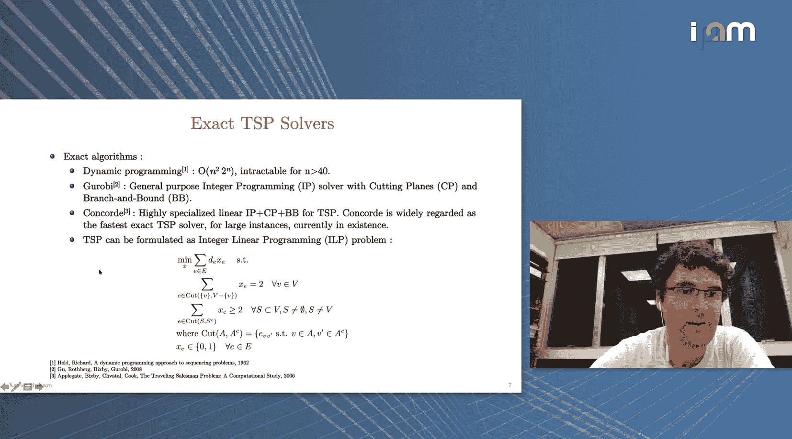

#  003：用于旅行商问题的Transformer网络

在本节课中，我们将学习如何利用Transformer神经网络架构来解决经典的组合优化问题——旅行商问题。我们将从问题定义开始，介绍传统解法，然后深入探讨基于深度学习的解决方案，特别是我们提出的Transformer网络模型。

## 旅行商问题概述

旅行商问题是一个著名的组合优化问题。给定一组城市，目标是找到一条最短的可能路径，从一个城市出发，恰好访问每个城市一次，然后返回起点城市。这个问题最早由William Hamilton提出。

TSP属于一个更广泛的组合优化问题类别，这些问题在工业中每天都被使用，例如仓库管理、运输、供应链、硬件设计和制造等。TSP是一个困难的问题，穷举搜索的复杂度是 **O(n!)**。然而，它也是最受欢迎和研究最广泛的组合优化问题之一，其现代研究可追溯到1951年的Von Neumann。

## 传统解法分类

传统上，有两类主要算法用于解决组合优化问题。

以下是两类算法的简要介绍：

*   **精确算法**：例如穷举搜索、动态规划或整数规划。这类算法保证能找到最优解，但当问题规模 `n` 增大时，它们会迅速变得不可行。
*   **近似算法**：这类算法本质上是在最优性和计算时间之间进行权衡。为此，需要设计一些启发式规则，这些通常是理论上可应用的简单规则，直到获得解。这类算法的复杂度通常是多项式级别的，其解的质量通过与已知最优解的差距来评估。

由于时间关系，我们对传统方法的介绍将比较简要。

上一节我们回顾了TSP的传统解法，本节中我们来看看近年来利用神经网络解决TSP的新思路。

## 基于神经网络的解决方案

近年来，利用神经网络解决TSP成为了一个活跃的研究方向。我们的工作正是基于这一背景展开。

接下来，我将介绍我们为此问题设计的核心架构。

## 模型架构：Transformer for TSP

我们的模型基于Transformer架构。Transformer最初是为自然语言处理任务设计的，但其强大的序列建模和注意力机制非常适合处理像TSP这样的序列决策问题。

在模型的具体实现中，编码器用于处理输入的城市坐标序列，解码器则用于逐步生成访问城市的顺序（即旅行路径）。

## 解码技术

为了从模型输出中构造出有效的旅行路径，我们需要使用特定的解码技术。这个过程将模型预测的概率分布转化为具体的城市访问序列。

## 数值结果与分析

我们在一系列标准TSP数据集上评估了我们的Transformer模型，并将其性能与传统的启发式算法进行了比较。

以下是部分关键结果的总结：

*   在中小规模问题上，我们的模型能够快速找到接近最优的解。
*   与一些传统启发式方法相比，神经模型在求解速度上展现出潜力。
*   模型展示了良好的泛化能力，即在训练分布之外的问题规模上也能表现良好。

## 讨论与结论

本节课中，我们一起学习了如何应用Transformer网络来解决旅行商问题。我们首先介绍了TSP的定义及其重要性，然后概述了传统精确算法和近似算法。接着，我们重点介绍了基于神经网络的解决方案，并详细阐述了我们的Transformer模型架构、解码技术以及最终的实验结果。

总结来说，深度学习为组合优化问题提供了新的工具和视角。虽然传统方法在最优性保证方面有优势，但神经网络方法在求解速度和适应新问题实例方面具有潜力。将两者的优势结合，可能是未来一个重要的发展方向。