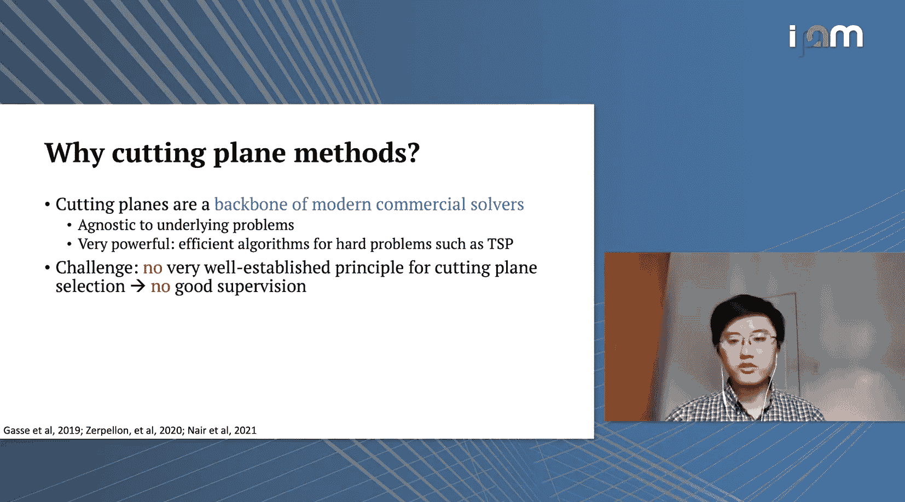

#  007：学习切割

在本节课中，我们将探讨如何将强化学习应用于整数规划，特别是用于自动化切割平面方法中的决策过程。我们将了解切割平面方法的重要性，以及如何通过机器学习来改进这一经典算法。

---

## 概述

切割平面方法是现代商业求解器的核心组件，它独立于具体问题，是一种强大的通用方法。然而，其效果很大程度上依赖于人工设计的启发式规则来选择有效的切割平面。本节课程将介绍我们如何利用强化学习来自动化这一选择过程，从而加速整数规划的求解。

## 组合优化中的机器学习方法

在本次研讨会中，我们一直在讨论机器学习在组合优化中的应用。使用机器学习技术来帮助加速或解决组合优化问题有多种途径。

一种方法是直接根据问题的表示来预测解。在这种情况下，我们需要考虑解的参数化以及可以针对特定预测问题定制的神经网络架构。

另一种更中立的方法是更接近算法本身，即设计一个神经架构来模仿算法的计算过程。这样，我们能够结合机器学习方法学习表示的灵活性，以及来自算法（如算法思维）的归纳偏置。

此外，还有第三种方法，即直接将机器学习与硬编码算法相结合。在这种情况下，我们试图使用机器学习技术来自动化算法中的某些决策过程，从而取代这些流行算法中部分由人工设计的启发式规则。先前的工作已经对分支定界等算法以及原始启发式方法进行了大量研究，而本项工作将聚焦于切割平面方法。

可以看到，这三种方法都属于将机器学习应用于组合优化问题的更大范畴的一部分。最上层是更纯粹的基于机器学习的预测方法，它允许我们受益于机器学习表示的灵活性。而在底层，我们可以将机器学习与纯粹的经典算法相结合，从而受益于数十年来解决组合优化问题的硬编码算法研究。

## 为什么关注切割平面方法？

切割平面方法是许多强大的现代商业求解器的支柱。它的一个主要优点是它对底层问题是不可知的，同时也是一种非常强大的方法。例如，我们可以使用切割平面来高效解决诸如旅行商问题（TSP）等难题。

考虑切割平面方法的一个主要挑战是，目前没有非常完善的、通用的启发式规则来自动选择最有效的切割平面。这通常依赖于专家的经验和问题领域的知识。

## 切割选择问题

在切割平面方法的每一步，我们都会从当前线性规划松弛解的不等式池中生成多个候选切割平面。目标是选择其中一个添加到公式中，以尽可能快地收紧松弛边界。

以下是切割选择过程的关键步骤：

1.  **生成候选池**：基于当前解，生成一组潜在的切割平面（例如，Gomory切割、覆盖切割）。
2.  **评估候选**：需要一种方法来评估每个候选切割的“好坏”。
3.  **做出选择**：根据评估，选择一个切割添加到问题中。

传统的启发式方法可能基于切割的“深度”、与当前解的角度，或其对目标函数值的预期影响等因素。我们的目标是使用强化学习来学习一个选择策略，该策略能够超越这些固定的启发式规则。

## 强化学习框架

我们将切割选择过程建模为一个马尔可夫决策过程（MDP）：
*   **状态（s_t）**：在步骤 *t* 时，由当前线性规划松弛解和候选切割池组成的表示。
*   **动作（a_t）**：从候选池中选择一个切割平面。
*   **状态转移**：将选定的切割添加到问题中，并重新求解线性规划松弛，得到新的状态 *s_{t+1}*。
*   **奖励（r_t）**：衡量添加该切割后带来的改进。一个自然的奖励是**对偶间隙的减少量**，即 `r_t = (gap_{t} - gap_{t+1})`，其中 `gap` 是当前最优解与松弛边界之间的差距。

我们的目标是学习一个策略 **π(a_t | s_t)**，它能够最大化从初始状态到终止状态（例如，达到某个间隙阈值或迭代次数限制）所获得的累积奖励。

## 策略网络与训练

我们使用一个神经网络来表示策略 **π**。该网络的输入是状态 *s_t* 的特征化表示，输出是在所有候选切割上的概率分布。

**状态特征**可能包括：
*   当前线性规划解的信息。
*   每个候选切割的属性（如深度、有效性、方向）。
*   全局问题统计信息。

**训练**通过策略梯度方法（例如REINFORCE或PPO）进行。我们让智能体在大量整数规划实例上进行交互，根据其获得的累积奖励来更新网络参数，目标是让智能体学会选择那些能最有效加速收敛的切割。

## 实验与结果

我们在经典的整数规划基准测试集上进行了实验，例如MIPLIB。我们将学习的切割选择策略与常用的启发式规则（如最深的切割、随机选择）进行对比。

关键指标包括：
*   **求解时间**：达到特定对偶间隙所需的时间。
*   **迭代次数**：达到收敛所需的切割添加次数。
*   **最终对偶间隙**：在固定时间或迭代次数后的解质量。

实验结果表明，通过学习得到的策略能够显著减少达到相同解质量所需的迭代次数，并且在许多情况下能够更快地收敛到更优的解。

## 总结

本节课中，我们一起学习了如何将强化学习应用于整数规划中的切割平面选择问题。我们首先回顾了机器学习与组合优化结合的几种范式，然后重点介绍了切割平面方法的重要性及其面临的挑战。接着，我们详细阐述了将切割选择建模为马尔可夫决策过程、设计奖励函数、构建策略网络以及进行训练的整体框架。通过这种方法，我们可以让机器学习智能体自动学习如何选择有效的切割，从而减少对人工启发式规则的依赖，并潜在地提升求解器的性能。这展示了将数据驱动方法与经典优化算法相结合的巨大潜力。