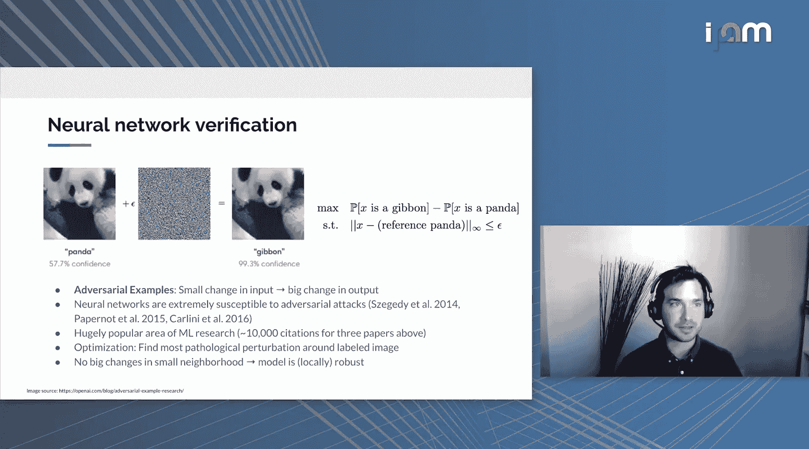

#  008：神经网络验证作为分段线性优化

在本节课中，我们将探讨深度学习中的一个问题，并尝试从运筹学的视角出发，开发新的方法来解决它。这是我们与合著者Ross Bochn、Will Kunll、Christian和Wan Pablo在过去几年中合作完成的一系列论文。

## 分段线性函数简介 🧩

为了确保大家有共同的理解基础，首先描述一下什么是分段线性函数。这是一个相当简单的对象。其核心思想是：将一个函数的定义域划分为若干部分，然后该函数在每个部分上都是线性的，但线性表达式会随着跨越不同的定义域部分而变化。从某种意义上说，这是一个非常简单的函数族，它们具有局部线性的特性，但依然能够表达非常复杂的非线性或非凸行为。

分段线性函数在运筹学的许多场景中出现。事实上，我在博士期间花了大量时间思考如何最好地建模和求解包含分段线性函数的优化问题。在运筹学中，你可能会遇到用分段线性函数来建模某些经济现象，例如收益递减或规模经济。如果你在过程工程或化学工程领域工作，处理物理系统时，可能会混合一些化学物质，它们以非线性方式相互作用，因此很自然地会尝试通过分段线性近似来捕捉这些非线性行为。

在运筹学中，我们常常比较幸运，或者会做出一些建模假设，使得我们能够处理低维或可分离的分段线性函数，这从分析的角度来看非常有利。因此，有长达数十年的研究工作序列，专门开发用于解决这类优化问题的优秀算法，尤其是在这种低维设置下。这里展示的两张图片来自我的博士论文，我花了大量时间思考像左边这样的单变量分段线性函数，以及像右边这样的双变量分段线性函数。这些都是低维的，你可以真正运用多面体理论等工具来理解如何在优化背景下最好地对它们进行建模。

## 深度学习应用：神经网络验证 🔍

以上是关于分段线性函数的一些背景，我们稍后会再回到这个话题。现在，我将介绍我们目标所在的深度学习应用领域：神经网络验证。过去几年的观察发现，你训练出的神经网络可能在样本内和样本外都有很高的准确率，但却并非完全可靠。

神经网络验证的核心问题是：给定一个训练好的神经网络和一个输入区域，我们希望验证在该区域内所有可能的输入下，网络的输出是否都满足某些特定的性质（例如，分类结果始终正确，或输出值保持在某个安全范围内）。这本质上是一个保证神经网络鲁棒性和安全性的问题。

## 将验证问题转化为分段线性优化 🛠️

有趣的是，许多现代神经网络（如使用ReLU激活函数的全连接网络）本身就是分段线性函数。这意味着神经网络的输入-输出映射可以被表示为一个复杂的分段线性函数。因此，神经网络验证问题可以转化为：在一个分段线性函数定义的区域内，寻找其输出的最大值或最小值，以检查是否违反给定的性质约束。

这便将一个深度学习中的验证问题，与运筹学中经典的分段线性优化问题联系了起来。我们可以利用运筹学中为低维分段线性优化开发的成熟理论和算法，尝试解决高维神经网络带来的验证挑战。当然，直接应用传统方法面临维度灾难，但其中的核心思想——如利用函数的分段线性结构、构造松弛边界、进行分支定界搜索——为设计新的、可扩展的验证算法提供了强大的视角和工具。

## 总结 📝

本节课我们一起学习了分段线性函数的基本概念及其在运筹学中的常见性。接着，我们介绍了深度学习中的神经网络验证问题及其重要性。最关键的是，我们看到了如何将神经网络的验证问题重新表述为一个分段线性优化问题，从而搭建起连接深度学习与组合优化这两个领域的桥梁。这种跨学科的视角有助于我们利用运筹学的经典工具，来应对确保现代神经网络安全可靠这一新兴挑战。