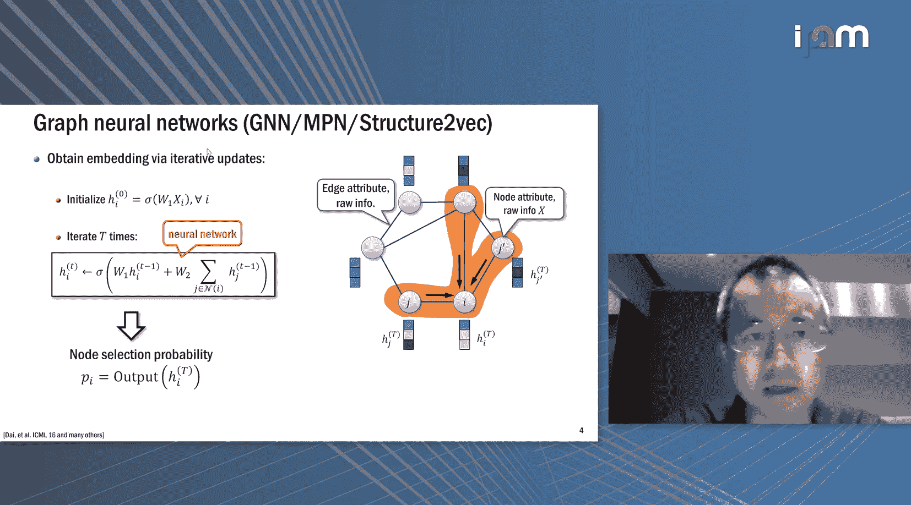

#  010：图算法可微分发现的框架

在本节课中，我们将探讨如何使基于图神经网络解决组合优化问题的方法变得更强大、更具表现力。这项工作是佐治亚理工学院与谷歌大脑及香港中文大学的合作者共同完成的。

## 概述

当我们讨论图上的组合优化问题时，可以发现许多不同的应用场景。无论你从事社交网络、互联网、计算生物学还是智慧城市领域，都能找到图数据。通常，我们需要解决一些基于图的组合优化问题，例如最小顶点覆盖、最小支配集、最大支配集等。本次讲座将以最小顶点覆盖问题作为贯穿始终的示例，但该方法同样适用于其他类型的组合优化问题，如最大团问题等。

## 最小顶点覆盖问题示例

让我们以图上的组合优化问题作为运行示例。在这个特定问题中，我们希望从图中选择一个节点的子集。如果节点被选中，我们将其标记为1。我们的目标是覆盖所有的边，这意味着每条边至少有一个端点被选中。

将其写成一个组合优化问题，形式如下：对于每条边，其两个端点的选择指示器之和必须大于等于1。我们的目标是最小化被选中节点的总数。这个问题虽然简单，但已应用于信息传播等多个不同领域。它是一个简单但属于NP难的问题。

针对此类问题，已经设计了许多启发式或近似算法。最近，出现了一种使用图神经网络来参数化图算法并学习该算法以解决组合优化问题的兴趣。其背后的推理是，这类组合优化问题并非只解决一次，而是需要反复解决。因此，有机会学习一些算法，使其能够适应特定的问题分布，从而可能更好地解决该组合优化问题。

## 什么是图神经网络

上一节我们介绍了最小顶点覆盖问题及其背景。本节中，我们来看看解决此类问题的关键工具——图神经网络。

图神经网络是一种专门用于处理图结构数据的神经网络。它通过学习图中节点和边的特征表示，能够捕获图的拓扑结构和节点属性信息。在图算法中，GNN可以用来学习节点的嵌入表示，这些表示可以用于后续的决策过程，例如判断一个节点是否应该被选入顶点覆盖集。

## 总结

本节课中，我们一起学习了如何利用图神经网络框架来增强解决组合优化问题的能力。我们以最小顶点覆盖问题为例，介绍了问题的定义、应用背景以及引入图神经网络的基本动机。理解这个框架是探索更强大、更具表现力的可学习图算法的基础。