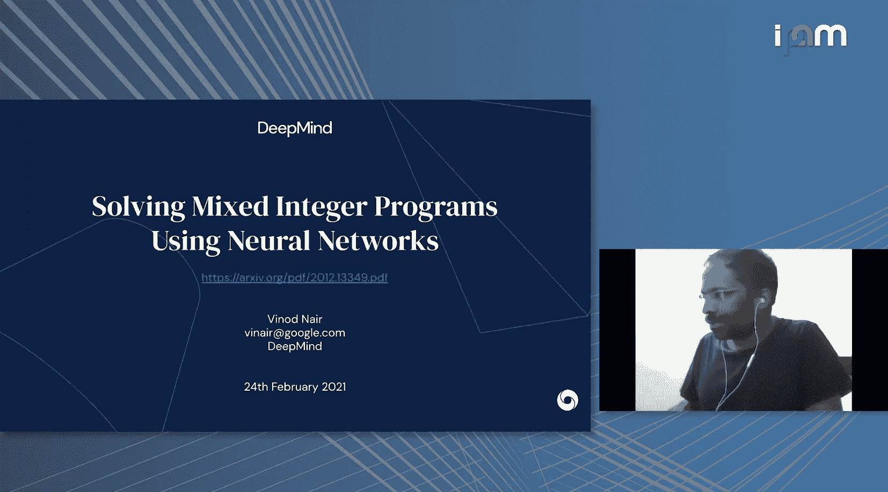
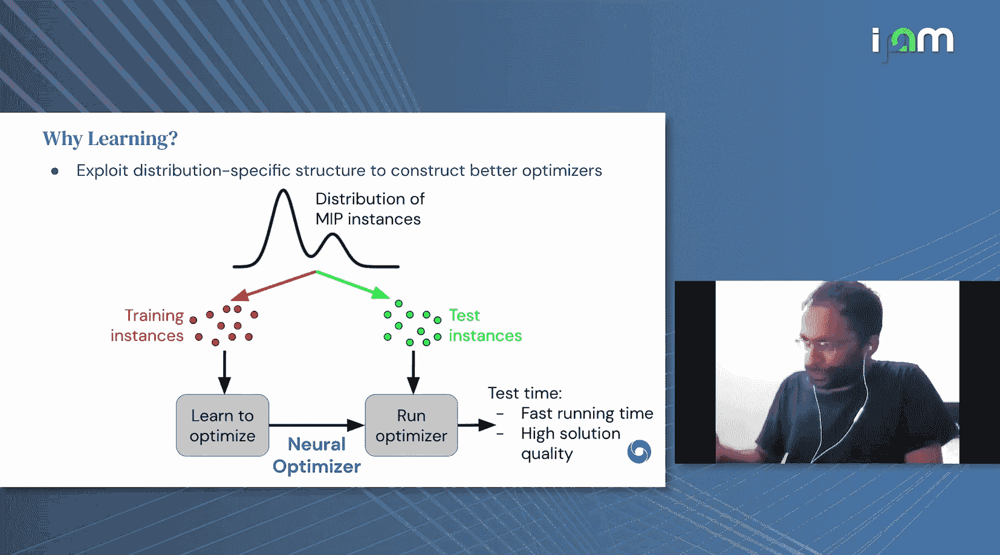

#  012：使用神经网络求解混合整数规划

在本节课中，我们将学习如何利用深度学习技术来求解混合整数规划问题。混合整数规划是运筹学中的核心问题，广泛应用于物流、调度、资源分配等领域。我们将探讨传统求解器的局限性，以及神经网络如何通过学习问题结构来辅助求解过程。

---

## 背景介绍：什么是混合整数规划？

上一节我们介绍了组合优化的基本概念，本节中我们来看看一个具体且重要的问题——混合整数规划。

混合整数规划是一种优化问题，其目标是在满足一系列线性约束的条件下，优化一个线性目标函数。问题的决策变量可以同时包含整数和连续变量。

其标准形式可以用以下公式描述：

**目标函数：** `minimize c^T x`
**约束条件：** `Ax ≤ b`
**变量要求：** `x_i ∈ Z` （部分或全部变量为整数）

其中，`c` 和 `b` 是向量，`A` 是矩阵，`x` 是决策变量向量。如果忽略变量的整数约束，问题就变成了一个可以在多项式时间内求解的线性规划。然而，整数约束的引入使得问题变成了NP难问题，求解变得非常困难。

尽管如此，MIP因其在线性框架下强大的表达能力，在工业界有着极其广泛的应用。

---

## 动机：为何引入深度学习？

既然已有众多成熟且高效的商业或开源求解器，为何还要探索深度学习的方法呢？

核心思想在于，尽管通用求解器非常强大，但它们在求解每个具体问题时，仍然需要进行大量耗时的搜索和计算。深度学习有可能通过学习大量同类问题实例中隐含的结构和模式，来预测更优的搜索策略或初始解，从而加速整个求解过程。

以下是深度学习可能带来帮助的几个方面：
*   **加速搜索：** 预测分支定界法中更有效的分支变量。
*   **生成初始解：** 为求解器提供一个高质量的起点，减少迭代次数。
*   **学习启发式规则：** 自动发现针对特定问题类别的有效启发式方法。

我们的目标是探索学习技术能否在现有求解器已经取得的惊人成就基础上，带来进一步的提升。

---

## 方法概述：神经网络如何与求解器结合？

这项工作是与DeepMind和Google Research的同事们共同完成的。我们提出了一种将神经网络与传统MIP求解器相结合的方法。

具体而言，我们设计了一个神经网络模型，其输入是MIP问题的实例数据（如约束矩阵`A`、目标向量`c`、约束向量`b`）。模型经过训练后，能够输出对求解过程有益的指导信息，例如变量在最优解中取值的概率分布。

模型架构通常采用图神经网络，因为MIP问题可以自然地表示为一个二分图：一边是变量节点，另一边是约束节点，边表示变量在约束中的系数。

训练数据来源于大量历史问题实例及其最优解（或高质量解）。通过监督学习，模型学习从问题特征到解决方案的映射。

---

## 总结

本节课中我们一起学习了使用神经网络求解混合整数规划的基本思路。我们首先回顾了MIP问题的定义及其挑战，然后探讨了引入深度学习的动机——即通过学习问题结构来增强传统求解器。最后，我们概述了将神经网络与MIP求解器结合的一般方法。

这项研究展示了机器学习与运筹学交叉领域的巨大潜力。通过利用数据驱动的方法，我们有望为那些计算成本高昂的经典优化问题开发出更高效的解决方案。如需了解更详细的技术细节和实验结果，请参阅相关的学术论文。