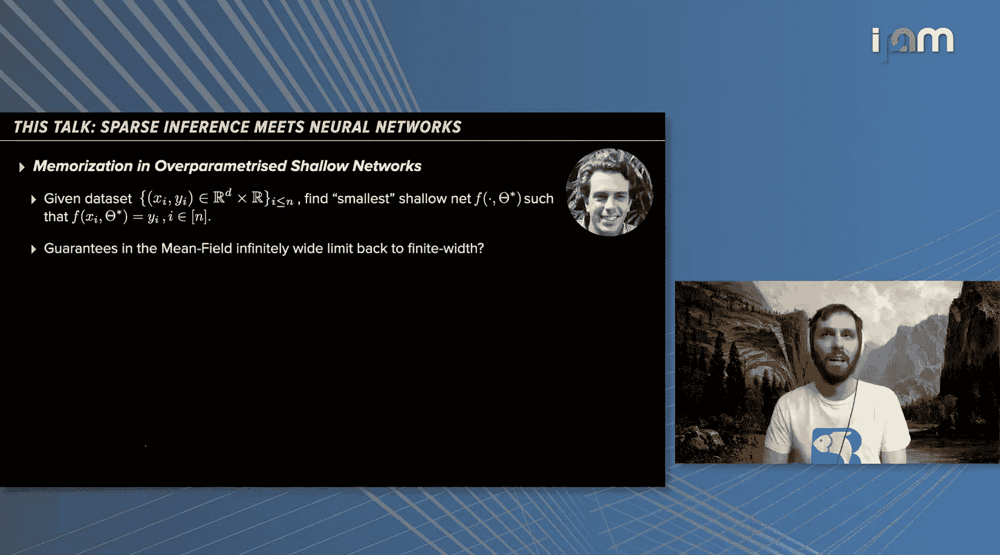

#  013：论稀疏线性规划与（简单）神经网络


## 概述
在本节课程中，我们将探讨稀疏线性恢复问题，并分析其与简单神经网络模型之间的内在联系。我们将看到，这个看似“枯燥”的组合优化子类，如何反过来帮助我们理解深度学习中的某些核心问题。

## 从稀疏线性恢复问题谈起
上一节我们了解了深度学习在组合优化中的多种应用。本节中，我们来看看一个非常具体的组合优化问题：稀疏线性恢复。

该问题的核心是：给定一个欠定的线性方程组 **y = Ax**，我们能否利用关于解 **x** 的额外假设（通常是稀疏性）来恢复它？这个框架包含了多个具有代表性的NP难问题，并在统计学、应用数学等领域极具影响力。

以下是该问题的标准形式：
```
给定 y 和 A，求解 x，使得 y = Ax，且 x 尽可能稀疏。
```

## 松弛方法与几何洞察
解决上述NP难问题的一个强大工具是凸松弛。具体来说，我们将衡量稀疏性的 **L0 范数**（非零元素个数）替换为凸的 **L1 范数**（绝对值之和）。

这个松弛之所以有效，背后有深刻的几何原理。L1范数最小化倾向于产生稀疏解，这为设计高效算法打开了大门。Candes、Romberg、Tao和Donoho等人的开创性工作，建立了一套完善的理论，用以阐明这种松弛在何时是有效的。

## 与神经网络的联系
现在，让我们将视线转向神经网络。稀疏线性恢复问题如何帮助我们理解神经网络呢？

一个有趣的视角来自神经科学，例如Bruno Olshausen和David Field的工作。他们发现，稀疏编码模型可以解释初级视觉皮层中简单细胞感受野的形成。这提示我们，追求稀疏性的优化过程，可能与神经网络学习到的表示有根本联系。

简而言之，研究这个“简单”的组合优化问题，或许能为我们理解深度学习模型为何有效、以及它们学习了什么，提供新的几何与优化理论基础。



## 总结
本节课我们一起学习了稀疏线性恢复这一组合优化问题。我们介绍了其基本形式，探讨了通过L1范数进行凸松弛的核心思想及其几何意义。最后，我们看到了该问题与神经网络，特别是在解释学习表示方面，存在的深刻联系。这为我们从优化理论的角度理解深度学习打开了一扇窗。