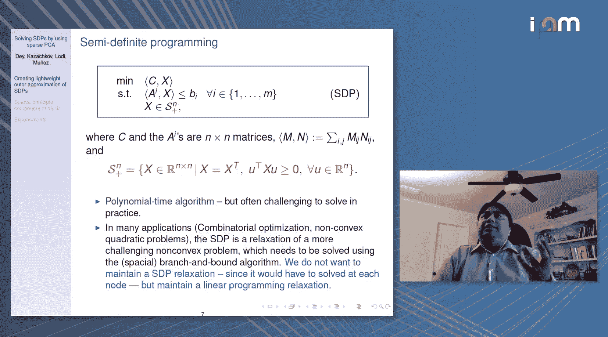

#  015：利用稀疏主成分分析求解半定规划

在本节课中，我们将学习如何利用来自统计学和机器学习领域的稀疏主成分分析技术，来高效求解大规模半定规划问题。我们将看到，跨领域的技术迁移不仅发生在数学层面，也发生在计算层面，为解决传统优化求解器的规模瓶颈提供了新思路。

## 概述

半定规划是一类重要的凸优化问题，在组合优化等领域有广泛应用。然而，通用求解器在处理大规模问题时面临计算挑战。本节将介绍一种新颖方法，通过借鉴稀疏主成分分析的思想来突破这一瓶颈。

## 半定规划简介

上一节我们介绍了组合优化问题的背景，本节中我们来看看半定规划的标准形式。

SDP问题通常表述如下：我们有一个矩阵变量 **X**（在本讲座中，所有矩阵均默认为对称矩阵），一个线性目标函数，以及一组线性约束。同时，矩阵 **X** 需要是半正定的。

其数学形式可概括为：
*   目标：最小化 **C • X**（矩阵内积）
*   约束：**A_i • X = b_i**，对于 i = 1, ..., m
*   并且 **X ≽ 0**（即 **X** 为半正定矩阵）

半正定矩阵有多个等价刻画，例如其所有特征值非负，或对于任意向量 **z**，其二次型 **z^T X z** 非负。

理论上，凸优化理论保证半定规划可以在多项式时间内求解。但在实际计算中，当矩阵维度 **n**（即行数或列数）达到100左右时，即使是商业求解器也会开始感到吃力。除非问题具有特殊结构，否则求解更大规模的问题一直是个挑战。

## 动机与核心思路

了解了SDP的挑战后，我们自然会问：如何突破这个规模限制？本节将介绍我们研究工作的核心动机。

我们感兴趣的是开发能够解决更大规模SDP问题的方法。这项工作的一个关键联系在于，虽然本次讲座不涉及太多“学习”成分，但它展示了如何将一个领域（如统计学中的稀疏主成分分析）的技术，应用到另一个领域（如优化中的半定规划求解），这种迁移不仅发生在数学层面，也发生在计算层面。

## 方法：从稀疏PCA到SDP求解

那么，具体如何将稀疏主成分分析的思想用于求解SDP呢？以下是该方法的核心步骤。

稀疏主成分分析旨在寻找具有少量非零元素的特征向量，这通常涉及一个带有基数约束的优化问题。我们的核心洞察是，某些大规模SDP问题的解矩阵具有低秩或稀疏结构。通过主动寻找具有稀疏支撑集的解，我们可以将原SDP问题转化为一个规模更小、更易处理的问题。

以下是实现这一过程的关键环节：
1.  **问题重构**：将原SDP问题重新表述，显式地引入对解矩阵稀疏性或低秩性的追求。
2.  **算法设计**：设计迭代算法，在每一步固定一个稀疏的支撑集，然后在缩小的子空间内求解一个较小的SDP子问题。
3.  **支撑集更新**：根据当前解的信息，更新稀疏支撑集，例如利用梯度信息或残差。
4.  **收敛求解**：重复上述步骤，直至满足收敛条件，得到原问题的一个近似解。

这种方法的核心优势在于，它通过解决一系列小规模的子问题来逼近大规模原问题的解，从而规避了直接求解大规模SDP的计算负担。

## 总结

本节课中，我们一起学习了如何利用稀疏主成分分析的技术来求解大规模半定规划问题。我们回顾了SDP的基本形式及其计算挑战，介绍了跨领域技术迁移的动机，并详细阐述了通过寻找稀疏解来降低问题规模的核心方法。这项工作表明，结合机器学习与优化领域的思想，能够为解决经典的计算难题开辟新的有效途径。