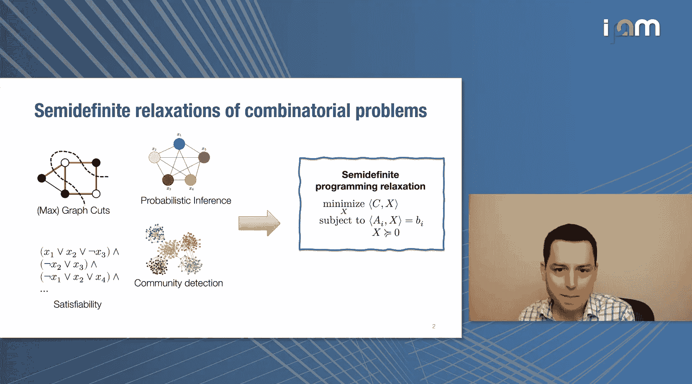

#  019：用于（可微分）组合优化的快速半定规划

## 概述
在本节课中，我们将探讨如何将半定规划松弛技术应用于组合优化问题，并重点介绍如何使其适应现代可微分学习架构。我们将从半定松弛的基本概念开始，逐步深入到其高效求解方法及其与深度学习的结合。

## 半定规划松弛简介
上一节我们概述了课程主题，本节中我们来看看半定规划松弛的基本思想。组合优化问题，如图割、推理、可满足性等，都是在离散结构上进行推理的问题。众所周知，这些问题都可以通过半定规划进行松弛求解。

半定规划是一种优化技术，其经典形式是**最小化矩阵X的某个线性函数**，并满足一系列关于X的等式、不等式约束以及一个半定约束（即X是半正定矩阵）。通过这种方式，我们可以将离散的组合问题嵌入到一个连续的向量空间中，从而利用连续优化技术进行求解。

## 半定规划的核心形式
以下是半定规划问题的标准数学描述：

**目标**：最小化线性函数 `C • X`（即矩阵C和X的内积）。
**约束**：
1.  对于所有 `i`，有 `A_i • X = b_i`（线性等式约束）。
2.  `X ≽ 0`（半定约束，表示矩阵X是半正定的）。

这个框架的强大之处在于，许多NP难的组合优化问题都可以被松弛为这种形式的半定规划问题，从而得到原问题最优解的一个近似下界（对于最小化问题）或上界（对于最大化问题）。

## 快速求解与可微分性
传统的半定规划求解器可能计算量较大。为了使半定松弛能够高效地集成到基于梯度的深度学习模型中，我们需要解决两个关键问题：求解速度和计算图的可微分性。

我们的工作重点在于开发快速的、可微分的半定规划求解方法。这使我们能够将组合推理层作为神经网络的一部分进行端到端训练。以下是实现这一目标的几个核心思路：

1.  **使用一阶优化方法**：我们采用基于梯度的优化算法（如投影梯度下降）来求解半定规划问题，这比传统的内点法更快，更适合处理大规模问题。
2.  **保证可微分性**：通过设计特定的求解流程，确保从问题参数（如系数矩阵C）到解矩阵X的映射是连续且可微的，从而允许梯度反向传播。
3.  **利用问题结构**：针对特定的组合问题（如最大割），我们可以利用其半定松弛的特殊结构来设计更高效的定制化算法。

## 总结
本节课中，我们一起学习了半定规划松弛在组合优化中的应用。我们首先介绍了半定规划如何为离散组合问题提供连续松弛。接着，我们探讨了为了将此类松弛整合进深度学习管道，所需解决的快速求解与可微分性挑战。通过采用一阶优化方法并精心设计求解器，我们可以创建高效且可微的组合优化层，从而为神经模型注入复杂的推理能力。