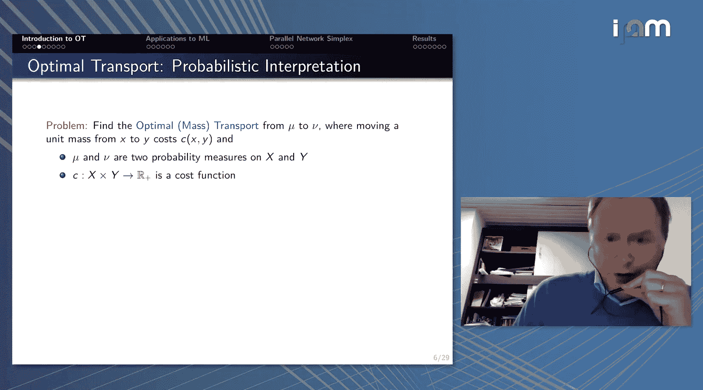

#  020：通过并行网络单纯形法进行离散最优传输

在本节课中，我们将从组合优化的视角介绍最优传输问题，并探讨如何利用并行网络单纯形法，特别是GPU加速，来解决该问题。我们将回顾最优传输的历史与数学基础，并展示其在机器学习中的应用潜力。

## 最优传输简介：从蒙日到康托洛维奇

上一节我们概述了课程内容，本节中我们来看看最优传输问题的起源与发展。

最优传输是一个古老的问题，由蒙日在其原始论文中提出，他讨论了分子分布的移动问题，即如何将分子从一个给定的初始形状移动到目标形状。如今，当我们谈论最优传输时，通常指的是概率分布的传输。

蒙日的原始问题可以被表述为一个组合优化问题。

具体来说，它可以被表述为一个指派问题，该问题可以在二分图上通过流算法在强多项式时间内求解，其复杂度为 **O(n³)**。

从蒙日之后，康托洛维奇做出了极其重要的贡献。他不仅是线性规划对偶理论的发明者，也是引入传输度量的研究者。如今，康托洛维奇度量已成为基础度量。康托洛维奇的原始工作受到资源优化问题应用的启发，并以俄文写成。

在组合优化术语中，康托洛维奇问题的表述与蒙日不同，因为我们从指派问题转向了运输问题，其强多项式复杂度在二分图上上升至 **O(n³ log n)**。这是一个重要的区别。

## 网络单纯形法在机器学习中的应用

上一节我们回顾了最优传输的数学基础，本节中我们来看看网络单纯形法在机器学习中的潜在应用。

我将提前介绍网络单纯形法在机器学习中的应用。

## 并行网络单纯形法的技术描述

上一节我们提到了应用前景，本节中我们将深入探讨一种可能的技术实现。

现在，我将转向对一个可能的并行网络单纯形法实现进行简要的技术描述，该实现试图利用GPU进行计算。

## 计算结果展示

以下是部分计算结果的展示。

本节课中，我们一起学习了最优传输问题从蒙日到康托洛维奇的发展历程，理解了其作为组合优化问题的数学表述（如复杂度为 **O(n³)** 的指派问题）。我们还探讨了网络单纯形法在机器学习中的应用潜力，并简要介绍了一种旨在利用GPU加速的并行网络单纯形法实现。最后，我们预览了相关的计算结果。