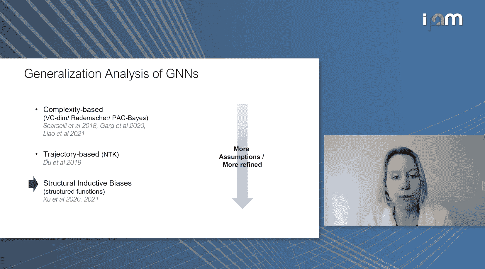

#  022：图神经网络中的任务结构与泛化

在本节课中，我们将探讨图神经网络在算法推理任务中的泛化与泛化外推能力。我们将从理解这些特性的角度出发，分析网络架构与任务结构如何影响其学习效果。

感谢Pe的介绍，也感谢大家的聆听和本次研讨会的邀请。我很荣幸能在此发言，并享受之前的精彩报告。今天，我想从理解特性的角度，讨论图神经网络的泛化与外推能力。这是与我的多位合作者，特别是我的学生Qulu，共同完成的工作。

本次报告的主题是算法推理。算法推理是什么？在之前的报告中我们已经有所了解，其本质是让神经网络学习一个完整的优化算法。可能出现的、你试图学习回答的问题包括：给定一组物品，找出颜色最不相似的一对物体；在物理推理中，预测物理系统的下一个状态；或者计算诸如最短路径之类的问题。

在所有这些任务中，你本质上都是给定一个由某些物品构成的集合，这些物品以某种方式相互作用。首先，你需要感知这些物品，并将它们编码为特征向量。然后，你试图对这些物品进行推理并回答问题。

这本质上与Peter在周二报告的内容相似。但与他的报告不同，今天我将聚焦于这个流程的第二部分，试图理解如何学习这种推理。我将假设我们已经完成了感知步骤，并且已经以特征向量（例如颜色、位置等）的形式编码了我们的对象。我们只是试图学习如何回答问题，因此本质上我们只是在学习算法。

我想理解的是，不同的神经网络学习这种推理任务的效果如何，以及它们为何能或不能做到。这本质上是一个关于泛化的问题。我将从两个不同的部分来审视它：第一部分是观察标准的泛化方式，即给定训练分布，观察来自同一分布的数据，并将泛化性能与架构结构及任务结构联系起来。在报告的第二部分，我将进一步探讨外推，即现在你看到的数据来自不同的分布。你的方法还能否有效？这取决于什么？

让我们从泛化开始。由于图神经网络将在此扮演重要角色，让我快速回顾一下什么是图神经网络。

