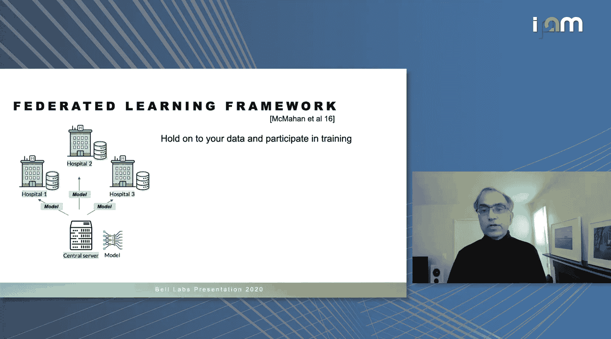

#  025：隐私保护下的深度学习

## 概述

在本节课中，我们将探讨一个核心问题：如何在保护数据隐私的前提下进行深度学习。我们将介绍一种名为“Inhe”的方法，它允许在不泄露原始数据的情况下训练深度神经网络。课程将涵盖其应用场景、技术背景以及联邦学习的基本框架。

---

## 引言与背景

感谢邀请，很高兴能在本次研讨会上发言。

我过去的研究领域是组合算法或组合优化，特别是在NPR问题的背景下。近十年来，我的兴趣转向了深度学习和其他机器学习技术。

本次演讲的主题是“Inhe”，这是一种允许在您的数据上进行深度学习而无需泄露数据本身的想法。

这项工作是与我指导的研究生杨希博、博士后赵宗、同事Kaaili共同完成的。此外，还有一篇关于“textt”的第二篇论文，由同一团队以及另一位同事Don Qhenhen共同参与。

## 问题：隐私与效用的权衡

当今互联世界的运行建立在一项默认的交易之上。

我们将自己的数据提供给企业，作为回报，我们获得了经过训练并为我们量身定制的智能设备世界。

但我们不禁要问，这种现状是必然的吗？

我们需要认识到，智能世界越来越依赖于大型深度网络，这些网络使用某种形式的反向传播算法，在我们的数据上进行训练和定制。

从现在开始，这个勤劳的蓝色小图标将代表标准的深度网络训练过程。

这引出了我们看似矛盾的问题：**能否在不让我们泄露数据的情况下，对我们的数据进行深度学习？**

如果答案是肯定的，那么这里有一些应用场景：
*   医院希望利用患者数据训练深度网络，但隐私法禁止他们将数据交给他人。
*   用户群体可能希望使用他们的聊天记录来定制Gbo，而不泄露这些聊天内容。
*   更广泛地说，上述问题的解决方案将开始从根本上改变当今大型科技公司所依赖的关于隐私与效用权衡的隐含假设。

## 两种不同的应用场景

在这个领域，需要注意两种不同的设置：

1.  **计算能力强大的客户端场景**：例如医院，它们使用私有数据在中央服务器上协作训练一个深度网络。
2.  **大量轻量级设备场景**：例如物联网设备，它们将用户数据发送到中央服务器，以进行深度学习，实现所有用户都将受益的目标。

我们将主要解决第一种设置，但该解决方案也适用于第二种设置，尽管对于第二种设置可能没有那么安全。

## 联邦学习框架

联邦学习是思考此类问题的一个框架，尤其适用于我们的第一个示例场景。

我们的运行示例将是：医院试图在不泄露患者数据的情况下训练一个深度网络。

---

## 总结

本节课中，我们一起学习了在隐私保护下进行深度学习的核心挑战与前景。我们探讨了“Inhe”方法的基本概念，分析了数据隐私与模型效用之间的权衡问题，并介绍了适用于不同场景的联邦学习框架。理解这些基础，是迈向构建既强大又尊重用户隐私的下一代人工智能系统的第一步。