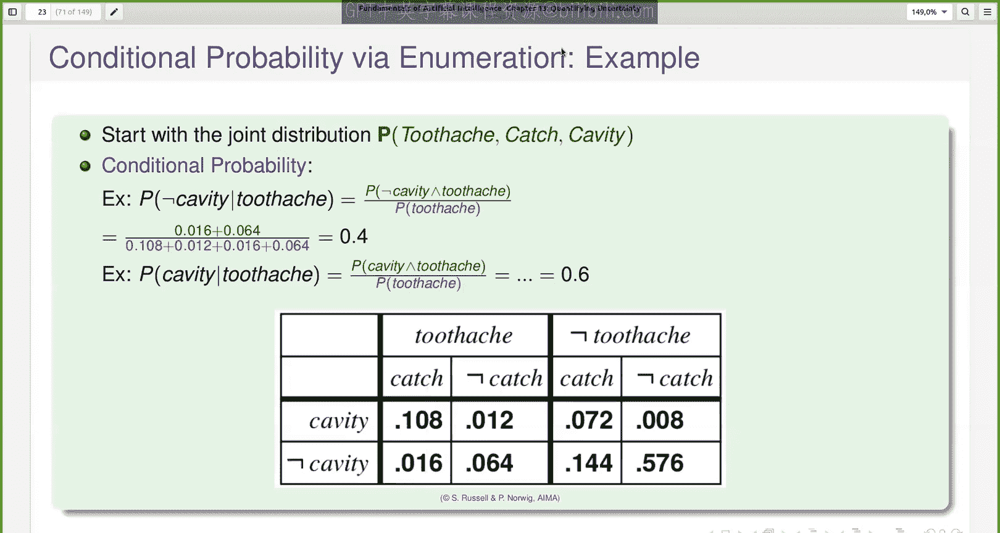

#  002：概率推理入门 🎲

在本节课中，我们将要学习概率推理的基本概念。概率论是人工智能中处理不确定性的核心数学工具。当智能体（无论是人工的还是自然的）面临信息不完整的情况时，它无法做出100%确定的决策，此时就需要借助概率来量化我们对不同结果的“信念程度”。

## 为什么需要概率？🤔

上一节我们介绍了课程概述，本节中我们来看看为什么在人工智能中需要概率推理。

智能体在决策时，常常无法获得完整信息。因此，它必须在不确定性下进行推理。你无法保证某个行动一定会成功，但可以给出该行动成功可能性的“信念度”。数学上，我们使用**概率论**来形式化这种“信念度”。

一个理性的决策，既取决于我们想要实现的目标的相对重要性（收益或成本规避），也取决于我们实现该目标的可能性。这本质上是成本与收益之间的权衡。科学为我们提供的、用来表示这种“信念度”或“可能性”概念的明显工具就是概率论。

## 一个经典例子：赶飞机 ✈️

以下是关于如何应用概率进行决策的一个具体例子。

假设你需要从旧金山开车去机场。这里存在许多不确定性来源：交通状况、其他司机的行为、车辆可能出问题等。虽然你可以查看地图应用，但这并非100%可靠。预测交通非常复杂，很难用纯粹的确定性（逻辑）方法处理，通常需要基于经验的启发式方法，并以概率来思考。

*   **行动A25**：提前25分钟出发。这相当冒险，即使你认为25分钟通常足够到达机场。你可能遇到事故、堵车、找不到停车位等问题。
*   **行动A90**：提前90分钟出发。这看起来更合理。
*   **行动A120**：提前2小时出发。你有很高的概率（例如95%）达成目标。
*   **行动A1000**：提前1000分钟（超过16小时）出发。这近乎是确定的，但完全不切实际（例如需要在机场过夜）。

那么，应该选择哪个行动？这通常取决于成本与收益的权衡。

## 另一个例子：诊断问题 🩺

诊断问题是概率推理的另一个典型应用场景。

诊断问题的关键在于，给定一系列症状，试图找出最可能的原因。尝试用纯逻辑（例如布尔逻辑）来表示这类问题非常困难且存在缺陷。

*   **逻辑表示的局限性**：例如，“牙痛意味着有蛀牙”这个逻辑蕴含（`Toothache ⇒ Cavity`）并不总是成立，因为牙痛可能由许多其他原因引起（牙龈问题、脓肿等）。反之，“蛀牙意味着牙痛”（`Cavity ⇒ Toothache`）也不一定成立，可能蛀牙很大了才会痛。
*   **缺点**：试图用确定性逻辑规则来表示存在复杂性高、可能原因太多、缺乏对领域的完整理论、对特定患者信息了解不全等问题。

因此，使用概率来处理不确定性是一个很好的理由。我们试图找出对某个陈述（如一个可能的诊断）的置信度或可能性。

## 概率的来源与条件概率 📊

概率论本身是一个数学理论。我们通常从统计数据和领域经验中获取概率信息。

*   **统计与经验**：例如，医生从大量病例统计中知道，80%的牙痛病例是由蛀牙引起的。我们可以将此视为概率P(蛀牙 | 牙痛) = 0.8。统计数据越多，对真实概率的近似就越可靠。医生的经验也常常以启发式的方式量化这种可能性。
*   **条件概率**：概率通常不是绝对的，而是基于某些已知信息（证据）。我们用 **P(A | B)** 表示在已知B发生的情况下，A发生的概率。例如，P(蛀牙 | 牙痛) = 0.8。
*   **证据的重要性**：概率会随着新证据的出现而改变。例如，P(蛀牙 | 牙痛) 可能较高，但 P(蛀牙 | 牙痛 且 有长期牙龈病史) 可能就低得多，因为牙痛更可能是牙龈问题引起的。这就是为什么向医生提供完整信息至关重要。

## 基于概率的决策与效用函数 ⚖️

那么，如何基于概率做出决策呢？这通常是一个妥协和权衡的过程。

决策取决于不同结果的可能性，以及每个结果带来的成本或收益。我们使用**效用函数**来量化收益或成本。一个理性的智能体会选择能带来**最大期望效用**的行动，即对所有可能结果的效用按其概率进行加权平均。

但需要注意的是，效用函数并非总是线性的。例如，金钱的效用通常不是线性的：对大多数人来说，从0美元到100万美元的效用提升，远大于从100万美元到200万美元的效用提升。因此，在计算期望收益时需要谨慎。

## 概率论基础回顾 📚

由于概率推理建立在概率论基础上，我们接下来回顾一些核心概念。如果你已经熟悉，可以快速浏览。

*   **样本空间与事件**：样本空间 Ω 是所有可能世界状态（与我们问题相关的部分）的集合。一个样本点 ω 是一个可能的世界（原子事件）。事件是样本空间的任意子集，表示我们感兴趣的某些特征的组合。
*   **概率模型**：概率模型为样本空间中的每个可能结果分配一个概率值。概率是介于0和1之间的数，且所有可能结果的概率之和为1。例如，一个均匀的骰子，每个面朝上的概率是 1/6。
*   **随机变量**：随机变量为可能世界（或事件）的某个特征提供抽象描述。随机变量有一个定义域（可能取值的集合），并关联一个**概率分布**，为其每个可能取值指定概率。例如，`Weather` 变量可能取值 {sunny, rain, cloudy}，其分布 P(Weather) = <0.6, 0.1, 0.3>。
*   **联合概率分布**：多个随机变量的联合概率分布为每个可能的取值组合指定一个概率。例如，P(Weather, Cavity) 是一个表格。联合分布的规模会随着变量数量指数级增长，这是概率推理中的一个主要挑战。

## 条件概率与链式法则 🔗

条件概率是概率推理中极其重要的概念。

*   **定义**：在事件B发生的前提下，事件A发生的条件概率定义为：**P(A | B) = P(A ∧ B) / P(B)**，要求 P(B) > 0。这可以理解为将样本空间缩小到B发生的情形，然后看其中A也发生的比例。
*   **乘积形式**：上述定义可改写为 **P(A ∧ B) = P(A | B) P(B)**。这对联合分布也成立：**P(X, Y) = P(X | Y) P(Y)**，注意这是元素级的乘积，而非矩阵乘法。
*   **链式法则**：链式法则是乘积规则的推广。对于任意一组随机变量 X1, X2, ..., Xn，其联合分布可以分解为一系列条件概率的乘积：
    **P(X1, X2, ..., Xn) = P(X1) * P(X2 | X1) * P(X3 | X1, X2) * ... * P(Xn | X1, ..., Xn-1)**
    变量顺序可以任意选择。链式法则本身没有降低复杂度，但如果某些变量在给定其他变量时条件独立，就能大幅简化计算。这是贝叶斯网络的基础。

## 概率推理：枚举与边缘化 🧮

给定概率信息后，我们如何进行推理和计算呢？我们从最基本的方法开始。

*   **枚举法**：最直接的方法是枚举。对于一个命题，计算其概率的方法是：对所有使该命题为真的原子事件（样本点）的概率求和。例如，从联合分布表 P(Toothache, Catch, Cavity) 中计算 P(Toothache ∨ Cavity)，就是将表中所有 Toothache=true 或 Cavity=true 对应的概率值相加。
*   **边缘化**：边缘化（或求和消元）是另一个基本操作。当我们想从联合分布中得到部分变量的概率分布时，需要对其他变量求和。例如，从 P(Toothache, Catch, Cavity) 得到 P(Toothache)，需要对 Catch 和 Cavity 的所有可能取值组合求和：**P(Toothache) = Σ_{catch} Σ_{cavity} P(Toothache, catch, cavity)**。
*   **条件概率计算**：利用边缘化，我们可以计算条件概率。例如，计算 P(Cavity | Toothache)：
    1.  用边缘化计算分子：P(Cavity ∧ Toothache) = Σ_{catch} P(Cavity, Toothache, catch)
    2.  用边缘化计算分母：P(Toothache) = Σ_{catch} Σ_{cavity} P(Toothache, catch, cavity)
    3.  代入公式：P(Cavity | Toothache) = P(Cavity ∧ Toothache) / P(Toothache)

## 总结 📝

本节课中我们一起学习了概率推理的基本动机和核心概念。我们了解到，智能体在信息不完全时必须处理不确定性，而概率论是量化这种不确定性的数学工具。我们通过赶飞机和医疗诊断的例子看到了概率的应用场景。我们回顾了概率论的基础，包括样本空间、随机变量、概率分布，并重点学习了条件概率的定义、乘积形式和链式法则。最后，我们介绍了两种基本的概率推理方法：枚举法和边缘化。这些概念是后续学习更高效的概率推理模型（如贝叶斯网络）的基石。