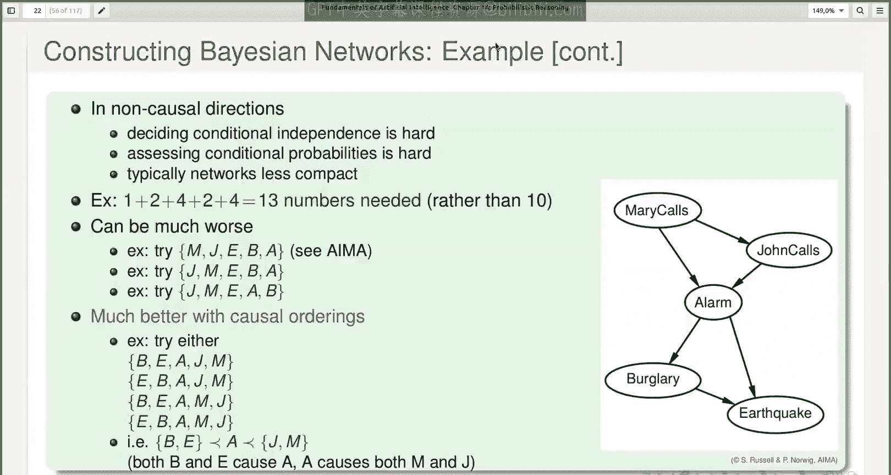

#  004：贝叶斯网络

在本节课中，我们将要学习概率推理的核心工具——贝叶斯网络。我们将探讨其基本定义、全局与局部语义、关键性质，并了解如何构建贝叶斯网络模型。

## 概述

贝叶斯网络是一种用于表示随机变量间依赖关系的图模型。它通过有向无环图（DAG）来编码变量间的条件独立性，从而能够紧凑地表示复杂的联合概率分布。本节课我们将学习其基本概念、语义解释以及建模方法。

## 贝叶斯网络的定义

贝叶斯网络本质上是一个有向无环图。图中每个节点代表一个随机变量（可以是离散的或连续的，本章主要讨论离散变量，尤其是二元变量，这主要是为了方便举例）。节点之间的有向边连接成对的变量。

按照惯例，我们采用自上而下的绘图方式，即父节点位于子节点之上。如果存在一条从节点 X 指向节点 Y 的有向边，则称 X 是 Y 的父节点。

除了图结构，每个节点 X 还关联着一个条件概率分布：**P(X | Parents(X))**。这个分布量化了在给定其父节点取值的情况下，该节点取各个值的概率。如果一个节点没有父节点，则其关联的是一个先验概率分布 **P(X)**。

条件概率分布通常以条件概率表（CPT）的形式给出。对于二元变量，CPT列出了在父节点取值的每一种可能组合下，该节点为“真”的概率。为“假”的概率可以通过互补（1 - P(True)）得到。

贝叶斯网络的关键在于，它显式地表示了变量间的条件依赖关系。通常，一条从 X 指向 Y 的边意味着 X 对 Y 有直接的因果影响。

## 一个运行示例

我们将使用一个经典的“盗窃-地震-警报”例子作为贯穿本章的运行示例。该场景包含五个二元变量：
*   **Burglary (B)**: 入室盗窃发生。
*   **Earthquake (E)**: 发生地震。
*   **Alarm (A)**: 警报响起。
*   **JohnCalls (J)**: John打电话报警。
*   **MaryCalls (M)**: Mary打电话报警。

其网络结构如下图所示，反映了因果知识：盗窃和地震可能直接导致警报响起，而警报响起可能导致John和Mary打电话。

每个节点的CPT提供了具体的概率数值。例如：
*   **P(B = true) = 0.001**, **P(E = true) = 0.002**
*   **P(A = true | B=true, E=true) = 0.95**
*   **P(J = true | A=true) = 0.90**, **P(J = true | A=false) = 0.05**
*   **P(M = true | A=true) = 0.70**, **P(M = true | A=false) = 0.01**

## 全局语义

上一节我们介绍了贝叶斯网络的结构化表示，本节中我们来看看如何从整体上理解其含义。全局语义揭示了贝叶斯网络如何完整地定义整个系统的联合概率分布。

贝叶斯网络提供了一个非常紧凑的联合概率分布表示方法。其核心优势在于，它利用了“每个变量只直接依赖于有限数量的其他变量”这一观察结果，从而避免了显式列出所有变量组合的指数级开销。

设网络中有 n 个变量，每个变量最多有 k 个父节点。完整网络所需指定的参数数量上界为 **n * 2^k**。相比之下，显式表示整个联合分布需要 **2^n** 个参数。当 n 很大而 k 较小时（这是常见情况），这种从指数级到近似线性的压缩是巨大的。

全局语义指出，贝叶斯网络所定义的完整联合概率分布，等于所有节点条件概率分布的乘积：

**P(X1, X2, ..., Xn) = Π_i P(Xi | Parents(Xi))**

这个等式的成立基于链式法则以及对变量进行一种特殊的排序：任何满足“父节点出现在子节点之前”的全序排列。在这种排序下应用链式法则，并利用贝叶斯网络所蕴含的条件独立性（即每个变量在给定其父节点时，条件独立于其所有非后代节点），就可以推导出上述乘积形式。

让我们通过一个计算示例来理解。假设我们想计算概率 **P(J=true, M=true, A=true, B=false, E=false)**。

根据全局语义的乘积公式，我们有：
**P(j, m, a, ¬b, ¬e) = P(j|a) * P(m|a) * P(a|¬b,¬e) * P(¬b) * P(¬e)**

代入示例中的CPT数值：
= 0.90 * 0.70 * 0.001 * 0.999 * 0.998
≈ 一个非常小的数值

这个计算表明，我们可以利用网络结构高效地计算联合分布中的任一项。虽然我们通常不会显式计算整个联合分布表，但这个性质保证了贝叶斯网络是完整概率模型的有效表示。

## 局部语义与条件独立性

理解了全局视角后，我们来看看贝叶斯网络局部性质。局部语义揭示了网络中单个变量与其邻居之间的条件独立关系，这对于高效推理至关重要。

局部语义指出，在贝叶斯网络中，**给定其父节点，任意节点 X 条件独立于其所有非后代节点**。非后代节点包括除了其子孙（孩子、孩子的孩子等）之外的所有其他节点。

这意味着，在评估一个节点的概率时，如果不知道其子孙的信息，那么只需要关注其父节点的状态即可。子孙的信息可以通过贝叶斯规则反向影响该节点，但那是另一种情况。

另一个重要的局部性质是**马尔可夫毯**。一个节点 X 的马尔可夫毯包括：其父节点、其子节点、其子节点的其他父节点。性质指出：**给定其马尔可夫毯，节点 X 条件独立于网络中所有其他节点**。

马尔可夫毯构成了节点 X 的一个“隔离层”，一旦知道了毯内所有变量的值，X 的概率就与毯外变量无关。这个性质在近似推理算法中非常有用。

例如，在运行示例中，根据局部语义，**P(J | A, B, E, M) = P(J | A)**，因为给定父节点 A 后，J 独立于非后代节点 B, E, M。根据马尔可夫毯性质，对于节点 Burglary，其马尔可夫毯是 {Alarm, Earthquake}（其子节点Alarm的其他父节点是Earthquake）。因此，**P(B | J, M, A, E) = P(B | A, E)**。

这些条件独立性是贝叶斯网络能够简化推理计算的数学基础。它们允许我们在计算求和时忽略许多变量，将复杂的全局计算分解为更易处理的局部计算。

## 如何构建贝叶斯网络

掌握了贝叶斯网络的语义和性质后，本节我们来看看如何从实际问题出发构建一个贝叶斯网络。构建一个好的网络是有效进行概率推理的前提。

构建贝叶斯网络涉及两个核心部分：图拓扑结构（变量和边）和条件概率表（CPT）。首要步骤是**选择变量的排序**。这里有一条黄金法则：**遵循因果顺序**。即，原因变量应该排在结果变量之前。

构建过程可以概括为以下步骤：
1.  从第一个变量 X1 开始，它没有父节点。
2.  对于后续的每个变量 Xi，从所有已添加的变量 {X1, ..., Xi-1} 中，选择一个子集作为其父节点。
3.  选择父节点的依据是：哪些变量对 Xi 有**直接**影响（直接原因）。这需要利用领域知识来区分直接原因和间接原因。
4.  为每个节点 Xi 指定条件概率分布 **P(Xi | Parents(Xi))**。

如果按照因果顺序构建，并且正确识别了直接依赖关系，那么得到的网络通常会比较稀疏（边较少），从而更紧凑，后续推理也更高效。这是因为因果顺序天然地契合了条件独立性的假设。

反之，如果选择一个糟糕的排序（例如，将结果排在原因之前），为了正确表示所有依赖关系，你可能需要添加许多额外的边。例如，在运行示例中，如果按 MaryCalls, JohnCalls, Alarm, Burglary, Earthquake 的顺序构建，你会发现 JohnCalls 需要依赖于 MaryCalls，Alarm 需要同时依赖于 JohnCalls 和 MaryCalls，等等。最终的网络会更复杂，CPT 表更大，失去了紧凑性的优势。

因此，构建贝叶斯网络不仅是一个技术过程，更是一个建模艺术，深刻理解问题领域的因果关系是关键。

## 总结

本节课中，我们一起学习了贝叶斯网络的基础知识。我们首先定义了贝叶斯网络是一种表示变量间条件依赖关系的有向无环图。接着，我们探讨了其全局语义，即网络通过局部条件概率的乘积定义了完整的联合概率分布，并展示了其如何实现概率模型的紧凑表示。然后，我们学习了局部语义和马尔可夫毯等条件独立性性质，这些是进行高效概率推理的理论基础。最后，我们介绍了构建贝叶斯网络的方法，强调了遵循因果顺序对于获得简洁有效模型的重要性。贝叶斯网络将图论的直观性与概率论的严谨性相结合，为处理大规模不确定性问题提供了强大的框架。