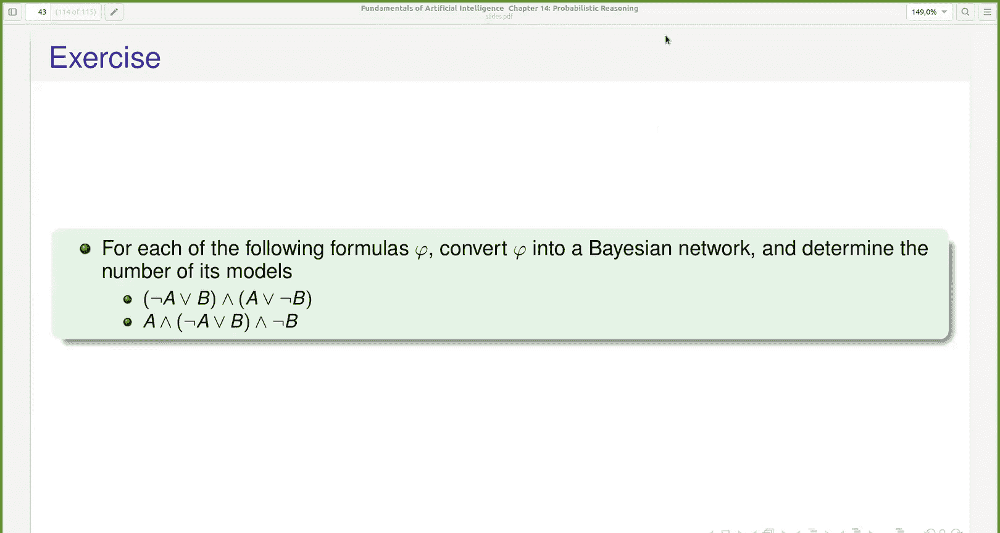

#  005：贝叶斯推断

在本节课中，我们将学习如何构建贝叶斯网络，并利用它进行概率推断。我们将从回顾网络构建的关键原则开始，然后深入探讨一种实用的参数估计方法——噪声或分布。最后，我们将学习如何执行基本的枚举推断，并了解其计算挑战和优化方法。

## 回顾：贝叶斯网络的构建原则

上一节我们讨论了如何构建贝叶斯网络。其核心要点是，构建网络时，应基于领域知识，并遵循一个**智能的顺序**。

贝叶斯网络本质上反映了**因果关系的流向**。它利用由因果关系诱导出的偏序关系，其中**原因总是出现在其直接结果之前**。这是你必须利用的基本原则。

因此，当你想用贝叶斯网络表示一个系统时，从图形角度看，你必须选择一个顺序，并且必须遵循因果关系。这意味着，原因必须出现在其直接结果之前。这是一条需要牢记的基本经验法则。

一旦确定了顺序，你逐步添加每个新节点，并选择其父节点——即该节点的直接原因。如果你能确保 `P(Xi | 所有前序节点) = P(Xi | 父节点)`，那么你就保证了全局语义的一致性。

贝叶斯网络类似于软件工程中的UML图，它是一种形式化、描述和建模领域知识的方法。如果你拥有领域知识，你应该了解变量间的依赖关系，并据此绘制图表。如果你没有领域知识，有时可以通过机器学习自动完成，即利用大量数据样本来学习依赖关系和概率。

关键在于选择正确的顺序。如果顺序选择不当，最终得到的网络会非常糟糕。经验法则是：始终将原因放在结果之前。注意，通常因果顺序是偏序，可能两个元素间没有因果依赖。如果是这样，你可以选择任意一个扩展了该偏序的全序。

## 参数估计：噪声或分布

接下来我们讨论概率参数。这些概率通常基于你的知识进行估计。如今，你可以通过机器学习，利用大量统计数据来推断概率。即使在机器学习普及之前，许多领域（如医学诊断）也积累了描述事件间相互关系的大量统计数据，并据此估计条件概率表。

有一种非常简单的方法来构建条件概率表，称为**噪声或分布**。它并不总是精确的，但在许多情况下是一个合理的近似，并且是进行初步尝试的好方法。

其核心思想是什么？对于每一个父子关系，你需要找出相关的概率。如果你有海量数据，那很好。但如果你没有这些工具，只想用较少的信息进行实际估算，一个很好的起点或常用技术就是噪声或分布。

你假设**原因在导致结果时彼此不交互**。你已经绘制好了图表，现在试图找出某个节点的条件概率表。你做出的一个常见（有时是近似）假设是：原因彼此独立地导致结果。

首先，你假设所有父节点是且仅是该节点的全部原因。这就带来了第一个问题：有时你并不知道导致某个结果的所有可能原因。例如，导致高烧的原因，你可能只知道一个常见原因列表，但并非全部。

解决这个问题的标准技巧是添加一个所谓的**泄露节点**，一个代表“其他所有原因”的父节点。这样，你就包含了该结果的所有可能原因。这意味着，当所有已知原因都为假时，结果发生的概率为0（即，不发生结果的概率为1）。换句话说，这些就是全部且仅有的可能原因。

然后，你假设**独立失效概率**。这意味着，在给定某些原因为真、其他为假的情况下，结果不发生的概率，是各个原因单独为真时结果不发生概率的乘积。

我们用 `qi` 表示第 `i` 个原因单独为真时结果不发生的概率。在噪声或分布中，我们倾向于将结果不发生的概率计算为独立的。因此，结果不发生的概率，在给定所有原因子集的情况下，等于各个相关原因对应的 `qi` 的乘积。

这是一个在许多场景下都相当可靠且广泛使用的模型。在这种假设下，你所需的数据量大大减少。对于一个有 `k` 个父节点（原因）的节点，你只需要 `k` 个 `qi` 值，而不是完整的 `2^k - 1` 个条件概率值。所有其他组合的概率都可以通过乘积和补运算自动计算出来。

## 贝叶斯推断：枚举法

现在，假设我们已经有了一个贝叶斯网络。网络是表示多变量联合分布的一种非常紧凑的方式，它利用了变量间的条件独立性。

那么，我们如何利用这一点进行推断？典型的查询形式是 `P(X | E = e)`。其中，`X` 是查询变量（可以是一个或多个），`E` 是证据变量（其取值 `e` 已知），`Y` 是其他未知变量（也称为隐藏变量）。

例如，我想计算盗贼入室 `B` 的概率，给定证据：约翰打电话 `J` 和玛丽打电话 `M`。我不知道是否发生了地震 `E`，也不知道警报是否响过 `A`。查询变量是 `Burglary`，证据变量是 `JohnCalls` 和 `MaryCalls`，隐藏变量是 `Earthquake` 和 `Alarm`。

典型的做法是使用**枚举法**进行推断。我们应用上一章学到的知识到贝叶斯网络定义的分布上。

关键点是，当我们有 `P(X | E)` 时，我们计算一个非归一化的分布 `P(X, E)`，然后通过归一化常数 `α` 进行归一化。`α` 是 `P(E)`，在所有 `X` 的取值上对 `P(X, E)` 求和即可得到。

为了计算 `P(X, E)`，我们需要对隐藏变量 `Y` 求和：`P(X, E) = Σ_y P(X, E, Y)`。这时，使用贝叶斯网络的优势就体现出来了。因为 `P(X, E, Y)` 可以利用全局语义，写成先验概率和条件概率的乘积形式，这大大减少了计算量。

以盗贼网络为例，我们想计算 `P(B | j, m)`。我们需要对隐藏变量 `E` 和 `A` 求和：`P(B, j, m) = Σ_e Σ_a P(B, e, a, j, m)`。应用全局语义，将其分解为 `P(B) * P(e) * P(a | B, e) * P(j | a) * P(m | a)` 的乘积。

然后，我们可以进行代数简化。例如，`P(B)` 不依赖于 `e` 和 `a`，可以提到求和符号外面。`P(e)` 不依赖于 `a`，可以提到对 `a` 的求和外面。这样，计算就变成了 `P(B) * Σ_e P(e) * Σ_a P(a | B, e) * P(j | a) * P(m | a)`。

我们需要为 `B` 的每个取值（真/假）分别计算这个表达式。计算过程涉及嵌套求和，每次遇到对变量求和时，我们都需要分支计算其每个取值。这本质上是一种递归搜索。

这种计算的一个后果是，其复杂度会随着隐藏变量数量呈指数级增长。因为对 `Y` 求和意味着对 `Y` 中所有变量取值的所有组合进行求和。如果 `Y` 包含 `k` 个布尔变量，就有 `2^k` 个求和项。我们的目标是尽可能地进行因子分解，以避免这种完全的枚举。

## 优化推断：避免重复计算

然而，不出所料，最坏情况下的计算步骤仍然是指数级的。这是因为贝叶斯网络中的概率推断是 NP 难问题。我们需要使用许多技巧来优化。

这种计算效率低下的一个来源是，有时我们会重复相同的计算多次。为什么会这样？这是利用条件独立性所带来的一个副作用。

在我们之前的计算示例中，我们注意到乘积项 `P(j | a) * P(m | a)` 被计算了两次：一次在 `E = true` 的分支，一次在 `E = false` 的分支。同样，`P(j | ¬a) * P(m | ¬a)` 也被计算了两次。这是因为 `JohnCalls` 和 `MaryCalls` 的概率只依赖于 `Alarm`，而不依赖于 `Earthquake`。这是贝叶斯网络条件独立性的好处，但在朴素枚举中导致了重复计算。

如何解决这个问题？本质上，我们需要将计算从树形结构转换为有向无环图结构，以便共享子计算。这类似于在搜索中，用**图搜索**（带缓存）代替**树搜索**。

具体方法是：在计算子表达式时，不仅计算结果，还在返回结果前将其缓存到一个哈希表中。之后，每当需要计算某个表达式时，先检查哈希表中是否已有缓存结果。如果有，直接使用缓存值，避免重复计算。这就是所谓的**记忆化**。

你的教材用另一种方式解释了这一点，称为**变量消元法**。其思想是，通过改变求和顺序和利用因子分解，尽可能地将求和操作向内推，并合并公共因子。

另一种优化是**消除不相关变量**。有些变量可能与特定查询完全无关，可以提前从求和式中移除。例如，如果某个概率项对某个变量所有取值的求和等于1，那么这项就可以被消去。

## 总结

本节课中，我们一起学习了贝叶斯推断的核心内容。

我们首先回顾了构建贝叶斯网络的基本原则，即遵循因果顺序。接着，我们学习了一种实用的参数估计方法——噪声或分布，它通过假设原因独立作用来简化条件概率表的构建。

然后，我们深入探讨了如何使用枚举法在贝叶斯网络中进行概率推断，计算诸如 `P(查询变量 | 证据)` 这样的条件概率。我们看到了计算过程如何利用网络的因子化表示进行简化，但也认识到最坏情况下的指数复杂度挑战。

最后，我们探讨了优化推断的方法，特别是通过缓存中间结果（记忆化/图搜索）来避免重复计算，以及通过识别和消除不相关变量来简化计算过程。这些技术对于在实际中处理复杂的贝叶斯网络至关重要。